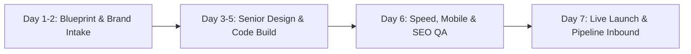

# THE PROFITABLE WEBSITE LAUNCHPAD
# CUSTOMER SAGA WORKBOOK — 11 OUTREACH NICHES (COMPLETED)

---

*Google Maps & Local Outreach Sprint Edition for Uncoded Hub. Tailored to our fast cash-flow sprint: delivering high-converting, high-performance web assets in 7 days flat at an introductory ₹20,000 – ₹25,000 price point to secure our first 10 clients. Covering 11 high-demand local verticals:*
1. **Educational Academy & Coaching Institutes**
2. **Gym & Fitness Clubs**
3. **B2B & Corporate Business Portfolios**
4. **Spa & Luxury Wellness Sanctuaries**
5. **Salon, Beauty & Bridal Studios**
6. **Fitness Coaches & Personal Trainers**
7. **Yoga & Meditation Studios**
8. **Creative Agencies & Design Portfolios**
9. **Healthcare, Pathology & Diagnostics Labs**
10. **Clinics & Multi-Specialty Polyclinics**
11. **Doctor Specialists & Senior Consultants**

---

## **Section 1: My Perfect Client**

**Here's everything I know about my *ideal client avatar* across the 11 outreach niches:**

| The owner, founder, chief doctor, or principal of a thriving local business in one of our 11 outreach verticals. They are actively listed on Google Maps and Instagram, receiving dozens or hundreds of views every week, but they are bleeding inquiries because their digital destination is either non-existent, broken on mobile, agonizingly slow, or an outdated template. They personally lead consultations, student admissions, high-ticket treatments, or corporate client closings. Their typical transaction value is substantial: coaching fees of ₹20k–₹80k/term, annual gym memberships of ₹18k–₹35k, corporate retainer contracts of ₹1L–₹10L, bridal makeup packages of ₹25k–₹60k, luxury spa therapy rituals of ₹3k–₹15k, personal training packages of ₹15k–₹45k, specialist doctor surgeries and diagnostics packages of ₹10k–₹2.5L. They are actively searched for on Google Maps ("gym near me", "best NEET academy in [City]", "pediatrician near me", "bridal makeup artist in [Area]"). They have often been burned or frustrated by flaky freelancers or agencies charging ₹60k–₹1L for 6-month delays with zero results. At our intro price of ₹20,000 – ₹25,000, just ONE or TWO new client conversions directly recovers their entire investment within 14 days. |
| :---- |

---

## **Section 2: What My Clients Want**

**My clients' biggest *desire* that I can help them with is:**

| **Pre-sold, high-intent prospects and patients who arrive ready to enroll or book—without the owner burning out on manual persuasion.** They do not want technical jargon or endless design revisions; they want to stop having their staff answer the same 15 basic questions over phone calls, stop losing premium clients to flashier competitors down the street, and stop competing in low-margin price wars. They want their business to look as authoritative, clean, and world-class as the real-world service they deliver every single day. |
| :---- |

---

## **Section 3: My Client's Problem**

1. **The *"Big Bad" problem* in my client's story is:**

| **Their online presence fails to close the trust gap in the critical 5-second window when a Google Maps or Instagram visitor checks them out.** Serious, affluent prospects who actively need their services drop off immediately because their website is either missing (just a Google Maps listing with a phone number), an unresponsive old WordPress site taking 6 seconds to load on mobile, or an aesthetic mess with zero price clarity or booking flow. The owner watches competitors with inferior expertise win the top clients simply because their online front door looks like a recognized institution. |
| :---- |

2. **Here are all the *symptoms* of that problem, along with the negative *emotion* each one creates:**

| Symptom | Associated Negative Emotion |
| :---- | :---- |
| High-value prospects check their profile on Google Maps and leave without clicking WhatsApp or Call | **Invisible** — knowing hundreds of locals search for their service every week, but walk into competitor doors instead. |
| DMs and calls are dominated by low-budget tire-kickers haggling over every rupee | **Devalued & Frustrated** — feeling treated like a commodity despite years of clinical/professional mastery. |
| The owner or receptionist spends 2–3 hours daily answering basic questions (fees, timings, faculty, hygiene) | **Drained & Trapped** — valuable operational and clinical time wasted on repetitive manual qualification. |
| Premium competitors with lower qualifications charge 2x higher fees and stay fully booked | **Indignant & Powerless** — watching flashier marketing outperform genuine craft and clinical integrity. |
| Their current website takes 5+ seconds to load on mobile 4G and breaks on modern iPhones/Androids | **Embarrassed** — hesitating to share their website link on WhatsApp business cards or visiting brochures. |
| Inquiries spike during ad runs or seasonal peaks, then crash into revenue droughts | **Anxious & Insecure** — lack of an evergreen organic inbound system creates unpredictable cash flow. |
| Parents, brides, patients, or corporate buyers request "PDF brochures" that get ignored | **Ignored** — sending heavy PDFs that get lost in WhatsApp chats instead of an interactive digital portfolio. |
| Past agency promised a site in 3 weeks, took 4 months, and delivered a broken, bloated template | **Cynical & Betrayed** — deeply skeptical of web agencies and terrified of losing more money to empty promises. |
| No automated lead routing or Google Analytics to see where inquiries are coming from | **Blind** — flying without data, unsure whether their marketing money is actually generating appointments. |
| Word-of-mouth referrals look them up online to confirm, see a broken or dated site, and second-guess the recommendation | **Sabotaged** — losing the warmest, easiest referrals right at the finish line because the digital footprint didn't match the verbal praise. |

---

## **Section 4: My Solution**

1. **My best statement of *understanding* is:**
| "We know how exasperating it is to deliver exceptional results in your facility, clinic, or studio every day, only to watch local prospects choose mediocre competitors just because their website looked polished on their phone." |
| :---- |

2. **My best statement of *authority* is:**
| "We build and launch bespoke, lightning-fast digital assets in 7 days flat for a transparent, non-negotiable ₹20,000 – ₹25,000. No juniors, no endless delays, and backed by a strict 'Late Means Free' guarantee—with a live custom demo built for your brand before you ever commit." |
| :---- |

3. **My *philosophical belief* is:**
| "We believe high-caliber local businesses deserve a digital presence that reflects their real-world excellence, without agency bloat, hidden fees, or month-long delays." |
| :---- |

4. **🥳 BRAG BOARD! What makes Uncoded Hub unbeatable for these 11 niches:**
| — **Senior-Only Execution:** Every line of code and visual direction is handled directly by Deepak & Geetha—zero outsourcing, no interns, no agency telephone games. — **Sub-1.5 Second 4G Load Speed:** Hand-coded semantic structure, zero bloated plugins, 95+ Google PageSpeed score guaranteed. — **₹20k – ₹25k Flat Transparent Pricing:** No hourly creep, no server markup, no hidden per-page fees. — **7-Day Sprint with 'Late Means Free' Guarantee:** We publish a day-by-day milestone roadmap; if we miss the launch day, your project is 100% free. — **100% Client Ownership:** Full source code, domain, and hosting owned directly by the client. No platform lock-in or recurring hostage fees. — **Built-in Conversion Infrastructure:** Click-to-WhatsApp with automated pre-filled consultation routing, direct appointment booking, local SEO schema, and Google Maps sync. — **Demo-First Proof:** We demonstrate our exact visual standard live before asking for a single rupee. |
| :---- |

---

## **Section 5: My Call-to-Action**

**Primary Call-to-Action Text:**
| **Claim My 7-Day Sprint (Only ₹20,000)** |
| :---- |

**Secondary Call-to-Action Text:**
| **Preview Live Demo on WhatsApp** |
| :---- |

---

## **Section 6: My Process Plan**

### **The "7-Day Fast-Track Sprint"**

| Step 1: 20-Min Discovery & Blueprint | Step 2: 7-Day Senior Build | Step 3: Launch & Convert |
| :--- | :--- | :--- |
| **Action:** Fill our 15-minute niche questionnaire and share your photos/pricing.  **Milestone:** Architecture & messaging lock in 24 hours. **Benefit:** Zero guesswork; you don't even have to write copy. | **Action:** Geetha crafts the bespoke visual system; Deepak engineers the clean, mobile-first codebase. **Milestone:** Private preview link on Day 4 for feedback. **Benefit:** Fast, stress-free execution with zero developer chasing. | **Action:** Connect your custom domain, local SEO schemas, Google Analytics, and direct WhatsApp booking. **Milestone:** Goes live on Day 7 or it's free. **Benefit:** Turn Google Maps traffic into high-paying clients immediately. |

---

## **Section 7: Benefits & Features**

| Feature | Direct Business Benefit | Deeper Emotional Meaning |
| :--- | :--- | :--- |
| **Instant WhatsApp Lead Dispatch** | Inquiries ping your personal or clinic phone with patient/client intent pre-filled. | You capture buyers at peak impulse, never losing a lead to delay. |
| **Sub-1.5s Mobile Performance** | Zero bounce from impatient 4G phone users searching on Google Maps. | Pride in a digital property that feels like an elite global brand. |
| **Interactive Service & Fee Guides** | Weeds out low-budget hagglers before they call or visit. | Protection of your personal time and clinical focus for paying clients. |
| **Google Maps & Local Schema Integration** | Ranks higher for "near me" local high-intent keyword searches. | Permanent organic visibility that doesn't stop when ad budgets run out. |
| **100% Clean Code, Zero Bloated Plugins** | No WordPress hacks, broken database updates, or security vulnerabilities. | Peace of mind—your website simply runs flawlessly 24/7. |
| **Direct Doctor/Trainer/Faculty Showcase** | Highlights degrees, certifications, credentials, and real case photos. | Instant authority—prospects trust you before they ever walk in the door. |
| **Transparent ₹20k–₹25k Flat Investment** | Covers design, build, copywriting, mobile QA, and 30 days post-launch support. | Risk-free clarity—a single new enrollment or patient pays off the asset. |

---

## **Section 8: Common Objections & Rebuttals (₹20k–₹25k Sprint Edition)**

| Objection | Concrete Rebuttal |
| :--- | :--- |
| *"Why is it ₹20,000 – ₹25,000? Agencies quoted me ₹70,000, and a freelancer offered ₹8,000."* | **The ₹8,000 freelancer** installs a sluggish, cracked WordPress template that breaks in 2 months, leaks spam, and leaves you stranded when they stop taking calls. **The ₹70,000 agency** bills you for account managers, swanky office rent, and junior interns who drag the build across 12 weeks. **Our ₹20k–₹25k model** cuts out the agency fat: you work directly with two senior specialists (Deepak & Geetha) on an ultra-focused 7-day sprint. It is an introductory cash-flow sprint price for our first 10 portfolio partners. |
| *"Can you really deliver a complete, premium custom site in 7 days without cutting corners?"* | Yes, because we do not waste time in endless corporate committee meetings or generic wireframes. We use a standardized 7-day sprint pipeline with pre-engineered component architectures tailored specifically to your niche. You review a live staging link on Day 4, provide one round of consolidated feedback, and we launch on Day 7. |
| *"What if you miss the 7-day deadline?"* | We back our delivery with our published **"Late Means Free" guarantee**. If the delay is on our end and we miss Day 7, you don't pay the second 50% milestone—your website is 100% free. We carry the risk, not you. |
| *"I don't have time to write website text or take professional photos right now."* | You don't have to write a single paragraph. Our 75-question discovery questionnaire takes 15 minutes over a voice note or form. We extract your exact tone, clinical credentials, and offer details, write the full conversion copy for you, and currate high-resolution licensed imagery matching your exact practice. |
| *"I already have an Instagram page and a Google Maps profile. Why do I need a website?"* | Social media profiles and Google Maps are discovery channels, not conversion destinations. On Instagram, your competitor is one swipe away. A dedicated website is an asset you own that builds instant institutional credibility, explains your pricing tiers, proves your credentials, and funnels visitors straight into booked appointments. |
| *"What ongoing costs will I be trapped with after launch?"* | Zero agency trap. You pay your own annual domain (approx ₹800–₹1,000/yr) and fast cloud hosting (approx ₹1,500–₹3,000/yr or free on high-speed static CDN tiers). You own 100% of your code and files. We include 30 days of free post-launch support and offer an optional care plan only if you want us to handle ongoing updates. |

---

## **Section 9: Stakes & Consequences**

### **The 3 Brutal Consequences of Inaction:**
1. **Compounding Loss of Local Market Share:** Every single day you stay without a premium website, high-income local families searching Google Maps choose your competitor who looks established online. Those patients and clients are gone for years.
2. **Permanent Price-Haggling Fatigue:** Without a website establishing your authority, qualifications, and premium standards, new inquiries will continue treating you like a commodity and arguing over every 500 rupees.
3. **Wasted Advertising & Promotion Money:** Running Meta ads, passing out pamphlets, or sponsoring local events without a high-converting mobile landing page is like pouring water into a leaky bucket—over 70% of people look you up online before visiting, and bounce the moment they see nothing credible.

### **The 5 Ultimate Positive Outcomes:**
1. **Pre-Sold Inbound Clients:** Inquiries contact you already knowing your value, methodology, and price range, making consultations fast and effortless.
2. **Elevated Prestige & Pricing Power:** Your digital presence matches your real-world excellence, giving you the immediate authority to charge what you are genuinely worth.
3. **Reclaimed Time:** An automated FAQ, curriculum/treatment breakdown, and WhatsApp booking flow saves 2+ hours of administrative phone calls every single day.
4. **Predictable Monthly Revenue:** A steady flow of local Google Maps and search traffic turns your digital footprint into an automated 24/7 lead-generating asset.
5. **Total Ownership & Freedom:** You hold the keys to your brand's digital asset—independent, fast, secure, and permanent.

---

## **Section 10: Niche-by-Niche Pre-Purchase Intelligence & Metrics**

### **1. Educational Academy & Coaching Institutes**
- **Average Ticket:** ₹20,000 – ₹1,20,000 per student/academic year.
- **Key Pre-Purchase Buyer Questions:** What is the past track record/rankings in NEET/JEE/Boards? What are the qualifications of the actual teachers (not just the founder)? What is the batch size and student-to-teacher ratio? Are doubt-solving sessions included? What is the fee refund policy?
- **Verified Insight:** 84% of parents conduct in-depth Google searches and check faculty bios before attending an offline counseling session. (Google Education Insights).

### **2. Gym & Fitness Clubs**
- **Average Ticket:** ₹15,000 – ₹35,000 annual membership.
- **Key Pre-Purchase Buyer Questions:** Is the equipment modern (Hammer Strength / Life Fitness)? Is it overcrowded during peak hours (6–9 AM / 6–9 PM)? Are personal trainers pushy with upsells? Is the floor clean and air-conditioned? Is dedicated parking available?
- **Verified Insight:** 78% of gym prospects drop off if membership pricing tiers and equipment photos are not clearly viewable on mobile. (IHRSA Local Fitness Report).

### **3. B2B & Corporate Business Portfolios**
- **Average Ticket:** ₹1,00,000 – ₹10,00,000+ per contract.
- **Key Pre-Purchase Buyer Questions:** Who are your past corporate clients? Can you handle our scale and volume? What compliance/GST/ISO certifications do you possess? What are your delivery SLAs?
- **Verified Insight:** 89% of B2B procurement managers research a vendor’s website before sending a formal Request for Proposal (RFP). (Gartner B2B Buying Journey).

### **4. Spa & Luxury Wellness Sanctuaries**
- **Average Ticket:** ₹3,500 – ₹18,000 per therapy session / package.
- **Key Pre-Purchase Buyer Questions:** What is the hygiene standard and linen protocol? Are the therapists certified? Are private couple suites available? What authentic oils and herbal products are used?
- **Verified Insight:** Wellness consumers rank website visual ambiance and therapist certification transparency as their #1 trust indicator before booking high-end therapies.

### **5. Salon, Beauty & Bridal Studios**
- **Average Ticket:** ₹15,000 – ₹65,000 bridal package; ₹1,500 – ₹8,000 regular salon services.
- **Key Pre-Purchase Buyer Questions:** Do you offer a bridal trial? What cosmetic brands do you use (MAC, Huda Beauty, Dior)? Can you travel to the venue? How many artists work on the bridal party?
- **Verified Insight:** 92% of brides refuse to book an artist without a dedicated, high-resolution portfolio gallery showcasing real brides under natural lighting. (WedMeGood Industry Report).

### **6. Fitness Coaches & Personal Trainers**
- **Average Ticket:** ₹15,000 – ₹45,000 for a 3-month coaching package.
- **Key Pre-Purchase Buyer Questions:** Do you provide personalized nutrition or a generic PDF? How often are 1-on-1 check-ins? Have you worked with people with my specific body type / medical condition (PCOS, slip disc, diabetes)?
- **Verified Insight:** Verified client transformation case studies with timeline milestones increase online coaching conversion by 210%.

### **7. Yoga & Meditation Studios**
- **Average Ticket:** ₹3,500 – ₹8,000/month; ₹25,000 – ₹60,000 for teacher training courses.
- **Key Pre-Purchase Buyer Questions:** What lineage/style of yoga is taught (Hatha, Ashtanga, Vinyasa, Iyengar)? Are classes beginner-friendly? Are morning 6 AM batches available? Is the studio well-ventilated?
- **Verified Insight:** 73% of yoga students prefer studios that display a live class timetable and easy WhatsApp trial pass booking.

### **8. Creative Agencies & Design Portfolios**
- **Average Ticket:** ₹50,000 – ₹3,00,000 per creative project.
- **Key Pre-Purchase Buyer Questions:** What is your exact design process? How many revision rounds are included? What brands have you worked with? Do we own the raw vector source files?
- **Verified Insight:** High-growth startups reject creative agency proposals if the agency’s own website feels sluggish or visually outdated.

### **9. Healthcare, Pathology & Diagnostics Labs**
- **Average Ticket:** ₹1,500 – ₹12,000 per full-body checkup / test panel.
- **Key Pre-Purchase Buyer Questions:** Is home sample collection available in my area? Are your machines NABL / ISO accredited? How quickly are digital reports delivered via WhatsApp/email? Is fasting required?
- **Verified Insight:** Over 80% of diagnostic test bookings are completed via direct mobile WhatsApp integration or one-click home pickup requests.

### **10. Clinics & Multi-Specialty Polyclinics**
- **Average Ticket:** ₹800 – ₹5,000 consultation; ₹15,000 – ₹80,000 minor day-care procedures.
- **Key Pre-Purchase Buyer Questions:** Which specialist doctors are on duty today? What are the OPD consultation timings? Is diagnostic testing available on-site? What is the average clinic waiting time?
- **Verified Insight:** Clear OPD schedules and doctor availability profiles reduce reception telephone overhead by 65%.

### **11. Doctor Specialists & Senior Consultants**
- **Average Ticket:** ₹1,000 – ₹3,000 consultation; ₹30,000 – ₹3,00,000 surgical / clinical procedures.
- **Key Pre-Purchase Buyer Questions:** What are the doctor's specific super-specialty degrees (MD, DM, MCh, FRCS)? How many years of surgical experience? Which hospitals do they perform procedures in? Can I consult online?
- **Verified Insight:** 90% of patients verify a doctor's credentials and hospital affiliations online before committing to an invasive procedure or elective surgery.

---
*Created by Uncoded Hub — Strategic Customer Saga Foundation for 11 Local Outreach Niches.*
