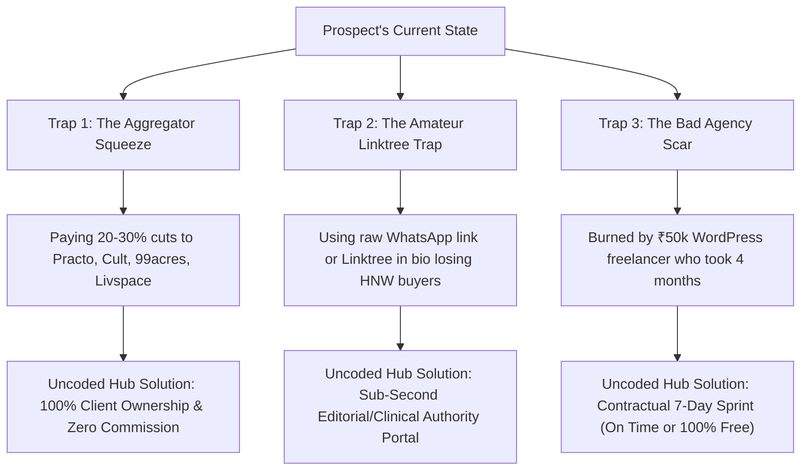

# 🎯 Uncoded Hub: Master Client Avatar Dossier (All 17 Niches)
### The Complete Psychological, Tactical & Commercial Field Manual for Deepak & Geetha
*Engineered to turn cold outreach into closed high-ticket clients across Bengaluru & Chennai.*

---

## 📑 Executive Quick-Reference Index

| # | Niche | Archetype | Target Ticket | Prime Pitch Angle | Dossier Link |
| :--- | :--- | :--- | :--- | :--- | :--- |
| **01** | **Educational Academies & Coaching Institutes** | The Devoted Academic Director / Institute Founder | ₹50,000 – ₹85,000 (Includes automated WhatsApp admission lead capture, topper showcase, and interactive syllabus portal). | Quick question regarding [Academy Name] admissions on mobile | [View Avatar](file:///c:/Users/LENOVO/Downloads/uncoded-hub/Outreach_System/Client_Avatars/01_Educational_Academies_Avatar.md) |
| **02** | **Commercial Gyms & Fitness Clubs** | The High-Energy Commercial Gym Owner / Fitness Director | ₹45,000 – ₹75,000 (Includes 1-tap trial day pass engine, interactive class schedule, and trainer showcase). | Stopping the 25% Cult cut at [Gym Name] — 1-tap direct day pass | [View Avatar](file:///c:/Users/LENOVO/Downloads/uncoded-hub/Outreach_System/Client_Avatars/02_Commercial_Gyms_Avatar.md) |
| **03** | **Interior Designers & Architects** | The Elite Principal Architect & Design Studio Founder | ₹50,000 – ₹85,000 (Includes high-res casework sliders, turnkey process blueprint, and budget qualification intake form). | Editorial digital portfolio for [Studio Name] (sub-second mobile casework) | [View Avatar](file:///c:/Users/LENOVO/Downloads/uncoded-hub/Outreach_System/Client_Avatars/03_Interior_Designers_Architects_Avatar.md) |
| **04** | **Real Estate & Property Consultants** | The Luxury Channel Partner & Commercial Property Advisor | ₹55,000 – ₹90,000 (Includes RERA-compliant property showcases, interactive rental yield calculators, and NRI lead capture). | Direct HNI & NRI buyer capture for [Company Name] (No portal leakage) | [View Avatar](file:///c:/Users/LENOVO/Downloads/uncoded-hub/Outreach_System/Client_Avatars/04_Real_Estate_Property_Consultants_Avatar.md) |
| **05** | **Dental & Aesthetic Clinics** | The Chief Dental Surgeon & Aesthetic Center Director | ₹45,000 – ₹75,000 (Includes smile makeover sliders, transparent procedure guides, and 1-tap WhatsApp OPD triage). | Eliminating Practo commission fees for [Clinic Name] (Direct 1-tap booking) | [View Avatar](file:///c:/Users/LENOVO/Downloads/uncoded-hub/Outreach_System/Client_Avatars/05_Dental_Aesthetic_Clinics_Avatar.md) |
| **06** | **Wedding Photographers & Event Planners** | The Acclaimed Creative Director & Wedding Cinematographer | ₹40,000 – ₹65,000 (Includes 4K full-bleed mobile video theater, interactive date availability checker, and package comparison matrix). | Eliminating 'Bro price please?' DMs for [Studio Name] (Instant Date Checker) | [View Avatar](file:///c:/Users/LENOVO/Downloads/uncoded-hub/Outreach_System/Client_Avatars/06_Wedding_Photographers_Event_Planners_Avatar.md) |
| **07** | **Home Renovation & Modular Kitchens** | The Turnkey Modular Contractor & Studio Managing Director | ₹45,000 – ₹75,000 (Includes interactive finish selector, material transparency matrix, and showroom visit booking). | Winning turnkey renovation leads over Livspace for [Studio Name] | [View Avatar](file:///c:/Users/LENOVO/Downloads/uncoded-hub/Outreach_System/Client_Avatars/07_Home_Renovation_Modular_Kitchens_Avatar.md) |
| **08** | **Coaches & Business Consultants** | The High-Ticket Executive Coach & Management Consultant | ₹35,000 – ₹60,000 (Includes structured methodology breakdown, client ROI case study showcase, and qualified application funnel). | Replacing Linktree with an enterprise authority portal for [Name] | [View Avatar](file:///c:/Users/LENOVO/Downloads/uncoded-hub/Outreach_System/Client_Avatars/08_Coaches_Business_Consultants_Avatar.md) |
| **09** | **Enterprise B2B & Corporate Advisory** | The Managing Partner & Corporate Governance Advisor | ₹65,000 – ₹1,20,000 (Includes institutional capability showcase, practice area whitepaper portal, and partner credential matrices). | Modernizing enterprise digital due-diligence for [Firm Name] | [View Avatar](file:///c:/Users/LENOVO/Downloads/uncoded-hub/Outreach_System/Client_Avatars/09_Enterprise_B2B_Corporate_Advisory_Avatar.md) |
| **10** | **Luxury Spas & Wellness Retreats** | The Holistic Wellness Director & Luxury Spa Founder | ₹45,000 – ₹75,000 (Includes sensory treatment menu visualizer, digital gift voucher checkout, and 1-tap WhatsApp booking). | Direct gift voucher & treatment booking for [Spa Name] | [View Avatar](file:///c:/Users/LENOVO/Downloads/uncoded-hub/Outreach_System/Client_Avatars/10_Luxury_Spas_Wellness_Retreats_Avatar.md) |
| **11** | **Salons & Bridal Beauty** | The Celebrity Makeup Artist & Bridal Beauty Atelier Owner | ₹40,000 – ₹65,000 (Includes unfiltered before/after skin sliders, interactive bridal date checker, and paid trial booking funnel). | Automating bridal date booking for [Studio Name] (Zero DM fatigue) | [View Avatar](file:///c:/Users/LENOVO/Downloads/uncoded-hub/Outreach_System/Client_Avatars/11_Salons_Bridal_Beauty_Avatar.md) |
| **12** | **Private Fitness Coaches & Personal Trainers** | The High-Ticket Transformation Coach & Executive Trainer | ₹35,000 – ₹55,000 (Includes interactive DEXA before/after slider, 12-week roadmap visualizer, and qualified application intake funnel). | Replacing Linktree with a high-ticket transformation portal for [Name] | [View Avatar](file:///c:/Users/LENOVO/Downloads/uncoded-hub/Outreach_System/Client_Avatars/12_Private_Fitness_Coaches_Personal_Trainers_Avatar.md) |
| **13** | **Traditional Yoga Shalas & Meditation Sanctuaries** | The Revered Yoga Acharya & Shala Founder | ₹40,000 – ₹65,000 (Includes serene lineage archive, mobile-responsive interactive timetable, and TTC admission portal). | Preserving lineage & automating TTC admissions for [Shala Name] | [View Avatar](file:///c:/Users/LENOVO/Downloads/uncoded-hub/Outreach_System/Client_Avatars/13_Traditional_Yoga_Shalas_Meditation_Sanctuaries_Avatar.md) |
| **14** | **Creative Studios & Design Agencies** | The Visionary Creative Director & Agency Founder | ₹50,000 – ₹85,000 (Includes locked 60fps interactive casework, enterprise ROI metrics breakdown, and brief intake UX). | Locked 60fps mobile speed for [Agency Name] portfolio (Sub-1s LCP) | [View Avatar](file:///c:/Users/LENOVO/Downloads/uncoded-hub/Outreach_System/Client_Avatars/14_Creative_Studios_Design_Agencies_Avatar.md) |
| **15** | **Pathology Labs & Diagnostic Centers** | The Chief Pathologist & Diagnostic Center Managing Director | ₹50,000 – ₹80,000 (Includes 1-click home phlebotomy booking, automated WhatsApp report retrieval, and preventive health package selector). | Stopping the 30% 1mg aggregator cut for [Lab Name] (Direct home collection) | [View Avatar](file:///c:/Users/LENOVO/Downloads/uncoded-hub/Outreach_System/Client_Avatars/15_Pathology_Labs_Diagnostic_Centers_Avatar.md) |
| **16** | **Multi-Specialty Polyclinics & Outpatient Centers** | The Polyclinic Medical Director & Managing Trustee | ₹55,000 – ₹85,000 (Includes live visiting consultant schedule matrix, pediatric vaccination tracker, and 1-tap WhatsApp OPD booking). | Eliminating front-desk phone congestion for [Polyclinic Name] (Live OPD Roster) | [View Avatar](file:///c:/Users/LENOVO/Downloads/uncoded-hub/Outreach_System/Client_Avatars/16_Multi_Specialty_Polyclinics_Outpatient_Centers_Avatar.md) |
| **17** | **Super-Specialist Doctors & Surgeons** | The Super-Specialist Surgeon & Clinical Authority | ₹60,000 – ₹95,000 (Includes surgical case volume logbook, secure second-opinion scan upload portal, and pre/post-op patient recovery handbooks). | Independent surgical authority portal for Dr. [Last Name] (Second-Opinion Funnel) | [View Avatar](file:///c:/Users/LENOVO/Downloads/uncoded-hub/Outreach_System/Client_Avatars/17_Super_Specialist_Doctors_Surgeons_Avatar.md) |

---

## 🧠 Master Psychology Framework: How to Read Any Client in 10 Seconds

Every business owner in these 17 niches falls into one of three core psychological traps:

---

# ═══════════════════════════════════════════════════════════════════════════════
# NICHE 01: EDUCATIONAL ACADEMIES & COACHING INSTITUTES
# ═══════════════════════════════════════════════════════════════════════════════

## 1. Persona Profile
- **Archetype:** The Devoted Academic Director / Institute Founder
- **Representative Profile:** Prof. S. Radhakrishnan / R.K. Verma (Age 42 – 55)
- **Prime Localities:** Bengaluru (Jayanagar, Malleswaram, HSR) & Chennai (Anna Nagar, T Nagar, Adyar)
- **Business Scale:** Competitive entrance coaching (NEET, JEE, CA, UPSC) & premier foundation batches. ₹30,000 – ₹85,000 annual fee per student; 150 – 500 enrolled students. Annual revenue ₹60 Lakhs – ₹3.5 Crores.
- **Team Size:** 4-8 Senior Subject Faculty, 2 Academic Counselors, 1 Front Desk Coordinator.
- **Deal Value Target:** **₹50,000 – ₹85,000 (Includes automated WhatsApp admission lead capture, topper showcase, and interactive syllabus portal).**

## 2. Daily Reality & Inner Frustrations
Arrives at 8:30 AM to supervise morning test batches. Teaches 3-4 hours of high-stakes syllabus. Spends afternoons dealing with anxious parents asking about cutoffs and comparing fees to cheap online edtech. Stressed by admission seasonality: if the April–June batch doesn't fill up, the institute operates at a loss for 10 months.

> **Core Pride:** *"Their genuine track record of producing top 100 ranks through rigorous classroom mentoring without corporate marketing gimmicks."*  
> **The 'Big Bad':** Corporate Coaching Factories (Allen, Aakash, FIITJEE) who outmuscle them on Google with massive ad budgets, and cheap edtech apps (PW, Unacademy) that commoditize quality faculty.  
> **Past Scars:** *"Paid ₹50,000 to an amateur agency for a WordPress site that crashed on NEET result day, has broken PDF brochure links, and requires calling the developer for minor timetable changes."*

## 3. Symptoms & Emotional States
- **Parents choose massive corporate brands despite worse personal attention** → *Emotion: Outmuscled & Frustrated*
- **Receptionist answers the same 20 questions about fees, timings, and syllabus on every call** → *Emotion: Drained & Inefficient*
- **Parents ask for heavy discounts, treating experienced faculty like neighborhood tutors** → *Emotion: Devalued & Insulted*
- **Recent top exam ranks and student selections are buried on paper noticeboards** → *Emotion: Invisible & Forgotten*
- **Website crashes during peak board/entrance result declaration season** → *Emotion: Embarrassed & Damaged*
- **Prospective students miss admission deadlines due to broken online registration** → *Emotion: Lost Revenue*

## 4. Trigger Vocabulary & Slang
- **MUST USE:** `Rankers gallery`, `AIR cutoff`, `foundation batch`, `mock test analysis`, `faculty pedigree`, `parent orientation`, `seat matrix`, `doubt-clearing ratio`
- **NEVER SAY:** ~~tuition class~~, ~~study package~~, ~~coaching shop~~, ~~discount fee~~, ~~mass batch~~

## 5. Why Their Current Setup Is Bleeding Money
Zero website or using an unorganized Linktree with 8 static PDF brochures. When anxious parents search on Google Maps from their smartphone, they find no faculty credentials, no verified topper marks, and no 1-tap WhatsApp trial class booking. 45% bounce straight to corporate competitors.

## 6. Outreach Battle Scripts
- **45s Phone Opener:** *"Hi Prof. [Last Name], this is Deepak from Uncoded Hub here in Bengaluru/Chennai. I saw your institute's 4.8-star reputation on Google Maps in [Locality], but noticed you don't have a mobile admission portal to showcase your recent rankers and allow parents to book trial sessions in 2 taps. Rather than pitching you, we built an interactive 7-day specimen for coaching academies with sub-second speed and a 7-day delivery guarantee: on time, or 100% free. Can I send the mobile link to your WhatsApp?"*
- **35s Voice Note:** *"Hello Prof. [Last Name], Deepak here from Uncoded Hub. I was just reviewing your academy on Google Maps. Your rankers and parent reviews are top tier, but parents researching on their phones can't view your faculty pedigree or download syllabus directly without calling the desk. We engineer custom 1-second admission platforms that double trial seat bookings in 7 days guaranteed. Sending a 30-second mobile specimen below—take a look when you're between batches!"*
- **Email Subject:** `Quick question regarding [Academy Name] admissions on mobile`

## 7. Objection Busting
### Q: *"We get all students by word of mouth"*
> **A:** *"Word of mouth gets parents to hear about you, but the very next thing they do is search you on Google. If they find no official website or a broken link, they assume you are a small-scale tutor rather than a premier academy, and you lose the highest-paying parents to corporate brands."*

### Q: *"We already have a Facebook/Instagram page"*
> **A:** *"Social media is great for posts, but serious parents making a ₹60,000 education decision will never enroll their child through an Instagram DM. They require an official institutional portal with verified scorecards, faculty degrees, and transparent batch schedules."*

### Q: *"Websites take months and cost too much"*
> **A:** *"Traditional agencies take 3 months of meetings. Uncoded Hub works on a contractual 7-Day Sprint. You give us your topper list and faculty details, and within 7 days your sub-second portal is live. If we are late by even one hour, the entire build is 100% free."*

---

# ═══════════════════════════════════════════════════════════════════════════════
# NICHE 02: COMMERCIAL GYMS & FITNESS CLUBS
# ═══════════════════════════════════════════════════════════════════════════════

## 1. Persona Profile
- **Archetype:** The High-Energy Commercial Gym Owner / Fitness Director
- **Representative Profile:** Vikramaditya Rao / Karthik Reddy (Age 32 – 46)
- **Prime Localities:** Bengaluru (Indiranagar, Koramangala, HSR) & Chennai (T Nagar, Anna Nagar, Velachery)
- **Business Scale:** Multi-floor strength and conditioning facility, premium cardio zone, and group class studio. Membership ₹2,500 – ₹6,000/month (₹22,000 – ₹45,000 annual). 300 – 1,200 active members. Annual turnover ₹75 Lakhs – ₹3 Crores.
- **Team Size:** 1 General Manager, 6-12 Floor Trainers, 2 Receptionists, 2 Housekeeping staff.
- **Deal Value Target:** **₹45,000 – ₹75,000 (Includes 1-tap trial day pass engine, interactive class schedule, and trainer showcase).**

## 2. Daily Reality & Inner Frustrations
Starts at 6:00 AM on the gym floor checking equipment maintenance and trainer punctuality. Spends afternoons stressed about member retention, managing Cult/ClassPass commission payouts (losing 25% on every booking), and dealing with front-desk staff who fail to follow up on walk-in trial leads.

> **Core Pride:** *"Their imported biomechanical equipment (Hammer Strength, Life Fitness), locker room hygiene, and genuine member body transformations."*  
> **The 'Big Bad':** Aggregator Platforms (Cult.fit, ClassPass) who commoditize their brand and take 20-30% cuts, plus budget 24/7 franchise gyms (Anytime Fitness) competing on low-ball pricing.  
> **Past Scars:** *"Spent ₹40,000 on a heavy WordPress site with an unoptimized video banner that takes 8 seconds to load on mobile 4G and crashes whenever prospects try to view the group timetable."*

## 3. Symptoms & Emotional States
- **Paying 25% commissions to aggregators because direct member signups are weak** → *Emotion: Exploited & Dependent*
- **Heavy video header taking 7 seconds to load on phone, causing 60% visitor bounce** → *Emotion: Embarrassed*
- **Walk-in leads don't sign up because there is no 1-tap day pass or trial booking engine** → *Emotion: Lost Revenue*
- **No locker room hygiene proof or equipment showcase, so prospects assume it's an ordinary iron gym** → *Emotion: Undervalued*
- **Front desk staff misses phone inquiries during peak evening rush (6 PM - 9 PM)** → *Emotion: Frustrated*
- **Losing high-paying personal training clients to freelance trainers working under the table** → *Emotion: Undermined*

## 4. Trigger Vocabulary & Slang
- **MUST USE:** `Biomechanical equipment`, `Hammer Strength`, `day pass engine`, `LCP speed`, `annual retention`, `group class timetable`, `DEXA scan`, `peak-hour floor capacity`
- **NEVER SAY:** ~~cheap gym~~, ~~exercise room~~, ~~fitness shop~~, ~~gym discount~~, ~~weight club~~

## 5. Why Their Current Setup Is Bleeding Money
Zero website or using an Instagram bio with a raw WhatsApp link. When working professionals search 'best gym near me' on Google Maps, they cannot see locker room photos, equipment brands, trainer credentials, or book a 1-day pass. They default to Cult.

## 6. Outreach Battle Scripts
- **45s Phone Opener:** *"Hi [Name], Deepak here from Uncoded Hub in Bengaluru/Chennai. I saw your gym's great reviews on Google Maps in [Locality], but noticed you don't have an independent mobile site with a 1-tap day pass engine, which means prospective members searching on their phones either call the busy front desk or go through Cult and cost you 25% commissions. We engineered an interactive mobile platform specifically for commercial gyms with sub-second speed and a 7-day guarantee: on time, or 100% free. Can I WhatsApp you the demo link?"*
- **35s Voice Note:** *"Hey [Name], Deepak from Uncoded Hub. Was just looking at your gym profile on Maps. Your equipment setup and member reviews are fantastic, but you're losing hundreds of direct memberships to Cult because there's no 1-tap trial pass booking on mobile. We build custom 1-second platforms that capture direct annual memberships without aggregator cuts. Sending a quick mobile demo below—check it out between sets!"*
- **Email Subject:** `Stopping the 25% Cult cut at [Gym Name] — 1-tap direct day pass`

## 7. Objection Busting
### Q: *"We get enough members through walk-ins and Instagram"*
> **A:** *"Walk-ins only capture people who literally walk past your street. The high-earning corporate crowd Googles 'gyms in [Locality]' at work. If you don't have a sub-second site with equipment specs and transparent day passes, they join Cult or an aggregator where you lose 25% of your margin."*

### Q: *"Cult/Fitternity gives us all our footfall"*
> **A:** *"Aggregators give you footfall today so they can control your client database tomorrow. The moment they change their payout algorithm or promote a competitor 200m away, your revenue drops. A direct high-speed website lets you own your members directly with 100% profit margin."*

### Q: *"Gym websites don't convert; people just want to see the gym"*
> **A:** *"People DO want to see the gym—and that's why an unoptimized site fails. Our 1-second specimen gives them a 4K visual walkthrough, locker room hygiene proof, and a 1-tap day pass directly into your WhatsApp in under 15 seconds."*

---

# ═══════════════════════════════════════════════════════════════════════════════
# NICHE 03: INTERIOR DESIGNERS & ARCHITECTS
# ═══════════════════════════════════════════════════════════════════════════════

## 1. Persona Profile
- **Archetype:** The Elite Principal Architect & Design Studio Founder
- **Representative Profile:** Ar. Varun Somani / Ar. Arvind Swaminathan (Age 34 – 52)
- **Prime Localities:** Bengaluru (Indiranagar, Koramangala, Lavelle Road) & Chennai (Adyar, Alwarpet, Anna Nagar)
- **Business Scale:** High-end residential villas, penthouses, bespoke apartments, and commercial boutique offices. Turnkey project ticket size: ₹25 Lakhs to ₹2 Crores+. Takes 4–12 projects annually. Studio turnover ₹1.5 Crores – ₹10 Crores.
- **Team Size:** 2-4 Junior Architects, 2 3D Visualizers, 3 Site Supervisors, trusted carpentry/vendor ecosystem.
- **Deal Value Target:** **₹50,000 – ₹85,000 (Includes high-res casework sliders, turnkey process blueprint, and budget qualification intake form).**

## 2. Daily Reality & Inner Frustrations
Splits day between drafting revisions on CAD/Revit, reviewing Italian marble selections at quarries, and supervising joinery on site. Deeply frustrated by homeowners who demand free 3D conceptual drawings before signing contracts, or who compare their bespoke architectural joinery to cheap factory modular quotes.

> **Core Pride:** *"Their spatial storytelling, attention to lighting temperatures, bespoke furniture joinery, and design awards."*  
> **The 'Big Bad':** VC-funded Modular Giants (Livspace, HomeLane) who lure clients with misleading '₹5 Lakh full-home interior' ads, and cheap local contractors claiming to be 'designers'.  
> **Past Scars:** *"Hired an agency that uploaded uncompressed 45MB 3D project photos onto a WordPress theme. The site takes 9 seconds to load on mobile and crashes iPhones, causing prospective luxury homeowners to bounce immediately."*

## 3. Symptoms & Emotional States
- **Homeowners demand free 3D concepts before committing to a consultation fee** → *Emotion: Exploited & Devalued*
- **Losing 50L villa interior contracts silently to studios with sleek websites** → *Emotion: Frustrated & Baffled*
- **Best completed penthouses only live on phone camera rolls, uncatalogued** → *Emotion: Stifled & Invisible*
- **High mobile bounce rate because heavy portfolio photos crash mobile browsers** → *Emotion: Embarrassed*
- **Referral clients check the website to validate a recommendation and get unimpressed** → *Emotion: Sabotaged*
- **Spending weekends answering DM questions about minor decor rather than closing turnkey villas** → *Emotion: Exhausted*

## 4. Trigger Vocabulary & Slang
- **MUST USE:** `Turnkey handover`, `millimeter joinery`, `spatial storytelling`, `LCP mobile speed`, `Italian marble casework`, `lighting temperature`, `concept-to-execution`, `per-sqft rate leakage`
- **NEVER SAY:** ~~cheap decor~~, ~~interior package~~, ~~room painting~~, ~~budget woodwork~~, ~~furnishing deal~~

## 5. Why Their Current Setup Is Bleeding Money
Zero standalone site or relying purely on an Instagram grid with a Linktree. High-net-worth homeowners ready to spend ₹40 Lakhs to ₹1.5 Crores will not sign a contract over an Instagram DM. They require an editorial-grade, lightning-fast digital portfolio that validates the architect's design fees.

## 6. Outreach Battle Scripts
- **45s Phone Opener:** *"Hi Ar. [Last Name], Deepak here, co-founder of Uncoded Hub in Bengaluru/Chennai. I was admiring your residential project portfolio on Maps in [Locality]. You have exceptional execution quality, but I noticed you don't have an independent high-speed mobile portfolio linked—which means homeowners investing 40 Lakhs in a luxury villa can't view your material casework or process breakdown. We engineered an editorial-grade 7-day specimen specifically for interior architects that loads in sub-1 second with a 100% on-time guarantee. May I share the mobile link on your WhatsApp?"*
- **35s Voice Note:** *"Good afternoon Ar. [Last Name], Deepak from Uncoded Hub. I was reviewing your firm's work on Google Maps. Your completed residential spaces are stunning, but when luxury villa clients search on mobile, heavy photos buffer and there's no transparent 'concept to handover' process guide. We build bespoke sub-second digital platforms for architects that position you above Livspace in 7 days flat. Sending a 30-second mobile link below—let me know what you think of the casework sliders!"*
- **Email Subject:** `Editorial digital portfolio for [Studio Name] (sub-second mobile casework)`

## 7. Objection Busting
### Q: *"We get all our projects via builder referrals and word-of-mouth"*
> **A:** *"Word-of-mouth is your greatest asset, but every single HNI referral immediately Googles your firm before calling. If they find an outdated site or an amateur Linktree, their excitement cools down and they start questioning your design fees. An editorial portfolio pre-sells them before you even pick up the phone."*

### Q: *"Instagram is enough for our portfolio"*
> **A:** *"Instagram is an ephemeral feed where your work is placed next to reels and discount furniture ads. High-ticket homeowners spending 50 Lakhs want to see project case studies: before/after photos, floorplans, material palettes, and your turnkey process."*

### Q: *"Architectural websites take 4-6 months to build properly"*
> **A:** *"Traditional web agencies don't understand architecture, so they drag the project for months asking you for content. We work with a dedicated 7-Day Sprint. You give us your project photography, and in 7 days your editorial platform is live, backed by our 100% on-time or free guarantee."*

---

# ═══════════════════════════════════════════════════════════════════════════════
# NICHE 04: REAL ESTATE & PROPERTY CONSULTANTS
# ═══════════════════════════════════════════════════════════════════════════════

## 1. Persona Profile
- **Archetype:** The Luxury Channel Partner & Commercial Property Advisor
- **Representative Profile:** Sameer Kochhar / Pranav Hegde (Age 36 – 54)
- **Prime Localities:** Bengaluru (Whitefield, Koramangala, Hebbal) & Chennai (OMR, ECR, Anna Nagar)
- **Business Scale:** Exclusive developer mandate marketing, luxury villa sales, and commercial leasing advisory. Transaction ticket sizes: ₹1.2 Crores to ₹15 Crores+. Commission: 1% – 3% per transaction (₹1.5 Lakhs – ₹15 Lakhs+ per deal). Annual turnover ₹1 Crore – ₹8 Crores.
- **Team Size:** 4-10 Investment Consultants, 2 Tele-sales Executives, 1 Digital Marketer, trusted legal advisor.
- **Deal Value Target:** **₹55,000 – ₹90,000 (Includes RERA-compliant property showcases, interactive rental yield calculators, and NRI lead capture).**

## 2. Daily Reality & Inner Frustrations
Constantly on calls coordinating site visits for HNIs, negotiating with tier-1 developers (Prestige, Sobha, Brigade, Casagrand), and sifting through dozens of junk portal leads. Frustrated by spending ₹1 Lakh/month on 99acres and MagicBricks only to receive shared, recycled leads that 10 other brokers are calling simultaneously.

> **Core Pride:** *"Their direct access to pre-launch allocations, legal due-diligence expertise, and personal trust with high-net-worth investors."*  
> **The 'Big Bad':** Real Estate Portals (99acres, MagicBricks, NoBroker) that sell the same buyer lead to 15 different agents and push brokers into price wars.  
> **Past Scars:** *"Spent money on a generic real estate WordPress template with broken IDX search iframes that took 6 seconds to load and captured zero investor inquiries."*

## 3. Symptoms & Emotional States
- **Paying ₹80k/month to property portals for recycled, low-quality leads** → *Emotion: Exploited & Dependent*
- **HNIs view them as an ordinary broker rather than an exclusive asset advisor** → *Emotion: Devalued*
- **Competitors close luxury NRI villa deals because their digital property showcase looks institutional** → *Emotion: Outclassed*
- **Unverified buyers waste weekend site visit slots without budget qualification** → *Emotion: Exhausted*
- **No digital property landing page for ₹5 Cr+ exclusive mandates** → *Emotion: Unprofessional*
- **Slow mobile layout causes impatient NRI buyers to abandon property walkthroughs** → *Emotion: Lost Revenue*

## 4. Trigger Vocabulary & Slang
- **MUST USE:** `Channel partner allocation`, `rental yield`, `pre-launch mandate`, `capital appreciation`, `SPV lease`, `RERA compliance`, `NRI concierge`, `HNW investor deck`
- **NEVER SAY:** ~~brokerage fee~~, ~~cheap flats~~, ~~broker commission~~, ~~budget plot~~, ~~small house~~

## 5. Why Their Current Setup Is Bleeding Money
Zero website or using an unbranded WhatsApp catalog with compressed JPEG floorplans. HNI and NRI investors looking to park ₹3–10 Crores in Bengaluru/Chennai real estate require an institutional property advisory portal that proves legal due diligence, rental yields, and high-res masterplans.

## 6. Outreach Battle Scripts
- **45s Phone Opener:** *"Hi Mr. [Last Name], Deepak here from Uncoded Hub in Bengaluru/Chennai. I saw your luxury property mandates in [Locality] on Google Maps. You have fantastic client reviews, but I noticed you don't have an exclusive mobile property portal to showcase your high-ticket villa and commercial assets directly to NRI and HNI investors without losing them to 99acres. We build sub-second investment platforms with an on-time 7-day sprint guarantee: on time, or 100% free. Can I share our interactive specimen on your WhatsApp?"*
- **35s Voice Note:** *"Hello Mr. [Last Name], Deepak from Uncoded Hub. Was reviewing your consultancy's presence on Maps. With the massive NRI buyer interest in [City], relying on portal leads costs thousands in shared broker fees. We engineer custom 1-second luxury real estate platforms that capture direct, exclusive buyer leads with rental yield calculators and RERA verification. Sending a 30-second mobile specimen below—take a look when you're between site visits!"*
- **Email Subject:** `Direct HNI & NRI buyer capture for [Company Name] (No portal leakage)`

## 7. Objection Busting
### Q: *"All our leads come from 99acres and developer tie-ups"*
> **A:** *"Portal leads are shared with 10 other agents the minute they register, turning your business into a race to the bottom. A dedicated luxury portal lets you run targeted ads to NRI investors who contact only you, preserving your full brokerage margin."*

### Q: *"Real estate is closed in person, not on a website"*
> **A:** *"The contract is signed in person, but the site visit is decided online. An HNI investing ₹4 Crores inspects your digital presence first to see if you are a credible advisor or just another middleman. Our platform pre-qualifies their budget before you spend 2 hours driving to the site."*

### Q: *"Building a property portal is too complex and requires MLS feeds"*
> **A:** *"You don't need a bloated MLS database with 10,000 irrelevant listings. You need a razor-sharp curated showcase of your top 8 exclusive luxury mandates with masterplans, walkthrough videos, and 1-tap WhatsApp consultation scheduling. We launch it in 7 days flat."*

---

# ═══════════════════════════════════════════════════════════════════════════════
# NICHE 05: DENTAL & AESTHETIC CLINICS
# ═══════════════════════════════════════════════════════════════════════════════

## 1. Persona Profile
- **Archetype:** The Chief Dental Surgeon & Aesthetic Center Director
- **Representative Profile:** Dr. Rohan Merchant, MDS / Dr. Priya Ranganathan (Age 35 – 52)
- **Prime Localities:** Bengaluru (Indiranagar, Koramangala, Jayanagar) & Chennai (T Nagar, Anna Nagar, Adyar)
- **Business Scale:** Multispecialty dental, dental implantology, clear aligners (Invisalign), and facial aesthetics. High-ticket procedures: Implants (₹35,000 – ₹60,000/tooth), Full mouth rehabilitation (₹2 Lakhs – ₹6 Lakhs), Aligners (₹80,000 – ₹2.5 Lakhs). Practice turnover ₹80 Lakhs – ₹4 Crores.
- **Team Size:** 2 Associate Dentists, 1 Visiting Implantologist, 3 Dental Assistants, 2 Front Desk Coordinators.
- **Deal Value Target:** **₹45,000 – ₹75,000 (Includes smile makeover sliders, transparent procedure guides, and 1-tap WhatsApp OPD triage).**

## 2. Daily Reality & Inner Frustrations
Spends 8 hours chairside performing root canals, surgical crown placements, and smile makeovers. Constantly frustrated by patients who cancel consultations at the last minute or who demand discounts comparing hospital-grade sterile implants to neighborhood budget clinics. Annoyed by paying Practo high commissions only to see competitor ads on their profile.

> **Core Pride:** *"Their international fellowship credentials, sterile operating protocols, digital intraoral scanners, and life-changing smile makeover transformations."*  
> **The 'Big Bad':** Healthcare Aggregators (Practo, Lybrate) that run competitor ads on their profile, and budget dental chains (Clove Dental) marketing cheap tooth cleanings to pull walk-ins.  
> **Past Scars:** *"Paid an agency that set up a generic WordPress clinic theme filled with stock photos of Caucasian models that looked completely fake and had no transparent procedure pricing or WhatsApp triage."*

## 3. Symptoms & Emotional States
- **Anxious patients cancel appointments or avoid booking due to opaque procedure pricing** → *Emotion: Lost Revenue*
- **Patients compare hospital-grade implantology to cheap single-chair clinics** → *Emotion: Insulted & Devalued*
- **Practo plasters competing clinics right next to their doctor profile** → *Emotion: Exploited*
- **Front desk phone is constantly engaged during peak hours, missing high-ticket calls** → *Emotion: Chaotic & Drained*
- **Smile makeover before/after proof is buried in clinic photo albums** → *Emotion: Invisible*
- **Patients from overseas (dental tourism) cannot verify clinic sterilization standards** → *Emotion: Skeptical*

## 4. Trigger Vocabulary & Slang
- **MUST USE:** `CBCT 3D imaging`, `intraoral scanner`, `clear aligner triage`, `immediate load implants`, `smile makeover`, `autoclave sterilization`, `chairside triage`, `painless laser dentistry`
- **NEVER SAY:** ~~cheap dental~~, ~~tooth pulling~~, ~~discount braces~~, ~~dental deal~~, ~~teeth shop~~

## 5. Why Their Current Setup Is Bleeding Money
Zero website or using an unverified Google Maps listing with a mobile number. Patients needing ₹1.5 Lakh dental implants or Invisalign will not book blindly through a Justdial listing. They demand doctor credentials, clinical case proof, sterilization badges, and 1-tap WhatsApp triage.

## 6. Outreach Battle Scripts
- **45s Phone Opener:** *"Good morning Dr. [Last Name], Deepak here, co-founder of Uncoded Hub in Bengaluru/Chennai. I was looking at your clinic's fantastic patient reviews on Google Maps in [Locality]. You have exceptional clinical credibility, but I noticed you don't have an independent mobile platform with 1-tap WhatsApp triage and smile makeover galleries—which means high-ticket implant and aligner patients are booking elsewhere. We build custom sub-second clinical platforms delivered in 7 days guaranteed: on time, or 100% free. May I send you the mobile specimen?"*
- **35s Voice Note:** *"Hello Dr. [Last Name], Deepak from Uncoded Hub. I was just reviewing your clinic on Google Maps. Your patient reviews are stellar, but patients searching on mobile can't see your sterilization protocols, doctor degrees, or transparent implant pricing. We build bespoke 1-second dental portals that eliminate Practo commissions and book high-ticket procedures in 7 days flat. Sending a 30-second mobile link below—take a look between patients!"*
- **Email Subject:** `Eliminating Practo commission fees for [Clinic Name] (Direct 1-tap booking)`

## 7. Objection Busting
### Q: *"We get enough patients from Practo and local footfall"*
> **A:** *"Practo charges you recurring listing fees and places competitor ads directly below your doctor bio. Every patient who books via Practo is Practo's customer, not yours. A custom platform gives you 100% patient ownership with direct WhatsApp booking."*

### Q: *"Patients don't like booking dental treatments online"*
> **A:** *"They don't book the surgery online—they book the consultation. Anxious patients search at 10:30 PM when your front desk is closed. If your site lets them ask a confidential WhatsApp question or view before/after aligner results in 2 taps, you win the patient before morning."*

### Q: *"Medical websites have too many compliance issues"*
> **A:** *"We specifically engineer our healthcare platforms to comply with Indian Medical Council guidelines: zero misleading claims, verified doctor registration numbers, and transparent clinical disclaimers. We deliver the entire compliant platform in 7 days."*

---

# ═══════════════════════════════════════════════════════════════════════════════
# NICHE 06: WEDDING PHOTOGRAPHERS & EVENT PLANNERS
# ═══════════════════════════════════════════════════════════════════════════════

## 1. Persona Profile
- **Archetype:** The Acclaimed Creative Director & Wedding Cinematographer
- **Representative Profile:** Karan Malhotra / Rahul Menon (Age 28 – 44)
- **Prime Localities:** Bengaluru (Indiranagar, Koramangala) & Chennai (ECR, Besant Nagar, T Nagar)
- **Business Scale:** Luxury destination and multi-day traditional wedding coverage (Mehendi, Sangeet, Muhurtham, Reception). Ticket size: ₹2.5 Lakhs to ₹15 Lakhs+ per wedding. Covers 15–35 weddings per season. Studio turnover ₹50 Lakhs – ₹3 Crores.
- **Team Size:** 2 Lead Cinematographers, 2 Candid Photographers, 2 Traditional Shooters, 2 Drone Pilots, 3 In-house Editors.
- **Deal Value Target:** **₹40,000 – ₹65,000 (Includes 4K full-bleed mobile video theater, interactive date availability checker, and package comparison matrix).**

## 2. Daily Reality & Inner Frustrations
Shoots 14-hour marathon wedding days on weekends. Spends weekdays in the edit bay color-grading 4K LOG footage, syncing audio, and managing 20TB NAS storage. Deeply exhausted by endless Instagram DM inquiries asking 'Bro price please?' only to ghost when quoted ₹4 Lakhs.

> **Core Pride:** *"Their visual color grading, emotional storytelling, cinematic drone captures, and publication in WeddingSutra/WedMeGood."*  
> **The 'Big Bad':** Aggregator Directories (WedMeGood, ShaadiSaga) taking listing fees, and Instagram algorithm changes that hide their posts unless they post daily reels.  
> **Past Scars:** *"Hired a developer who created a website with heavy unoptimized 4K Vimeo/YouTube embeds that take 8 seconds to load on mobile 4G and stutter, ruining the cinematic luxury feel."*

## 3. Symptoms & Emotional States
- **Over-reliance on Instagram algorithm changes causes sudden drops in booking inquiries** → *Emotion: Anxious & Vulnerable*
- **High-budget couples ghost after asking for prices in Instagram DMs** → *Emotion: Exhausted & Frustrated*
- **Unoptimized 4K wedding films buffer and stutter on prospective clients' mobile screens** → *Emotion: Embarrassed*
- **WedMeGood takes hefty commissions while promoting discount competitors** → *Emotion: Exploited*
- **No automated wedding date availability checker, causing endless repetitive messaging** → *Emotion: Inefficient*
- **Function-wise portfolio (Muhurtham vs Sangeet) is unorganized on cloud drives** → *Emotion: Unprofessional*

## 4. Trigger Vocabulary & Slang
- **MUST USE:** `Color grading (LOG/LUTs)`, `Sangeet teaser`, `Muhurtham traditional`, `cinematic drone reel`, `package tiering`, `date availability checker`, `wedding film stream speed`, `deliverables timeline`
- **NEVER SAY:** ~~cheap photo~~, ~~candid package deal~~, ~~camera guy~~, ~~discount video~~, ~~photo booth~~

## 5. Why Their Current Setup Is Bleeding Money
Relying 100% on Instagram or using a Linktree with broken Google Drive links. High-budget wedding couples and parents spending ₹5 Lakhs on wedding media will not hire a studio that shares raw Drive folders. They expect a full-bleed, cinematic mobile cinema that streams instant 4K reels.

## 6. Outreach Battle Scripts
- **45s Phone Opener:** *"Hi [Name], Deepak here from Uncoded Hub in Bengaluru/Chennai. I was watching your incredible wedding films on Instagram. Your cinematic grading is top tier, but I noticed you don't have an independent mobile theater with an instant wedding date checker—which means couples looking for ₹4L+ luxury coverage are dropping off in your DMs. We build sub-second full-bleed mobile video portals delivered in 7 days guaranteed: on time, or 100% free. Can I share the mobile link on your WhatsApp?"*
- **35s Voice Note:** *"Hey [Name], Deepak from Uncoded Hub. Love your wedding cinematography work. When couples search for luxury wedding studios in [City], sending them to an Instagram bio or Google Drive link causes 40% drop-off. We engineer custom 1-second video platforms that stream full-bleed 4K wedding films without buffering and qualify dates instantly. Sending a quick mobile demo below—check it out between edits!"*
- **Email Subject:** `Eliminating 'Bro price please?' DMs for [Studio Name] (Instant Date Checker)`

## 7. Objection Busting
### Q: *"Instagram is our entire portfolio; that's where brides hang out"*
> **A:** *"Brides discover you on Instagram, but when it's time to justify a ₹4 Lakh budget to their fiancé or parents, an Instagram DM link looks unprofessional. They need an official portfolio portal to showcase the full wedding film, gear list, and package inclusions."*

### Q: *"Video websites are too slow and expensive to host"*
> **A:** *"That's because amateur developers dump uncompressed 4K files on basic shared servers. We use global edge CDN video streaming that starts playing in under 400 milliseconds on 4G mobile without buffering."*

### Q: *"Wedding season is too busy; we don't have time to create a website"*
> **A:** *"That is exactly why our 7-Day Sprint exists. You send us links to your top 4 wedding reels and deliverables sheet. We handle all design, compression, and deployment in 7 days flat."*

---

# ═══════════════════════════════════════════════════════════════════════════════
# NICHE 07: HOME RENOVATION & MODULAR KITCHENS
# ═══════════════════════════════════════════════════════════════════════════════

## 1. Persona Profile
- **Archetype:** The Turnkey Modular Contractor & Studio Managing Director
- **Representative Profile:** Sandeep Nair / Nilesh Patil (Age 36 – 52)
- **Prime Localities:** Bengaluru (HSR Layout, Whitefield, Koramangala) & Chennai (T Nagar, Velachery, Anna Nagar)
- **Business Scale:** Turnkey modular kitchens, custom wardrobes, and full apartment renovation. Ticket sizes: Kitchens (₹2.5 Lakhs – ₹8 Lakhs), Full Flat Renovation (₹12 Lakhs – ₹45 Lakhs). Turnover ₹1.2 Crores – ₹6 Crores.
- **Team Size:** 1 Studio Manager, 2 CAD Draftsmen, 4 Site Supervisors, dedicated carpentry & factory assembly team.
- **Deal Value Target:** **₹45,000 – ₹75,000 (Includes interactive finish selector, material transparency matrix, and showroom visit booking).**

## 2. Daily Reality & Inner Frustrations
Spends mornings coordinating factory board-cutting and edge-banding, afternoons inspecting site plumbing and electrical conduits, and evenings meeting flat owners. Stressed by homeowners who are terrified of contractor delays and fraud, or who compare genuine marine-ply Hafele kitchens to particle-board discount brands.

> **Core Pride:** *"Their factory finish quality, 10-year warranty compliance, branded hardware (Hafele, Blum, Hettich), and on-time handover record."*  
> **The 'Big Bad':** Venture-funded Modular Portals (Livspace, HomeLane) with celebrity TV ads, and fly-by-night local carpenters who take cash advances and abandon unfinished flats.  
> **Past Scars:** *"Lost multiple ₹15 Lakh renovation projects because their digital presence looked like a shady unorganized contractor while the client hired a corporate modular studio with a sleek 3D kitchen visualizer."*

## 3. Symptoms & Emotional States
- **Homeowners assume they are an unvetted local contractor rather than an established studio** → *Emotion: Mistrusted*
- **Losing turnkey renovation contracts to Livspace's glossy 3D marketing** → *Emotion: Cheated & Outmuscled*
- **Clients demand endless revisions without understanding hardware price differences** → *Emotion: Drained*
- **No digital warranty certificate or delay penalty guarantee to reassure anxious buyers** → *Emotion: Hesitant Leads*
- **Finished modular kitchen photos look amateurish on WhatsApp chats** → *Emotion: Unimpressive*
- **No 3D finish selector or transparent cost calculator on mobile** → *Emotion: High Bounce Rate*

## 4. Trigger Vocabulary & Slang
- **MUST USE:** `Marine ply (BWP 710)`, `Hafele Blum hardware`, `acrylic vs PU finish`, `turnkey handover`, `delay penalty guarantee`, `edge-banding quality`, `modular carcass warranty`, `society demolition NOC`
- **NEVER SAY:** ~~cheap carpentry~~, ~~discount woodwork~~, ~~repair guy~~, ~~plumber contractor~~, ~~kitchen fix~~

## 5. Why Their Current Setup Is Bleeding Money
Zero website or using a basic Facebook page / Justdial profile. Flat owners spending ₹5–20 Lakhs on a modular kitchen or full flat makeover are terrified of delays and poor materials. Without an official studio website showing hardware specs, factory photos, and delay penalty guarantees, they default to Livspace.

## 6. Outreach Battle Scripts
- **45s Phone Opener:** *"Hi [Name], Deepak here from Uncoded Hub in Bengaluru/Chennai. I saw your modular kitchen studio on Google Maps in [Locality]. You have fantastic customer reviews, but I noticed you don't have an independent mobile site showing your Hafele/Blum hardware specs, factory photos, and an instant cost estimator—which means flat owners are booking Livspace instead. We build custom sub-second modular platforms delivered in 7 days guaranteed: on time, or 100% free. Can I WhatsApp you the live mobile specimen?"*
- **35s Voice Note:** *"Hello [Name], Deepak from Uncoded Hub. I was reviewing your kitchen studio on Maps. Homeowners in [City] are terrified of contractor delays, and when they search on mobile, an unbranded listing makes them hesitant. We engineer bespoke 1-second platforms with finish calculators and delay penalty guarantee badges that beat Livspace in 7 days flat. Sending a 30-second mobile link below—check it out when you're off-site!"*
- **Email Subject:** `Winning turnkey renovation leads over Livspace for [Studio Name]`

## 7. Objection Busting
### Q: *"Livspace spends crores on TV ads; a website won't help us beat them"*
> **A:** *"Livspace spends crores on ads, but their online customer reviews are filled with delay complaints and poor sub-contractor stories. When homeowners search locally in [Locality], they prefer an authentic local studio—IF your website shows verified factory quality, branded hardware, and a written delay guarantee."*

### Q: *"Kitchens need to be seen in the showroom, not online"*
> **A:** *"They visit the showroom ONLY after they verify your credibility online. If they search your studio and find no website, they never step into your showroom. Our platform acts as a digital front door that books the physical showroom walkthrough."*

### Q: *"We can't quote kitchen prices online because every home is custom"*
> **A:** *"You don't give a final quote online—you provide an interactive budget estimator (e.g. L-Shape Acrylic vs U-Shape PU). It qualifies their budget tier before your designer spends 2 hours doing free measurements."*

---

# ═══════════════════════════════════════════════════════════════════════════════
# NICHE 08: COACHES & BUSINESS CONSULTANTS
# ═══════════════════════════════════════════════════════════════════════════════

## 1. Persona Profile
- **Archetype:** The High-Ticket Executive Coach & Management Consultant
- **Representative Profile:** Saurabh Bhandari / Keerthana L. (Age 38 – 56)
- **Prime Localities:** Bengaluru (Koramangala, Indiranagar, HSR) & Chennai (Nungambakkam, Alwarpet, Guindy)
- **Business Scale:** C-suite executive coaching, business transformation advisory, and corporate leadership workshops. Retainer ticket size: ₹1.5 Lakhs – ₹8 Lakhs per client or ₹50,000/day for corporate workshops. Practice turnover ₹40 Lakhs – ₹2 Crores.
- **Team Size:** Solo consultant with 1 Executive Assistant, 1 Research Associate, and outsourced design/PR.
- **Deal Value Target:** **₹35,000 – ₹60,000 (Includes structured methodology breakdown, client ROI case study showcase, and qualified application funnel).**

## 2. Daily Reality & Inner Frustrations
Spends days running board meetings, 1-on-1 executive coaching sessions, and conducting corporate diagnostic workshops. Deeply frustrated by having to explain their credibility repeatedly, dealing with tire-kickers on Calendly, or looking like an amateur online with a generic Linktree bio.

> **Core Pride:** *"Their corporate track record, Ivy League/IIM pedigree, and measurable revenue impact delivered for enterprise clients."*  
> **The 'Big Bad':** Commoditized 'Life Coaches' on LinkedIn who sell ₹999 ebooks and devalue professional executive consulting, plus major consulting firms (McKinsey, BCG) dominating enterprise retainers.  
> **Past Scars:** *"Used a generic Canva template or standard Linktree that made their ₹5 Lakh advisory service look like a ₹2,000 digital course."*

## 3. Symptoms & Emotional States
- **Relying on generic Linktree in bio, looking like an amateur to enterprise procurement heads** → *Emotion: Embarrassed*
- **Spending hours on introductory calls with unqualified prospects who have no budget** → *Emotion: Exhausted*
- **No published case studies breaking down exact revenue lift and problem-to-outcome ROI** → *Emotion: Invisible Value*
- **Selling commoditized hourly sessions instead of high-ticket ₹3L+ strategic retainers** → *Emotion: Underpaid*
- **Enterprise HR heads reject their proposals during procurement background checks** → *Emotion: Disqualified*
- **Calendar chaos with back-to-back unvetted calls that lead nowhere** → *Emotion: Overwhelmed*

## 4. Trigger Vocabulary & Slang
- **MUST USE:** `Strategic retainer`, `C-suite diagnostic`, `revenue lift`, `leadership roadmap`, `application funnel`, `procurement due-diligence`, `organizational scale`, `boardroom advisory`
- **NEVER SAY:** ~~life coaching~~, ~~hourly session~~, ~~motivation tips~~, ~~cheap webinar~~, ~~mindset guru~~

## 5. Why Their Current Setup Is Bleeding Money
Using a generic Linktree with 6 buttons or no website at all. When corporate directors and founders consider hiring a ₹3 Lakh executive consultant, they conduct background due diligence. An amateur link-in-bio immediately disqualifies the consultant from high-ticket enterprise contracts.

## 6. Outreach Battle Scripts
- **45s Phone Opener:** *"Hi [Name], Deepak here from Uncoded Hub in Bengaluru/Chennai. I came across your executive coaching presence in [City]. You have an outstanding professional reputation, but I noticed you don't have an independent authority portal with structured case studies and an application funnel—relying instead on a basic link. We engineer bespoke, sub-second authority platforms that position consultants for high-ticket retainers with a contractual 7-day guarantee: on time, or 100% free. Can I share our mobile specimen on WhatsApp?"*
- **35s Voice Note:** *"Hello [Name], Deepak from Uncoded Hub. I was reviewing your consulting profile. Enterprise founders ready to pay ₹3L+ retainers expect an institutional authority portal showing your diagnostic framework and client ROI. We build custom 1-second advisory platforms that filter out tire-kickers and book qualified discovery calls in 7 days flat. Sending a 30-second mobile link below—check it out when you have a moment!"*
- **Email Subject:** `Replacing Linktree with an enterprise authority portal for [Name]`

## 7. Objection Busting
### Q: *"LinkedIn is my primary channel; I don't need a standalone site"*
> **A:** *"LinkedIn is rented land where algorithm shifts determine your reach. When a corporate client wants to hire you, procurement requires an official domain for background validation. An authority site anchors your intellectual property and justifies 3x higher retainers."*

### Q: *"I already have a Calendly link for bookings"*
> **A:** *"A bare Calendly link attracts tire-kickers who waste 30 minutes of your time. Our authority platforms use a 3-step application funnel that pre-qualifies their revenue and exact problem before they ever get access to your calendar."*

### Q: *"My consulting frameworks are too complex for a website"*
> **A:** *"That's why our design framework exists. We translate your proprietary methodology into clear visual diagrams, client ROI benchmarks, and institutional case studies that make your value obvious in 15 seconds."*

---

# ═══════════════════════════════════════════════════════════════════════════════
# NICHE 09: ENTERPRISE B2B & CORPORATE ADVISORY
# ═══════════════════════════════════════════════════════════════════════════════

## 1. Persona Profile
- **Archetype:** The Managing Partner & Corporate Governance Advisor
- **Representative Profile:** Adv. Sameer Singhania / M. Balakrishnan (Age 44 – 62)
- **Prime Localities:** Bengaluru (MG Road, Lavelle Road, Richmond Town) & Chennai (Nungambakkam, Alwarpet, Guindy)
- **Business Scale:** Corporate legal advisory, M&A due diligence, ESG compliance, and risk management. Retainers: ₹1 Lakh – ₹5 Lakhs/month or project fees ₹10 Lakhs – ₹50 Lakhs+. Annual practice turnover ₹2 Crores – ₹15 Crores.
- **Team Size:** 4 Senior Partners, 8 Associates, 3 Paralegals, dedicated compliance audit desk.
- **Deal Value Target:** **₹65,000 – ₹1,20,000 (Includes institutional capability showcase, practice area whitepaper portal, and partner credential matrices).**

## 2. Daily Reality & Inner Frustrations
Advises boardrooms on regulatory filings, cross-border M&A contracts, and enterprise compliance. Highly sensitive to confidentiality and institutional credibility. Frustrated that their firm's website was built in 2016, looks outdated on modern screens, and fails corporate procurement audits by international clients.

> **Core Pride:** *"Their legal precision, landmark arbitration victories, and trusted counsel to enterprise founders."*  
> **The 'Big Bad':** Tier-1 Global Consultancies (Big 4, Amarchand) who capture Fortune 500 mandates purely on glossy brand dominance, despite having junior teams execute the actual work.  
> **Past Scars:** *"Paid ₹1.5 Lakhs to a slow corporate agency that took 6 months of endless committee meetings, delivered an uneditable CMS, and forgot mobile optimization."*

## 3. Symptoms & Emotional States
- **Legacy 2016 website fails enterprise vendor onboarding due-diligence checks** → *Emotion: Disqualified & Lost Deals*
- **Non-responsive PDF capability decks that look terrible on mobile screens** → *Emotion: Outdated*
- **International and out-of-state corporate clients cannot verify practice credentials** → *Emotion: Mistrusted*
- **Junior associates at Big 4 win mandates simply because their web branding looks institutional** → *Emotion: Outclassed*
- **Generic 'Contact Us' form with 0% conversion rate among corporate general counsels** → *Emotion: Ineffective*
- **No published thought leadership or whitepaper downloads to anchor authority** → *Emotion: Invisible Expertise*

## 4. Trigger Vocabulary & Slang
- **MUST USE:** `Procurement audit`, `vendor onboarding`, `governance matrix`, `M&A due diligence`, `regulatory compliance`, `partner credentials`, `institutional capability deck`, `SLA security`
- **NEVER SAY:** ~~cheap legal~~, ~~quick consultation~~, ~~discount lawyer~~, ~~b2b deal~~, ~~law shop~~

## 5. Why Their Current Setup Is Bleeding Money
An outdated, non-responsive 2016 corporate website or no website at all. Enterprise procurement teams and general counsels vetting legal and management partners require an institutional, sub-second digital portal that proves compliance, partner credentials, and confidentiality standards.

## 6. Outreach Battle Scripts
- **45s Phone Opener:** *"Good afternoon Mr. [Last Name], Deepak here, co-founder of Uncoded Hub in Bengaluru/Chennai. I was researching established corporate advisory firms in [Locality]. Your practice has an impeccable reputation, but your digital platform doesn't reflect your enterprise caliber on mobile—which can create friction during corporate procurement audits. We engineer bespoke, sub-second institutional platforms delivered in 7 days with a contractual guarantee: on time, or 100% free. May I share our executive specimen with your office?"*
- **35s Voice Note:** *"Hello Mr. [Last Name], Deepak from Uncoded Hub. I was reviewing your firm's advisory presence. When enterprise enterprise boards and multinational general counsels evaluate partners, an outdated web presence creates unnecessary hesitation. We build bespoke sub-second institutional platforms that clear corporate procurement audits in 7 days flat. Sending a 30-second mobile link below—take a look when you have a moment!"*
- **Email Subject:** `Modernizing enterprise digital due-diligence for [Firm Name]`

## 7. Objection Busting
### Q: *"Our corporate clients come through personal relationships, not online searches"*
> **A:** *"Relationships initiate the deal, but enterprise compliance and procurement teams perform mandatory digital due-diligence before signing the Master Services Agreement. If your digital presence looks 10 years old, it creates delays and red flags in vendor onboarding."*

### Q: *"We cannot share client names or transaction details due to confidentiality"*
> **A:** *"You never share confidential details. Our institutional framework showcases problem-to-resolution capability matrices, anonymized transaction deal sizes, and regulatory domain expertise without compromising client privacy."*

### Q: *"Corporate websites take months because of partnership approvals"*
> **A:** *"That is why traditional agencies fail you. Our 7-Day Sprint uses senior founders only—no junior account managers. We present a finalized, turnkey prototype based on your practice areas within 72 hours."*

---

# ═══════════════════════════════════════════════════════════════════════════════
# NICHE 10: LUXURY SPAS & WELLNESS RETREATS
# ═══════════════════════════════════════════════════════════════════════════════

## 1. Persona Profile
- **Archetype:** The Holistic Wellness Director & Luxury Spa Founder
- **Representative Profile:** Ananya Sundaram / Soma Sen (Age 34 – 50)
- **Prime Localities:** Bengaluru (Indiranagar, Whitefield, Sadashivanagar) & Chennai (ECR, Nungambakkam, Alwarpet)
- **Business Scale:** Ayurvedic panchakarma, Swedish & Balinese therapies, hydrotherapy, and holistic weekend wellness retreats. Average treatment ticket size: ₹3,500 – ₹15,000/session; retreat packages ₹45,000 – ₹1.5 Lakhs. Annual turnover ₹60 Lakhs – ₹2.5 Crores.
- **Team Size:** 1 Spa Manager, 8-16 Certified Therapists, 1 Ayurvedic Doctor, 2 Front Desk Hosts.
- **Deal Value Target:** **₹45,000 – ₹75,000 (Includes sensory treatment menu visualizer, digital gift voucher checkout, and 1-tap WhatsApp booking).**

## 2. Daily Reality & Inner Frustrations
Oversees the sensory ambiance (essential oils, linen quality, soundscapes), manages therapist rosters, and ensures strict hygiene. Stressed by empty weekday appointment slots, high aggregator cuts (losing 20% to Urban Company or spa portals), and front desk staff who fail to explain treatment menus over the phone.

> **Core Pride:** *"Their botanical organic products, authentic Ayurvedic lineages, serene architectural sanctuary, and client stress relief."*  
> **The 'Big Bad':** Commercial discount massage parlors and aggregator apps (Urban Company) that commoditize therapeutic bodywork into cheap services.  
> **Past Scars:** *"Hired an agency that installed an ugly third-party booking iframe that broke the serene luxury feel of the brand and failed to process mobile gift card payments."*

## 3. Symptoms & Emotional States
- **Clunky booking widgets clash with their serene luxury aesthetic** → *Emotion: Embarrassed*
- **High-earning urban professionals call and ask for 'cheap massage deals'** → *Emotion: Devalued & Insulted*
- **Losing weekday morning appointment slots, leading to idle staff overhead** → *Emotion: Lost Margin*
- **No digital gift voucher checkout engine for anniversaries and corporate gifting** → *Emotion: Lost Revenue*
- **Therapist certifications and Ayurvedic herb purities are invisible online** → *Emotion: Unappreciated*
- **Clients drop off because treatment menus are buried in unreadable PDF files** → *Emotion: Frustrated*

## 4. Trigger Vocabulary & Slang
- **MUST USE:** `Panchakarma protocol`, `Balinese therapy`, `hydrotherapy suite`, `sensory ambiance`, `botanical purity`, `weekend retreat booking`, `gift voucher engine`, `aromatherapy menu`
- **NEVER SAY:** ~~cheap massage~~, ~~discount spa~~, ~~body rub~~, ~~parlor deal~~, ~~quick massage~~

## 5. Why Their Current Setup Is Bleeding Money
Zero website or using an Instagram bio with a raw phone number. Luxury wellness clients paying ₹8,000 for a weekend hydrotherapy session expect a serene, sensorial mobile website that showcases treatment menus, therapist credentials, and 1-tap booking.

## 6. Outreach Battle Scripts
- **45s Phone Opener:** *"Hi [Name], Deepak here from Uncoded Hub in Bengaluru/Chennai. I was looking at your sanctuary on Google Maps in [Locality]. Your ambiance and client reviews are breathtaking, but I noticed you don't have an independent mobile spa menu and gift voucher booking portal—relying on a phone number or PDF. We build serene, sub-second wellness portals delivered in 7 days guaranteed: on time, or 100% free. May I share our mobile specimen on WhatsApp?"*
- **35s Voice Note:** *"Hello [Name], Deepak from Uncoded Hub. I was just reviewing your spa's presence on Maps. Your client reviews are extraordinary, but urban professionals looking for luxury weekend retreats drop off when they have to call reception to see treatment menus. We build 1-second sensory portals that book high-ticket spa therapies directly. Sending a 30-second mobile link below—take a look when you have a free minute!"*
- **Email Subject:** `Direct gift voucher & treatment booking for [Spa Name]`

## 7. Objection Busting
### Q: *"Clients prefer calling reception to book appointments"*
> **A:** *"They call during the day, but high-earning corporate clients plan their weekend retreats at 10 PM in bed. If they can't browse your treatment menu or book a voucher in 2 taps, they postpone the idea and you lose the booking."*

### Q: *"We already post our spa menus on Instagram"*
> **A:** *"Instagram stories expire, and highlight covers are messy to read on phones. An official sensory portal lets clients buy gift cards, choose their therapist, and read about your organic botanical ingredients in high definition."*

### Q: *"Setting up an online booking engine is too technical for our staff"*
> **A:** *"We don't force complicated software on your desk. Our system sends confirmed appointment details directly into your front desk WhatsApp in clean, formatted text with zero technical friction."*

---

# ═══════════════════════════════════════════════════════════════════════════════
# NICHE 11: SALONS & BRIDAL BEAUTY
# ═══════════════════════════════════════════════════════════════════════════════

## 1. Persona Profile
- **Archetype:** The Celebrity Makeup Artist & Bridal Beauty Atelier Owner
- **Representative Profile:** Zoya Khan / Simran Bedi (Age 27 – 42)
- **Prime Localities:** Bengaluru (Indiranagar, Koramangala, Lavelle Road) & Chennai (T Nagar, Anna Nagar, Alwarpet)
- **Business Scale:** Luxury bridal hair & makeup, HD/Airbrush artistry, pre-bridal skin prep, and celebrity styling. Bridal package ticket size: ₹25,000 – ₹1.5 Lakhs per bride; pre-bridal packages ₹15,000 – ₹45,000. Annual turnover ₹45 Lakhs – ₹1.8 Crores.
- **Team Size:** 1 Studio Manager, 4 Hair & Draping Stylists, 2 Junior Makeup Artists, 1 Booking Coordinator.
- **Deal Value Target:** **₹40,000 – ₹65,000 (Includes unfiltered before/after skin sliders, interactive bridal date checker, and paid trial booking funnel).**

## 2. Daily Reality & Inner Frustrations
Works 4:00 AM bridal prep calls on wedding dates. Spends weekdays doing client trials, managing makeup kit inventories (Dior, Charlotte Tilbury, MAC), and filming Instagram reels. Completely swamped by dozens of Instagram DMs asking 'Price for muhurtham?' and answering the same questions about travel charges and trial dates.

> **Core Pride:** *"Their flawless skin finish that doesn't look cakey in 4K cameras, hair draping precision, and bride emotional satisfaction."*  
> **The 'Big Bad':** Instagram DM fatigue, ghosting brides, and budget home-salon aggregators (Urban Company) commoditizing makeup services.  
> **Past Scars:** *"Lost multiple high-budget destination brides because their booking contract was sent as a messy WhatsApp text and they had no official website with high-res skin texture proof."*

## 3. Symptoms & Emotional States
- **100% dependency on Instagram DMs, losing inquiries during peak wedding season chaos** → *Emotion: Overwhelmed & Frustrated*
- **Brides ghost after asking for pricing in DMs because they don't understand the value** → *Emotion: Devalued*
- **Using Linktree with broken links, giving an amateur impression to wealthy brides** → *Emotion: Embarrassed*
- **No peak-season bridal date availability checker, causing endless repetitive scheduling** → *Emotion: Inefficient*
- **High-res skin finish photos get compressed and look blurry on social media feeds** → *Emotion: Invisible Artistry*
- **Brides haggle over trial charges because there is no transparent policy portal** → *Emotion: Insulted*

## 4. Trigger Vocabulary & Slang
- **MUST USE:** `Airbrush vs HD makeup`, `real skin texture (no filters)`, `Muhurtham draping`, `trial session booking`, `destination wedding kit`, `pre-bridal countdown`, `Charlotte Tilbury kit`, `peak-season date checker`
- **NEVER SAY:** ~~cheap parlour~~, ~~beauty package~~, ~~face painting~~, ~~discount makeup~~, ~~local salon~~

## 5. Why Their Current Setup Is Bleeding Money
Relying 100% on Instagram DMs with a Linktree bio. Brides spending ₹50,000 to ₹1.5 Lakhs on wedding makeup need to zoom into unfiltered skin texture, verify the cosmetic brand kit (Dior/MAC), check date availability, and sign an official booking agreement.

## 6. Outreach Battle Scripts
- **45s Phone Opener:** *"Hi [Name], Deepak here from Uncoded Hub in Bengaluru/Chennai. I was admiring your bridal makeup portfolio on Instagram. Your skin finish and draping work are stunning, but I noticed you don't have an independent mobile atelier with an instant bridal date checker and unfiltered skin sliders—forcing you to answer repetitive pricing DMs all day. We build sub-second bridal portals with a 7-day sprint guarantee: on time, or 100% free. Can I WhatsApp you the demo link?"*
- **35s Voice Note:** *"Hey [Name], Deepak from Uncoded Hub. Loved your recent bridal transformations. Wedding season is crazy, and answering 50 DMs a day asking for Muhurtham pricing is exhausting. We engineer custom 1-second bridal platforms that filter out price-shoppers, show real skin texture sliders, and book paid trials automatically. Sending a 30-second mobile link below—take a look between brides!"*
- **Email Subject:** `Automating bridal date booking for [Studio Name] (Zero DM fatigue)`

## 7. Objection Busting
### Q: *"All my brides come through Instagram; I don't need a website"*
> **A:** *"Brides find you on Instagram, but when they want to show your work to their mother or groom to approve a ₹60,000 booking, an Instagram link gets lost in the feed. An official atelier site anchors your brand, allows them to book a paid trial, and eliminates price haggling."*

### Q: *"Bridal makeup is too custom to put pricing online"*
> **A:** *"You don't publish a flat rate; you showcase your tiered experiences (e.g., HD Signature vs Airbrush Couture) with inclusions (hair draping, lashes, trial). It pre-qualifies their budget so you stop wasting hours on brides with ₹5,000 expectations."*

### Q: *"I don't have time to manage a website during wedding season"*
> **A:** *"Our platforms are zero-maintenance. We set up the entire site in 7 days, link it to your existing WhatsApp, and automate your date qualification so your phone rings only with serious brides ready to pay deposits."*

---

# ═══════════════════════════════════════════════════════════════════════════════
# NICHE 12: PRIVATE FITNESS COACHES & PERSONAL TRAINERS
# ═══════════════════════════════════════════════════════════════════════════════

## 1. Persona Profile
- **Archetype:** The High-Ticket Transformation Coach & Executive Trainer
- **Representative Profile:** Capt. Dennis D'Souza / Ritika Sharma (Age 28 – 42)
- **Prime Localities:** Bengaluru (Indiranagar, Koramangala, Whitefield) & Chennai (Adyar, Alwarpet, ECR)
- **Business Scale:** 1-on-1 private executive personal training, online body recomposition cohorts, and corporate wellness advisory. Retainer ticket size: ₹15,000 – ₹45,000/month or ₹75,000 for 12-week transformation programs. Practice turnover ₹30 Lakhs – ₹1.2 Crores.
- **Team Size:** Solo coach with 1 Remote Nutritionist and 1 Video Editor.
- **Deal Value Target:** **₹35,000 – ₹55,000 (Includes interactive DEXA before/after slider, 12-week roadmap visualizer, and qualified application intake funnel).**

## 2. Daily Reality & Inner Frustrations
Trains HNI clients in luxury apartment gyms from 6 AM to 10 AM, conducts online check-ins from 11 AM to 2 PM, and trains evening clients from 5 PM to 8 PM. Completely sick of people in Instagram DMs asking for 'free diet charts' or comparing their specialized rehabilitation coaching to ₹1,500/month gym trainers.

> **Core Pride:** *"Their clinical transformation case studies (DEXA scan proof, blood panel reversal of diabetes/PCOS), athletic certifications, and client retention."*  
> **The 'Big Bad':** Generic fitness influencers selling ₹499 generic PDF workout plans, and commercial gym floor trainers charging low hourly rates.  
> **Past Scars:** *"Used a Linktree with 7 links to Google Forms that had a 70% abandonment rate and made them look like an amateur fitness creator rather than an elite executive transformation coach."*

## 3. Symptoms & Emotional States
- **Relying on Linktree in bio, looking like an amateur to high-paying executive clients** → *Emotion: Embarrassed*
- **Selling commoditized hourly sessions instead of high-ticket ₹50k+ 12-week retainers** → *Emotion: Underpaid & Exhausted*
- **Giving away free nutrition advice in DMs to people who never convert** → *Emotion: Drained & Exploited*
- **Client transformation proof (DEXA scans, blood markers) is buried in phone albums** → *Emotion: Invisible Authority*
- **Potential corporate clients reject proposals because there is no official portal** → *Emotion: Disqualified*
- **Managing client progress via scattered WhatsApp chats and chaotic PDF check-ins** → *Emotion: Chaotic*

## 4. Trigger Vocabulary & Slang
- **MUST USE:** `DEXA scan proof`, `metabolic flexibility`, `12-week transformation roadmap`, `hypertrophy bio-mechanics`, `blood panel reversal`, `executive posture rehabilitation`, `application intake funnel`, `macro adherence`
- **NEVER SAY:** ~~cheap trainer~~, ~~diet plan~~, ~~gym instructor~~, ~~weight loss discount~~, ~~workout buddy~~

## 5. Why Their Current Setup Is Bleeding Money
Using a generic Linktree with broken links or Google Forms. Wealthy executives, founders, and professionals ready to invest ₹60,000 in personal training will not fill out a generic Google Form. They demand an elite coaching portal that showcases clinical transformation case studies and an application funnel.

## 6. Outreach Battle Scripts
- **45s Phone Opener:** *"Hi [Name], Deepak here from Uncoded Hub in Bengaluru/Chennai. I saw your transformation results on Instagram in [City]. Your client results and certifications are top tier, but I noticed you're using a basic Linktree in your bio—which makes an elite coach look like an amateur creator and costs you high-ticket executive retainers. We build sub-second transformation portals with an application funnel in 7 days guaranteed: on time, or 100% free. Can I send the mobile specimen to your WhatsApp?"*
- **35s Voice Note:** *"Hey [Name], Deepak from Uncoded Hub. Love your transformation case studies. When high-earning tech founders and executives look for a coach in [City], sending them to a Linktree or Google Form causes 60% drop-off. We engineer custom 1-second authority portals with DEXA before/after sliders and application qualification in 7 days flat. Sending a 30-second mobile link below—check it out between clients!"*
- **Email Subject:** `Replacing Linktree with a high-ticket transformation portal for [Name]`

## 7. Objection Busting
### Q: *"I get enough clients through Instagram and word of mouth"*
> **A:** *"Word of mouth gets you clients at your current rates. An elite authority portal lets you 2x your pricing to ₹60k–₹80k retainers because corporate executives view you as a high-performance specialist rather than an hourly gym trainer."*

### Q: *"A Google Form is enough to onboard my clients"*
> **A:** *"Google Forms feel like school surveys and have a 65% drop-off rate. A custom application portal asks qualifying questions seamlessly while reinforcing your methodology, so clients arrive on your discovery call ready to invest."*

### Q: *"I don't have time to create content for a website"*
> **A:** *"You don't need a blog. You need a razor-sharp single-page authority platform showcasing your top 6 client transformations, your 12-week roadmap, and your application form. We build the entire thing in 7 days."*

---

# ═══════════════════════════════════════════════════════════════════════════════
# NICHE 13: TRADITIONAL YOGA SHALAS & MEDITATION SANCTUARIES
# ═══════════════════════════════════════════════════════════════════════════════

## 1. Persona Profile
- **Archetype:** The Revered Yoga Acharya & Shala Founder
- **Representative Profile:** Acharya Krishna Chaitanya / Radhika Shastri (Age 36 – 58)
- **Prime Localities:** Bengaluru (Malleshwaram, Indiranagar, Jayanagar) & Chennai (Mylapore, Besant Nagar, Adyar)
- **Business Scale:** Traditional Mysore-style Ashtanga, Classical Hatha Yoga, Pranayama, and 200/300-hour Yoga Teacher Training Courses (TTC). Monthly shala membership: ₹3,500 – ₹8,000; TTC courses: ₹85,000 – ₹2.5 Lakhs (with international students). Shala turnover ₹40 Lakhs – ₹1.8 Crores.
- **Team Size:** 1 Acharya, 3-6 Certified Yoga Teachers, 1 Shala Coordinator, visiting philosophy scholars.
- **Deal Value Target:** **₹40,000 – ₹65,000 (Includes serene lineage archive, mobile-responsive interactive timetable, and TTC admission portal).**

## 2. Daily Reality & Inner Frustrations
Opens the shala at 5:00 AM for Mysore-style self-practice and hands-on adjustments. Spends afternoons preparing teacher training study materials and managing international student visa/accommodation queries. Deeply pained by commercial gym 'hot yoga' trends that reduce an ancient spiritual tradition to a superficial sweat session.

> **Core Pride:** *"Their direct lineage (Parampara), adherence to Patanjali's Yoga Sutras, sacred chantings, and student spiritual transformation."*  
> **The 'Big Bad':** Commercialized Western fitness studios and wellness aggregators who commoditize authentic yoga into quick gym workouts.  
> **Past Scars:** *"Used an ugly third-party Mindbody widget that felt cold, corporate, and clashed with the spiritual sanctity of their traditional shala."*

## 3. Symptoms & Emotional States
- **Clunky Mindbody widgets clashing with their sacred, serene brand aesthetic** → *Emotion: Embarrassed*
- **International students drop off TTC enrollment pages due to opaque lodging fees** → *Emotion: Lost Revenue*
- **Static PNG image timetables that cannot be read on mobile phones** → *Emotion: Inefficient*
- **Prospective students confuse authentic traditional yoga with commercial gym yoga** → *Emotion: Misunderstood*
- **No digital 3-class trial pass booking engine, leading to chaotic drop-in visits** → *Emotion: Disorganized*
- **Generational lineage and philosophical teachings are uncatalogued online** → *Emotion: Forgotten Heritage*

## 4. Trigger Vocabulary & Slang
- **MUST USE:** `Parampara lineage`, `Mysore-style Ashtanga`, `Yoga Sutras of Patanjali`, `Pranayama breathwork`, `200-hour TTC certification`, `hands-on adjustment protocol`, `shala sanctuary`, `mindfulness timetable`
- **NEVER SAY:** ~~hot yoga burn~~, ~~yoga workout deal~~, ~~gym yoga~~, ~~cheap stretching~~, ~~fitness yoga~~

## 5. Why Their Current Setup Is Bleeding Money
Using an unreadable PNG timetable on an Instagram post or no website. International and high-caliber domestic students looking to invest ₹1 Lakh in a Teacher Training Course or dedicated Ashtanga practice expect an authentic, serene digital sanctuary that documents the lineage, daily shala rules, and trial passes.

## 6. Outreach Battle Scripts
- **45s Phone Opener:** *"Namaste Acharya [Last Name], Deepak here from Uncoded Hub in Bengaluru/Chennai. I was reading about your shala's traditional practice on Google Maps in [Locality]. Your lineage and student reverence are exceptional, but your digital presence currently lacks a serene mobile shala timetable and international TTC enrollment portal. We engineer bespoke, sub-second digital sanctuaries delivered in 7 days guaranteed: on time, or 100% free. May I share our mobile specimen on WhatsApp?"*
- **35s Voice Note:** *"Namaste [Name], Deepak from Uncoded Hub. I was admiring your shala's commitment to authentic Parampara yoga. Modern students searching on mobile often get confused by gym yoga because traditional shalas share static image timetables that buffer on phones. We build 1-second serene shala platforms that honor your lineage and enroll serious practitioners in 7 days flat. Sending a 30-second mobile link below—take a look when you have a quiet moment!"*
- **Email Subject:** `Preserving lineage & automating TTC admissions for [Shala Name]`

## 7. Objection Busting
### Q: *"Yoga is a spiritual practice; we don't believe in commercial marketing"*
> **A:** *"We completely agree. That is why we don't build commercial, flashy sales funnels. We build digital sanctuaries: calm, serene, fast platforms that document your sacred lineage and help serious practitioners find an authentic teacher instead of a commercial gym."*

### Q: *"Our students know our timings through word of mouth"*
> **A:** *"Local students know, but international students and new residents in [City] searching for authentic Ashtanga find modern corporate yoga studios instead. A clean timetable and lineage page brings you dedicated, respectful students."*

### Q: *"We tried software like Mindbody and it was too clunky"*
> **A:** *"Mindbody is built for American corporate gyms, not Indian yoga shalas. Our custom platforms have zero third-party software clutter—your students view the live timetable and book a trial pass directly into your shala's WhatsApp."*

---

# ═══════════════════════════════════════════════════════════════════════════════
# NICHE 14: CREATIVE STUDIOS & DESIGN AGENCIES
# ═══════════════════════════════════════════════════════════════════════════════

## 1. Persona Profile
- **Archetype:** The Visionary Creative Director & Agency Founder
- **Representative Profile:** Kabir Bedi / Tanvi Shah (Age 29 – 45)
- **Prime Localities:** Bengaluru (Koramangala, Indiranagar, HSR) & Chennai (Alwarpet, Besant Nagar, OMR)
- **Business Scale:** Brand identity, UI/UX product design, high-end packaging, and full-stack creative campaigns. Retainer ticket size: ₹1.5 Lakhs – ₹6 Lakhs/month or project fees ₹3 Lakhs – ₹25 Lakhs+. Agency turnover ₹80 Lakhs – ₹5 Crores.
- **Team Size:** 1 Managing Director, 4 Product Designers, 2 Brand Strategists, 2 Copywriters, 2 Motion Designers.
- **Deal Value Target:** **₹50,000 – ₹85,000 (Includes locked 60fps interactive casework, enterprise ROI metrics breakdown, and brief intake UX).**

## 2. Daily Reality & Inner Frustrations
Spends days pitching VC-funded startups and enterprise brands, conducting design sprints, and reviewing Figma prototypes. Deeply frustrated by having their Webflow site stutter at 35fps on mobile, or having enterprise clients reject proposals because their portfolio looks like pretty Behance eye-candy without business ROI metrics.

> **Core Pride:** *"Their typography craft, design system precision, Awwwards recognition, and commercial brand transformations."*  
> **The 'Big Bad':** Legacy slow agency conglomerates (Ogilvy) winning enterprise contracts on size, and cheap freelance platforms (Fiverr/Upwork) commoditizing logo design.  
> **Past Scars:** *"Built a bloated Webflow/Framer site with heavy JavaScript animations that scores 28/100 on Google PageSpeed Insights and loses enterprise procurement contracts."*

## 3. Symptoms & Emotional States
- **Webflow/Framer site stutters at 35fps and scores poorly on mobile Google PageSpeed** → *Emotion: Embarrassed*
- **Enterprise procurement teams reject proposals because case studies lack commercial ROI data** → *Emotion: Disqualified*
- **Behance grid shows pretty mockups without explaining the strategic business problem solved** → *Emotion: Commoditized*
- **Clients demand endless scope creep because there is no transparent retainer matrix** → *Emotion: Exhausted*
- **Inbound brief intake form is too long, leading to 70% abandonment by busy startup founders** → *Emotion: Lost Leads*
- **Losing international design retainers to studios with sub-second portfolio engineering** → *Emotion: Outclassed*

## 4. Trigger Vocabulary & Slang
- **MUST USE:** `Sub-second LCP`, `60fps micro-interactions`, `design system tokens`, `commercial ROI lift`, `procurement-ready casework`, `retainer scope matrix`, `Figma-to-production`, `Awwwards-level craft`
- **NEVER SAY:** ~~cheap logo~~, ~~graphic design package~~, ~~banner design~~, ~~discount agency~~, ~~creative shop~~

## 5. Why Their Current Setup Is Bleeding Money
Using an image-only Behance profile, an Instagram grid, or a stuttering Webflow site that takes 6 seconds to load on mobile. High-growth startup founders and enterprise CMOs hiring a ₹10 Lakh design agency judge their technical rigor by their website's load speed and interactive performance.

## 6. Outreach Battle Scripts
- **45s Phone Opener:** *"Hi [Name], Deepak here, co-founder of Uncoded Hub in Bengaluru/Chennai. I was admiring your agency's brand design portfolio. Your aesthetic craft is world-class, but I noticed your mobile site suffers from animation lag and heavy LCP—which hurts you during enterprise procurement and CMO reviews. We engineer sub-second, bespoke React platforms for design studios that run at a locked 60fps with a 7-day guarantee: on time, or 100% free. Can I share our specimen on WhatsApp?"*
- **35s Voice Note:** *"Hey [Name], Deepak from Uncoded Hub. Huge fan of your agency's visual identity work. When enterprise CMOs and tech founders evaluate creative agencies, heavy Webflow sites that stutter on mobile create doubt about technical execution. We build sub-second custom code portfolios that showcase commercial ROI at 60fps in 7 days flat. Sending a 30-second mobile link below—check out the case study transitions!"*
- **Email Subject:** `Locked 60fps mobile speed for [Agency Name] portfolio (Sub-1s LCP)`

## 7. Objection Busting
### Q: *"We are a design agency; we can build our own website in-house"*
> **A:** *"You have the talent, but agency client work always takes priority. Your in-house redesign has likely been sitting in Figma for 6 months while paying clients consume your team's hours. Uncoded Hub acts as your dedicated sprint partner—we take your Figma designs and turn them into locked 60fps code in 7 days."*

### Q: *"Webflow is good enough for our agency"*
> **A:** *"Webflow is easy to build on, but it carries 1.5MB of bloated vendor runtime that stutters on mobile phones and scores 30 on PageSpeed. Enterprise enterprise procurement teams run automated audits—our bespoke code gives you 99+ PageSpeed scores that prove your engineering rigor."*

### Q: *"We don't need a website; we get clients through Twitter/Behance"*
> **A:** *"Behance showcases visuals, but enterprise clients hiring for ₹5 Lakh/month retainers need to read strategic case studies: problem, business constraints, and commercial lift. An owned high-speed portal closes enterprise deals that Behance can't."*

---

# ═══════════════════════════════════════════════════════════════════════════════
# NICHE 15: PATHOLOGY LABS & DIAGNOSTIC CENTERS
# ═══════════════════════════════════════════════════════════════════════════════

## 1. Persona Profile
- **Archetype:** The Chief Pathologist & Diagnostic Center Managing Director
- **Representative Profile:** Dr. Satish Kulkarni, MD Path / Dr. Balan (Age 42 – 60)
- **Prime Localities:** Bengaluru (Jayanagar, HSR, Malleswaram) & Chennai (T Nagar, Anna Nagar, Kilpauk)
- **Business Scale:** Automated pathology, molecular diagnostics, biochemistry, and preventive full-body health packages. Test ticket sizes: Routine blood tests (₹500 – ₹2,500), Executive packages (₹4,500 – ₹12,000), Molecular/Genomic scans (₹15,000 – ₹45,000). Turnover ₹1 Crore – ₹8 Crores.
- **Team Size:** 2 Pathologists, 1 Biochemist, 8 Phlebotomists, 4 Lab Technicians, 2 Sample Dispatch Coordinators.
- **Deal Value Target:** **₹50,000 – ₹80,000 (Includes 1-click home phlebotomy booking, automated WhatsApp report retrieval, and preventive health package selector).**

## 2. Daily Reality & Inner Frustrations
Supervises automated analyzer calibration (Roche, Beckman Coulter), signs off on critical pathology reports, and coordinates morning home sample collection logistics. Constantly squeezed by aggregator apps (1mg, PharmEasy, Healthians) that take 30% commission cuts and commoditize precision diagnostic medicine.

> **Core Pride:** *"Their NABL accreditation, Roche/Siemens automated equipment accuracy, and cold-chain sample integrity."*  
> **The 'Big Bad':** Online Medicine Aggregators (Tata 1mg, Apollo 24/7) that undercut testing prices and burn investor cash to monopolize home sample bookings.  
> **Past Scars:** *"Hired an agency that set up a slow WordPress site where test report downloads failed constantly, resulting in hundreds of angry patient phone calls to the lab desk."*

## 3. Symptoms & Emotional States
- **Losing 30% margin on home sample collections to health aggregators (1mg/PharmEasy)** → *Emotion: Exploited & Dependent*
- **Patients call the lab repeatedly because online test report download is broken** → *Emotion: Chaotic & Drained*
- **Patients arrive for blood tests unprepared (not fasting) due to missing pre-test guides** → *Emotion: Frustrated*
- **No automated WhatsApp test report retrieval engine, slowing down front desk** → *Emotion: Inefficient*
- **State-of-the-art Roche/Siemens analyzer equipment is invisible to patients** → *Emotion: Undervalued*
- **Local doctors send referrals elsewhere because the digital referral portal doesn't exist** → *Emotion: Lost Revenue*

## 4. Trigger Vocabulary & Slang
- **MUST USE:** `NABL accreditation`, `Roche automated analyzer`, `fasting protocol guide`, `home phlebotomy engine`, `cold-chain integrity`, `WhatsApp report retrieval`, `preventive health packages`, `doctor referral portal`
- **NEVER SAY:** ~~cheap blood test~~, ~~discount lab~~, ~~test shop~~, ~~quick blood test~~, ~~sample pickup guy~~

## 5. Why Their Current Setup Is Bleeding Money
Zero website or an unmaintained portal with broken report download links. When families in [Locality] need urgent blood work or executive full-body checkups, they search Google Maps. Without an instant home collection booking engine and WhatsApp report retrieval, they default to 1mg.

## 6. Outreach Battle Scripts
- **45s Phone Opener:** *"Good morning Dr. [Last Name], Deepak here, co-founder of Uncoded Hub in Bengaluru/Chennai. I was reviewing your diagnostic center's outstanding reputation on Google Maps in [Locality]. You have top-tier NABL credibility, but I noticed you don't have an independent 1-click home sample collection booking and WhatsApp report engine—meaning you're losing high-margin health packages to 1mg. We build sub-second diagnostic platforms delivered in 7 days guaranteed: on time, or 100% free. May I share our mobile specimen on WhatsApp?"*
- **35s Voice Note:** *"Hello Dr. [Last Name], Deepak from Uncoded Hub. Was reviewing your lab on Maps. When families need urgent blood tests or home sample collection, an outdated site forces them to 1mg where you lose 30% commission. We build custom 1-second diagnostic platforms with automated WhatsApp report delivery and pre-test fasting guides in 7 days flat. Sending a 30-second mobile link below—check it out when you have a moment!"*
- **Email Subject:** `Stopping the 30% 1mg aggregator cut for [Lab Name] (Direct home collection)`

## 7. Objection Busting
### Q: *"Patients just call our front desk for home sample collection"*
> **A:** *"They call during business hours, but working professionals book health checkups for elderly parents late at night. An instant 1-click home sample booking engine captures those high-ticket corporate packages while your desk is sleeping."*

### Q: *"We already use laboratory software (LIMS) for reports"*
> **A:** *"LIMS software is great for internal machines, but its patient-facing web portal is notoriously clunky, ugly, and frustrating to use on phones. Our platform integrates seamlessly: clean frontend, 1-tap WhatsApp report delivery, and zero patient friction."*

### Q: *"Aggregators give us massive volume that we can't get on our own"*
> **A:** *"Aggregators give you volume while taking 30% of your margin and controlling the patient relationship. Every patient who books through your own high-speed site is 100% your customer, with zero commission leakage and higher lifetime repeat value."*

---

# ═══════════════════════════════════════════════════════════════════════════════
# NICHE 16: MULTI-SPECIALTY POLYCLINICS & OUTPATIENT CENTERS
# ═══════════════════════════════════════════════════════════════════════════════

## 1. Persona Profile
- **Archetype:** The Polyclinic Medical Director & Managing Trustee
- **Representative Profile:** Dr. Pradeep Kumar / Dr. Alka Malhotra (Age 44 – 64)
- **Prime Localities:** Bengaluru (HSR Layout, Whitefield, Jayanagar) & Chennai (Anna Nagar, Adyar, Kilpauk)
- **Business Scale:** Outpatient consultations across 8-15 specialties (Pediatrics, Gynecology, Ortho, Cardiology, Dermatology) with day-care procedures and in-house pharmacy. Daily footfall: 80 – 250 OPD patients. Polyclinic turnover ₹1.5 Crores – ₹7 Crores.
- **Team Size:** 1 Medical Director, 12-25 Visiting Consultants, 4 Duty Doctors, 6 Nurses, 3 Front Desk Staff, 2 Pharmacy Technicians.
- **Deal Value Target:** **₹55,000 – ₹85,000 (Includes live visiting consultant schedule matrix, pediatric vaccination tracker, and 1-tap WhatsApp OPD booking).**

## 2. Daily Reality & Inner Frustrations
Coordinates complex visiting doctor schedules, manages crowded reception waiting rooms, and resolves patient queue complaints. Stressed by phone lines constantly ringing busy, doctors arriving late without notification, and patients walking out because they didn't know doctor availability.

> **Core Pride:** *"Their neighborhood community trust, multi-specialty convenience, and patient-first medical ethics."*  
> **The 'Big Bad':** Corporate Hospital Chains (Apollo, Fortis, Manipal) that drain local outpatient volumes with heavy brand dominance, and Practo charging fees to list their own doctors.  
> **Past Scars:** *"Purchased an over-engineered hospital management system with an unusable website that patient families couldn't navigate on mobile phones."*

## 3. Symptoms & Emotional States
- **Front desk phone lines constantly engaged, leading to angry patients and missed bookings** → *Emotion: Chaotic & Drained*
- **Patients wait 45 minutes in waiting rooms because OPD timings were outdated online** → *Emotion: Embarrassed*
- **Families cannot see specialty doctor schedules (e.g. Pediatrician vs Dermatologist) on mobile** → *Emotion: Lost Patients*
- **Corporate hospital chains steal neighborhood OPD footfall due to slick mobile booking** → *Emotion: Outmuscled*
- **No automated WhatsApp symptom-based OPD triage to guide patients to the right specialist** → *Emotion: Inefficient*
- **Opaque consultation fee schedules cause friction at the front payment desk** → *Emotion: Disputed*

## 4. Trigger Vocabulary & Slang
- **MUST USE:** `OPD schedule matrix`, `specialty triage`, `day-care procedure`, `pediatric vaccination calendar`, `TPA insurance desk`, `visiting consultant roster`, `token queue visibility`, `WhatsApp OPD desk`
- **NEVER SAY:** ~~cheap doctor~~, ~~clinic discount~~, ~~medical shop~~, ~~bargain healthcare~~, ~~quick doctor~~

## 5. Why Their Current Setup Is Bleeding Money
Zero website or an unmaintained medical WordPress blog with outdated doctor timings. When a mother in [Locality] needs an emergency pediatrician or a family needs a cardiologist visit, they search on Google Maps. If the doctor roster isn't crystal clear with 1-tap WhatsApp booking, they rush to Apollo.

## 6. Outreach Battle Scripts
- **45s Phone Opener:** *"Good afternoon Dr. [Last Name], Deepak here, co-founder of Uncoded Hub in Bengaluru/Chennai. I was looking at your polyclinic on Google Maps in [Locality]. You have exceptional neighborhood trust, but I noticed your visiting doctor schedules and OPD timings aren't accessible on mobile—which causes front-desk phone congestion and sends patients to corporate hospitals. We build custom sub-second clinical platforms delivered in 7 days guaranteed: on time, or 100% free. May I share our mobile specimen on WhatsApp?"*
- **35s Voice Note:** *"Hello Dr. [Last Name], Deepak from Uncoded Hub. I was reviewing your polyclinic's presence on Maps. When families need a specialist in [Locality], engaged phone lines cause them to go to Apollo. We build 1-second polyclinic platforms with live doctor rosters, pediatric vaccination calendars, and 1-tap WhatsApp triage in 7 days flat. Sending a 30-second mobile link below—check it out when you have a moment!"*
- **Email Subject:** `Eliminating front-desk phone congestion for [Polyclinic Name] (Live OPD Roster)`

## 7. Objection Busting
### Q: *"Our visiting doctors change schedules frequently; updating a website is too hard"*
> **A:** *"That's why our system is engineered specifically for clinics. You don't call a developer; your front desk coordinator updates timings in 10 seconds via a simple Google Sheet or dashboard that syncs instantly to mobile."*

### Q: *"Patients in our neighborhood know us and just walk in"*
> **A:** *"Walk-ins work for coughs and colds, but high-margin specialty consultations (Orthopedics, Gynecology, Dermatology) are researched by families online. A clear specialty roster captures those lucrative consultations before they go to corporate hospitals."*

### Q: *"We can't afford expensive hospital software"*
> **A:** *"We don't charge corporate hospital software rates. Our 7-Day Sprint delivers a turnkey, high-speed web platform for a single flat fee with zero monthly software subscription traps."*

---

# ═══════════════════════════════════════════════════════════════════════════════
# NICHE 17: SUPER-SPECIALIST DOCTORS & SURGEONS
# ═══════════════════════════════════════════════════════════════════════════════

## 1. Persona Profile
- **Archetype:** The Super-Specialist Surgeon & Clinical Authority
- **Representative Profile:** Dr. Arvind Ranganathan, FRCS / Dr. Meera Vasudevan, MS (Age 42 – 62)
- **Prime Localities:** Bengaluru (Indiranagar, Koramangala, Sadashivanagar) & Chennai (Greams Road, Anna Nagar, Adyar)
- **Business Scale:** Advanced super-speciality surgery (Robotic joint replacement, Laparoscopic oncology, Spine surgery, Bariatric surgery). Surgical procedure ticket sizes: ₹1.8 Lakhs – ₹12 Lakhs per surgery. Performs 100 – 350 major surgeries annually. Personal practice revenue ₹1.5 Crores – ₹6 Crores.
- **Team Size:** 1 Senior Surgeon, 1 Junior Surgical Fellow, 1 Practice Coordinator, 1 Patient Counseling Manager.
- **Deal Value Target:** **₹60,000 – ₹95,000 (Includes surgical case volume logbook, secure second-opinion scan upload portal, and pre/post-op patient recovery handbooks).**

## 2. Daily Reality & Inner Frustrations
Performs complex surgeries from 7 AM to 2 PM at partner hospitals. Conducts post-op rounds, reviews MRI/CT scan reports, and sees private consultation patients until 8 PM. Deeply frustrated by being trapped on Practo where competitor ads appear on their profile, and losing outstation/NRI second-opinion surgeries because their personal surgical credentials are not showcased properly.

> **Core Pride:** *"Their surgical case volume (2,500+ successful operations), international fellowships, low complication rates, and academic research papers."*  
> **The 'Big Bad':** Healthcare Platforms (Practo, Justdial) that commoditize senior surgeons, and massive hospital PR machines that market the hospital brand while ignoring the surgeon's personal authority.  
> **Past Scars:** *"Paid a generic digital agency that built a generic clinic website filled with amateur medical stock photos and zero surgical case logbooks."*

## 3. Symptoms & Emotional States
- **Trapped on Practo where competitor ads are plastered on the surgeon's own profile page** → *Emotion: Exploited & Insulted*
- **High surgical case volume (2,500+ procedures) is uncatalogued online** → *Emotion: Invisible Authority*
- **Outstation and NRI second-opinion patients cannot securely upload DICOM/CT scans** → *Emotion: Lost Surgeries*
- **Patients cancel surgeries due to fear because there are no downloadable recovery guides** → *Emotion: Frustrated*
- **Hospital PR takes credit for landmark surgeries while the surgeon remains hidden** → *Emotion: Overshadowed*
- **Front desk staff lacks clinical expertise to triage anxious second-opinion inquiries** → *Emotion: Inefficient*

## 4. Trigger Vocabulary & Slang
- **MUST USE:** `Surgical volume logbook`, `minimally invasive robotic procedure`, `second-opinion scan portal`, `pre-op recovery protocol`, `fellowship credentials`, `complication rate transparency`, `international patient concierge`, `clinical case audit`
- **NEVER SAY:** ~~cheap surgery~~, ~~discount doctor~~, ~~operation deal~~, ~~surgeon discount~~, ~~medical shop~~

## 5. Why Their Current Setup Is Bleeding Money
Zero personal website or relying purely on a Practo profile or hospital directory. Patients facing a ₹4 Lakh robotic knee replacement or oncology procedure search extensively for the surgeon's personal track record. Without a dedicated personal surgical authority portal, they seek second opinions elsewhere.

## 6. Outreach Battle Scripts
- **45s Phone Opener:** *"Good evening Dr. [Last Name], Deepak here, co-founder of Uncoded Hub in Bengaluru/Chennai. I was reading about your surgical contributions in [Specialty]. You have extraordinary clinical authority, but I noticed you don't have an independent personal surgical portal with a secure second-opinion scan upload funnel—leaving your online presence tied to Practo where competitor ads appear. We engineer bespoke, sub-second surgical authority portals delivered in 7 days guaranteed: on time, or 100% free. May I share our specialist specimen with your practice coordinator?"*
- **35s Voice Note:** *"Hello Dr. [Last Name], Deepak from Uncoded Hub. I was admiring your surgical volume in [City]. Senior surgeons performing high-stakes procedures lose dozens of NRI and outstation second-opinion surgeries because hospital directories bury personal credentials. We build custom 1-second surgical authority platforms with secure scan upload funnels and recovery handbooks in 7 days flat. Sending a 30-second mobile link below—check it out between surgical rounds!"*
- **Email Subject:** `Independent surgical authority portal for Dr. [Last Name] (Second-Opinion Funnel)`

## 7. Objection Busting
### Q: *"I already have a profile on my hospital's website"*
> **A:** *"The hospital website promotes the hospital brand, not you. If you ever change hospitals or operate across multiple centers, your patient reviews and authority stay trapped on their server. A personal surgeon portal belongs 100% to you and travels with your career."*

### Q: *"Practo gives me all the consultation appointments I need"*
> **A:** *"Practo gives you routine consultations, but plasters competing doctors on your page. When a patient needs a ₹5 Lakh robotic surgery, they want to verify your personal case volume, fellowship training, and peer-reviewed papers. A personal portal closes the surgery; Practo only books the OPD visit."*

### Q: *"Super-specialist doctors shouldn't advertise or look commercial"*
> **A:** *"We strictly uphold medical ethics. Our platforms are educational, dignified, and academic: documenting surgical case volume, peer publications, patient recovery timelines, and hospital affiliations without commercial hype."*

---
