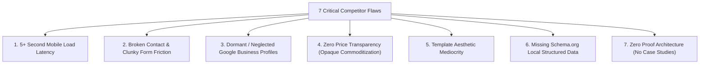

# Local Competitor Vulnerability Teardown & Growth Audit
### The 7 Critical Flaws Most Local Competitors Make & How Your New Digital Flagship Captures Their Traffic
**Uncoded Hub Client Asset Series &bull; Pillar 04**  
**Authored by Deepak & Geetha &bull; Founders, Uncoded Hub**  
**Confidential &bull; Exclusively for Uncoded Hub Clients**

---

## Executive Overview: The Invisible Leaks in Local Competition

In almost every major city and high-ticket service niche, **over 85% of your local competitors operate on broken, outdated digital infrastructure.**

They may have been in business for 10 years, they may have a reputable physical location, and they may spend thousands of rupees on Google or Instagram ads. Yet, when prospective clients search for their services online, their digital experience is so friction-heavy that **6 out of every 10 interested visitors bounce within 5 seconds.**

This guide gives you the competitive playbook to conduct a 10-minute audit of your top 3 local competitors, identify their invisible structural vulnerabilities, and systematically position your new Uncoded Hub digital platform as the undisputed market leader.

---

## The 7 Critical Vulnerabilities of Local Competitors

### Vulnerability 1: The 5+ Second Mobile Load Latency (Speed Slump)
- **The Competitor Flaw**: Most competitors use cheap WordPress shared hosting, bloated multi-purpose themes (Divi, Avada, Elementor), and 25+ unoptimized plugins. On an Indian 4G/5G mobile connection, their website takes 5 to 9 seconds to load.
- **Why It Bleeds Revenue**: Google officially confirms that 53% of mobile visitors abandon a website that takes longer than 3 seconds to load.
- **Your Uncoded Hub Advantage**: Your website compiles to pure, static, pre-rendered React with next-gen WebP images, delivering **sub-0.8s mobile LCP** (Lighthouse 95–100). When a prospect clicks your ad or search link, it renders instantaneously.

---

### Vulnerability 2: Form Friction & Lack of Direct WhatsApp Routing
- **The Competitor Flaw**: Competitors force mobile visitors to pinch-to-zoom and fill out an 8-field contact form requiring Name, Email, Address, Message, and Captcha verification. Mobile users hate forms; over 75% abandon them halfway through.
- **Your Uncoded Hub Advantage**: Every page on your website features prominent, frictionless **1-Click WhatsApp routing** with pre-filled greeting text. High-intent mobile buyers connect directly to your desk in 2 seconds.

---

### Vulnerability 3: Dormant Google Business Profile (GBP)
- **The Competitor Flaw**: Competitors often have a Google listing created 5 years ago with low-resolution photos taken on an old phone, zero weekly update posts, and unanswered negative reviews.
- **Your Uncoded Hub Advantage**: By applying the **Pillar 01 GBP 3-Pack Blueprint** and **Pillar 02 Review Machine**, your profile features verified categories, weekly updates, keyword-rich owner responses, and fresh customer reviews, causing Google to prioritize your listing in the Local 3-Pack.

---

### Vulnerability 4: Opaque Commoditization (Hiding All Starting Prices)
- **The Competitor Flaw**: Most local service businesses hide all pricing behind vague phrases like *"Call for quote"* or *"Contact us for custom estimation"*. This forces busy executives and high-ticket clients to waste time just to discover if the provider is within their budget.
- **Your Uncoded Hub Advantage**: By publishing clear starting rates (*"Sprints start from ₹25,000"*) or offering an interactive project estimator, you establish immediate transparency, filter out tire-kickers, and attract qualified buyers with established budgets.

---

### Vulnerability 5: Template Mediocrity & Lack of Visual Hierarchy
- **The Competitor Flaw**: Competitors use generic stock photos of smiling Caucasian models in generic corporate offices that look completely fake to local clients. The typography is cluttered, font sizes are inconsistent, and spacing is chaotic.
- **Your Uncoded Hub Advantage**: Uncoded Hub’s signature editorial aesthetic utilizes generous whitespace, refined typography, authentic photography, and switchable luxury palettes (e.g. Obsidian vs. Warm Heritage) that make your business look like an established, premier institution.

---

### Vulnerability 6: Missing Schema.org Local Structured Data
- **The Competitor Flaw**: Search engine bots crawling competitor sites only see unorganized raw text. There is no machine-readable code telling Google the business’s geo-coordinates, opening hours, accepted currencies, or customer review scores.
- **Your Uncoded Hub Advantage**: Every single page of your website includes deep `LocalBusiness`, `ProfessionalService`, `OfferCatalog`, and `FAQPage` JSON-LD schema. Google’s AI crawlers instantly index your services, display rich star snippets, and link your domain to your Google Maps pin.

---

### Vulnerability 7: The "Zero Proof" Problem
- **The Competitor Flaw**: Competitors write generic claims like *"We are the leading provider with 100% satisfaction"* but show zero actual case studies, zero before-and-after sliders, and zero verifiable metrics.
- **Your Uncoded Hub Advantage**: Your website features interactive before-and-after comparison sliders, verified client testimonials with photographs, and concrete metrics that systematically dismantle customer skepticism.

---

## The 10-Minute Local Competitor Audit Worksheet

Pick your top 3 local competitors and run this 10-minute diagnostic test:

| Audit Parameter | Competitor A | Competitor B | Competitor C | Your Uncoded Hub Site |
|:---|:---:|:---:|:---:|:---:|
| **PageSpeed Insights Score** (Run on `pagespeed.web.dev`) | _ /100 | _ /100 | _ /100 | **95–100 / 100** |
| **Mobile Load Speed** (Seconds to interactive) | __ sec | __ sec | __ sec | **< 0.8 seconds** |
| **Direct 1-Click WhatsApp Button** | [ ] Yes [ ] No | [ ] Yes [ ] No | [ ] Yes [ ] No | **[x] Instant 1-Click** |
| **Google Review Count & Rating** | __ ★ (Count) | __ ★ (Count) | __ ★ (Count) | *(Scaling Weekly)* |
| **GBP Updated in the Last 7 Days?** | [ ] Yes [ ] No | [ ] Yes [ ] No | [ ] Yes [ ] No | **[x] Weekly Updates** |
| **Transparent Starting Pricing Listed?** | [ ] Yes [ ] No | [ ] Yes [ ] No | [ ] Yes [ ] No | **[x] Clear & Upfront** |
| **Interactive Feature / Calculator** | [ ] Yes [ ] No | [ ] Yes [ ] No | [ ] Yes [ ] No | **[x] Included** |

---

## 30-Day Market Domination Plan

1. **Days 1–7**: Complete your Google Business Profile category and service menu setup (Pillar 01).
2. **Days 8–14**: Launch your 1-Click WhatsApp Review Campaign to your last 10 satisfied clients (Pillar 02).
3. **Days 15–21**: Train your front desk or sales team on the 7 Inbound WhatsApp Response Scripts (Pillar 03).
4. **Days 22–30**: Publish your first weekly GBP update post, monitor incoming Google Search Console queries, and watch your local inbound inquiries multiply.

> *"Superior digital infrastructure does not merely compete; it redefines the standard of your entire local market."*
