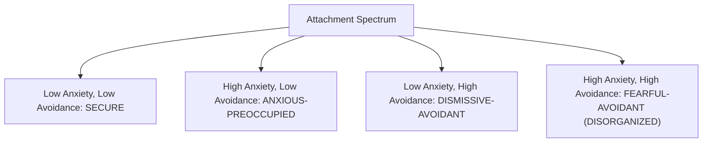

# The Attachment Style Decoder
### Navigating Anxious & Avoidant Dynamics: How to Stop Chasing and Build Secure, Long-Term Love
**By Deepak Ravi (@founderdeepak)**
**Price Tier:** $14.00 (Psychology Masterclass)

---

## Introduction: Why You Love the Way You Love

Have you ever wondered why you experience an overwhelming, gut-wrenching knot of panic in your stomach when someone takes three hours to text you back?

Or conversely, why you feel an intense urge to run away, feel suffocated, and shut down emotionally the second someone expresses deep emotional vulnerability toward you?

You are not crazy, and you are not broken. 

You are simply running an unconscious **attachment operating system** hardwired into your nervous system during your earliest developmental years.

Attachment theory—originally pioneered by British psychoanalyst John Bowlby and expanded by Mary Ainsworth—reveals that human romantic bonding is governed by our innate biological survival drive for safety and connection.

When you do not understand your attachment blueprint, your dating life feels like a repetitive cycle of heartbreak, chasing emotionally unavailable partners, or sabotaging healthy connections. 

When you decode your attachment style, you gain the superpower to break toxic relationship loops, communicate your needs without shame, and cultivate **Earned Security**.

---

## Module 1: The 4 Attachment Blueprints



### 1. The Anxious-Preoccupied Style (The Pursuer)
- **Core Wound**: Abandonment, rejection, and unworthiness.
- **Childhood Origin**: Inconsistent emotional caregiving (parents who were warm and loving one day, but distracted, cold, or chaotic the next). The child learned: *"I have to perform, cling, and hyper-monitor energy to keep love from disappearing."*
- **Romantic Behavior**: Hyper-vigilance. Over-analyzing text response times, lowercase letters, and tone shifts. Believing that someone else's mood is their fault. Chasing people who pull away.

### 2. The Dismissive-Avoidant Style (The Distancer)
- **Core Wound**: Loss of autonomy, emotional enmeshment, and vulnerability.
- **Childhood Origin**: Emotionally absent or neglectful caregivers. The child learned: *"Nobody is coming to soothe me. Emotions are dangerous. I must rely 100% on myself to survive."*
- **Romantic Behavior**: Deactivating strategies. The moment a relationship becomes close and intimate, their nervous system sounds an alarm. They find minor physical flaws in their partner, withdraw into hobbies or work, and convince themselves: *"I'm just better off alone."*

### 3. The Fearful-Avoidant / Disorganized Style (The Storm)
- **Core Wound**: Betrayal trauma. The source of safety was simultaneously the source of fear (abuse, addiction, or volatile household drama).
- **Romantic Behavior**: Deeply craving love, but terrified of getting burned. They pull someone close with intense passion, suddenly panic, push them away with hostility, and then panic that they lost them.

### 4. The Secure Style (The Anchor)
- **Core Foundation**: High self-worth combined with high trust in others.
- **Romantic Behavior**: Directly articulates needs without passive aggression. Does not take someone else's bad mood personally. Walks away calmly when mistreated without drama.

---

## Module 2: The Anxious-Avoidant Dance (The Toxic Loop)

Why do Anxious and Avoidant individuals magnetically attract each other in 90% of modern situationships?

Because their wounds fit together like puzzle pieces:
- The anxious person's pursuit validates the avoidant person's belief that partners are "needy and suffocating."
- The avoidant person's withdrawal validates the anxious person's belief that "everyone eventually abandons me."

### The 4-Stage Spiral:

```
Stage 1: The Electric Spark (Intense early chemistry and rapid intimacy)
   ▼
Stage 2: The Avoidant Deactivation (Avoidant feels smothered and steps back into silence)
   ▼
Stage 3: The Anxious Panic (Anxious sends 14 texts, calls repeatedly, demands clarity)
   ▼
Stage 4: The Explosion or Wall (Avoidant shuts down completely; Anxious collapses in despair)
```

---

## Module 3: Disarming the Loop: Word-for-Word Scripts

### If You Have an Anxious Attachment Style:
Your work is **Self-Soothing and Halting the Chase**.

When your partner pulls back, your urge will be to send three paragraphs demanding an answer. **STOP.** Place your hand over your heart, take three physiological sighs, and say out loud: *"I am safe right now. Their silence is about their nervous system, not my worth."*

#### When You Need Reassurance (The Non-Accusatory Script):
- *Wrong (Accusatory)*: *"Why are you ignoring me? You clearly don't care about this relationship anymore."*
- *Right (Vulnerable & Secure)*: 
*"Hey, I noticed a bit of quiet between us today, and my anxious brain started spinning stories. I know you're busy with work, but hearing a quick 'thinking of you' really helps my nervous system settle. Love you, talk tonight."*

### If You Have an Avoidant Attachment Style:
Your work is **Overcoming Deactivation and Voicing Reassurance**.

When you feel suffocated, your urge is to vanish into your cave for four days without a word. Recognize that silence is gasoline on an anxious partner's fire.

#### When You Need Space (The Reassurance Script):
- *Wrong (Ghosting / Dismissive)*: *"You're being crazy and suffocating, leave me alone."*
- *Right (Autonomous & Loving)*:
*"I'm feeling mentally depleted and overstimulated right now, and I need a few hours of quiet solitude to recharge my battery. I love you, everything is completely fine between us, and I will call you tonight at 9 PM when I'm centered."*

---

## Module 4: The 30-Day Earned Security Reprogramming Protocol

Security is not an innate genetic gift; it is an **earned neural pathway**. Follow this structured 4-week protocol:

### Week 1: Somatic De-Escalation
- Whenever you feel triggered, observe where the physical sensation sits (throat, solar plexus, chest).
- Practice 10 minutes of box breathing (4s inhale, 4s hold, 4s exhale, 4s hold) before opening your messaging app. Never send a text while in fight-or-flight.

### Week 2: Dismantling the "Protest Behaviors"
- Identify your protest behaviors: silent treatment, passive-aggressive Instagram stories, intentionally taking 6 hours to reply, fishing for compliments.
- Commit to eliminating all protest behaviors. If you have an emotional need, speak it plainly in one calm sentence.

### Week 3: Expanding Your Emotional Portfolio
- If your partner is 90% of your emotional focus, your life is out of balance.
- Reinvest in physical training, creative output, and deep platonic friendships. A diversified emotional portfolio prevents catastrophic panics.

### Week 4: The High-Value Screening Matrix
- Stop chasing potential. Evaluate people on **current emotional availability**.
- If someone displays chronic inconsistency for 30 consecutive days, you do not try to fix or heal them. You say: *"I respect myself too much to audition for someone's affection."* And you walk away with your dignity intact.

> "You do not need to become someone else to be worthy of deep, unconditional love. You only need to come home to your own worth, ground your nervous system in peace, and refuse to settle for anyone who treats you like an option."

---

## 🎁 Exclusive Reader Discounts & Referral Rewards

Thank you for reading this guide! Here are your exclusive discount and sharing benefits:

* **Your Personal Reader Discount (20% Off):** Use code `READER20` at checkout for **20% off** any individual guide or bundle.
* **Share With a Friend (5% Off Referral):** Loved this guide? Give your friends code `FRIEND5` so they get an instant **5% off** their first purchase!

### 📦 Curated Bundles (Best Value & Maximum Savings)

* **[Bundle 1: The Modern Texting & Flirting Toolkit](https://founderdeepak.gumroad.com/l/bundle-texting-toolkit/READER20)** — *Books 02 + 07* ➔ **$9.00** (*Only $7.20 with code READER20*)
* **[Bundle 2: The Silent Signs & Body Language Pack](https://founderdeepak.gumroad.com/l/bundle-body-language-pack/READER20)** — *Books 01 + 08 + 09* ➔ **$14.00** (*Only $11.20 with code READER20*)
* **[Bundle 3: The High-Stakes Romance Kit](https://founderdeepak.gumroad.com/l/bundle-high-stakes-romance/READER20)** — *Books 03 + 04 + 01* ➔ **$14.00** (*Only $11.20 with code READER20*)
* **[Bundle 4: The Deep Connection & Intimacy Masterclass](https://founderdeepak.gumroad.com/l/bundle-deep-connection/READER20)** — *Books 05 + 06 + 10* ➔ **$14.00** (*Only $11.20 with code READER20*)
* **[Bundle 5: The Complete 10-Book Original Vault](https://founderdeepak.gumroad.com/l/complete-10-book-vault/READER20)** — *Books 01 through 10* ➔ **$29.00** (*Only $23.20 with code READER20*)
* **[Bundle 6: The Rapid Dating Quick-Check Pack ($5 Tier Bundle)](https://founderdeepak.gumroad.com/l/bundle-rapid-checklists/READER20)** — *All 6 of the $5 Cheatsheets (Books 27 to 32)* ➔ **$15.00** (*Only $12.00 with code READER20*)
* **[Bundle 7: The Date Night & Attraction Mastery Pack](https://founderdeepak.gumroad.com/l/bundle-date-night-attraction/READER20)** — *Books 11 + 14 + 02* ➔ **$19.00** (*Only $15.20 with code READER20*)
* **[Bundle 8: The Reconnection & Ex-Back Strategy Pack](https://founderdeepak.gumroad.com/l/bundle-ex-reconnection/READER20)** — *Books 12 + 19 + 05* ➔ **$19.00** (*Only $15.20 with code READER20*)
* **[Bundle 9: The Boundary & Self-Worth Armor Kit](https://founderdeepak.gumroad.com/l/bundle-boundaries-armor/READER20)** — *Books 13 + 10 + 15* ➔ **$19.00** (*Only $15.20 with code READER20*)
* **[Bundle 10: The 60-Day Relationship Blueprint Pack](https://founderdeepak.gumroad.com/l/bundle-60-day-relationship/READER20)** — *Books 18 + 16 + 08* ➔ **$27.00** (*Only $21.60 with code READER20*)
* **[Bundle 11: The Master Conversation & Banter Suite](https://founderdeepak.gumroad.com/l/bundle-conversation-mastery/READER20)** — *Books 20 + 06 + 02 + 07* ➔ **$27.00** (*Only $21.60 with code READER20*)
* **[Bundle 12: The Seduction & Magnetic Presence Masterclass](https://founderdeepak.gumroad.com/l/bundle-seduction-magnetic/READER20)** — *Books 17 + 19 + 09 + 05 + 26* ➔ **$34.00** (*Only $27.20 with code READER20*)
* **[Bundle 13: The Long-Term Love & Healing Double-System](https://founderdeepak.gumroad.com/l/bundle-longterm-healing/READER20)** — *Books 24 + 25* ➔ **$34.00** (*Only $27.20 with code READER20*)
* **[Bundle 14: The Executive Double-Bible Masterclass](https://founderdeepak.gumroad.com/l/bundle-executive-bibles/READER20)** — *Books 21 + 22* ➔ **$29.00** (*Only $23.20 with code READER20*)
* **[Bundle 15: The Grand 32-Book Master Lifetime Library](https://founderdeepak.gumroad.com/l/grand-32-book-library/READER20)** — *ALL 32 BOOKS (The Complete Master Codex)* ➔ **$99.00** (*Only $79.20 with code READER20*)

---

### 📚 Complete 32-Book Master Library

#### $5 Micro-Cheatsheet
* **[Book 27: The 50 Best Opening Lines for Any Dating App](https://founderdeepak.gumroad.com/l/50-dating-app-openers/READER20)** ($5)
* **[Book 28: The 30-Second Body Language Quick-Check](https://founderdeepak.gumroad.com/l/body-language-quick-check/READER20)** ($5)
* **[Book 29: The Red Flag Rapid-Screening Checklist](https://founderdeepak.gumroad.com/l/red-flag-checklist/READER20)** ($5)
* **[Book 30: The Green Flag Locator](https://founderdeepak.gumroad.com/l/green-flag-locator/READER20)** ($5)
* **[Book 31: 30 Emergency Texts When a Conversation Goes Silent](https://founderdeepak.gumroad.com/l/emergency-texts-revival/READER20)** ($5)
* **[Book 32: The Morning After & Post-Date Etiquette Guide](https://founderdeepak.gumroad.com/l/post-date-etiquette/READER20)** ($5)

#### $7 Core Foundation
* **[Book 01: The Mixed Signals Decoder](https://founderdeepak.gumroad.com/l/mixed-signals-decoder/READER20)** ($7)
* **[Book 02: The Smooth Texting Vault](https://founderdeepak.gumroad.com/l/smooth-texting-vault/READER20)** ($7)
* **[Book 03: The Coworker Attraction Code](https://founderdeepak.gumroad.com/l/coworker-attraction-code/READER20)** ($7)
* **[Book 04: More Than Friends](https://founderdeepak.gumroad.com/l/more-than-friends/READER20)** ($7)
* **[Book 05: Quiet Chemistry](https://founderdeepak.gumroad.com/l/quiet-chemistry/READER20)** ($7)
* **[Book 06: Beyond "You're Pretty"](https://founderdeepak.gumroad.com/l/beyond-youre-pretty/READER20)** ($7)
* **[Book 07: The Late-Night Texting Playbook](https://founderdeepak.gumroad.com/l/late-night-texting/READER20)** ($7)
* **[Book 08: The First Move Formula](https://founderdeepak.gumroad.com/l/first-move-formula/READER20)** ($7)
* **[Book 09: The Silent Attraction Blueprint](https://founderdeepak.gumroad.com/l/silent-attraction-blueprint/READER20)** ($7)
* **[Book 10: The Situationship Exit Plan](https://founderdeepak.gumroad.com/l/situationship-exit-plan/READER20)** ($7)

#### $9 Action Toolkit
* **[Book 11: The Date Night Masterplan](https://founderdeepak.gumroad.com/l/date-night-masterplan/READER20)** ($9)
* **[Book 12: The Ex Factor](https://founderdeepak.gumroad.com/l/the-ex-factor/READER20)** ($9)
* **[Book 13: The High-Value Boundary Playbook](https://founderdeepak.gumroad.com/l/high-value-boundary-playbook/READER20)** ($9)
* **[Book 14: The DM Attraction Protocol](https://founderdeepak.gumroad.com/l/dm-attraction-protocol/READER20)** ($9)
* **[Book 15: The Jealousy & Mixed Signals Antidote](https://founderdeepak.gumroad.com/l/jealousy-mixed-signals-antidote/READER20)** ($9)

#### $14 Relationship System
* **Book 16: The Attachment Style Decoder ($14)** — *(You just finished this guide!)*
* **[Book 17: Modern Seduction & Magnetic Presence](https://founderdeepak.gumroad.com/l/modern-seduction-magnetic-presence/READER20)** ($14)
* **[Book 18: From First Date to Relationship in 60 Days](https://founderdeepak.gumroad.com/l/first-date-to-relationship-60-days/READER20)** ($14)
* **[Book 19: The Psychology of Making Them Miss You](https://founderdeepak.gumroad.com/l/psychology-of-making-them-miss-you/READER20)** ($14)
* **[Book 20: The Conversation Mastery Manual](https://founderdeepak.gumroad.com/l/conversation-mastery-manual/READER20)** ($14)

#### $19 Masterclass Bible
* **[Book 21: The Master Bible of Modern Romance](https://founderdeepak.gumroad.com/l/master-bible-modern-romance/READER20)** ($19)
* **[Book 22: The Emotional Intelligence & Charisma Bible](https://founderdeepak.gumroad.com/l/eq-charisma-bible/READER20)** ($19)
* **[Book 26: The Subconscious Attraction Trigger Matrix](https://founderdeepak.gumroad.com/l/subconscious-attraction-matrix/READER20)** ($19)

#### $24 Advanced Architecture
* **[Book 24: The Long-Term Relationship Mastery Manual](https://founderdeepak.gumroad.com/l/long-term-mastery-manual/READER20)** ($24)

#### $29 Flagship Opus
* **[Book 23: The Modern Romance Encyclopedia](https://founderdeepak.gumroad.com/l/romance-encyclopedia/READER20)** ($29)
* **[Book 25: The Breakup Recovery & Reinvention Blueprint](https://founderdeepak.gumroad.com/l/breakup-recovery-blueprint/READER20)** ($29)
