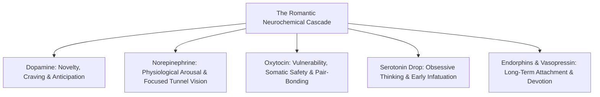
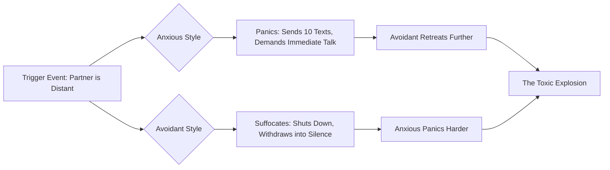

# The Modern Romance Encyclopedia
### The Complete Lifetime Codex of Human Attraction, Behavioral Psychology, Flirting & Unbreakable Love
**By Deepak Ravi (@founderdeepak)**
**Price Tier:** $29.00 (The Flagship Opus)

---

## The Master Preface: The Architecture of Modern Human Connection

Modern dating is an evolutionary anomaly.

For hundreds of thousands of years, human courtship took place in tight-knit ancestral tribes and villages. Reputations were publicly known, family structures were deeply interconnected, social accountability was permanent, and mating options were limited to a geographic radius of a few miles. 

Today, within the span of a single generation, humanity has transitioned into an hyper-connected, algorithmic dating ecosystem characterized by:
- **Infinite Choice Paradox**: Dating apps create the illusory fantasy of endless replacements, generating chronic decision paralysis and low investment.
- **Normalized Ambiguity**: The rise of "situationships", "talking stages", and "breadcrumbing", where individuals extract emotional intimacy and physical validation without offering accountability or emotional safety.
- **Digital Surveillance & Synthetic Intimacy**: Couples text constantly for weeks before meeting, projecting fantasies onto pixels, only to experience crushing disillusionment upon their first physical interaction.
- **The Erosion of Courtship Dignity**: Modern dating has conditioned people to treat emotional detachment as a power move and vulnerability as a liability.

The human nervous system was not biologically wired for this environment. As a consequence, millions of high-value individuals find themselves trapped in cycles of chronic dating anxiety, unexplained ghosting, emotional numbness, or quiet disillusionment.

**The Modern Romance Encyclopedia** is your lifetime canon. It is engineered to bridge cutting-edge evolutionary biology, neurochemistry, micro-expression analysis, digital communication strategy, and clinical attachment theory into one unified, actionable field codex.

Whether you are navigating a delicate early connection, breaking free from prolonged ambiguity, or engineering a 30-year sovereign marriage, this encyclopedia provides the definitive operational blueprint.

---

## Volume I: The Neurochemical Engine of Attraction & Bonding

Attraction is not an abstract metaphysical mystery. It is a biological calculation governed by five primary neurochemicals that evolved over millions of years to assess mate fitness, guarantee reproductive survival, and cement tribal pair-bonds.

When you master the biochemistry of romantic connection, human behavior stops being confusing and becomes entirely predictable.



### 1.1 Dopamine (The Anticipation Spark & The Intermittent Reward Loop)
Dopamine is commonly misunderstood as the neurochemical of pleasure or reward satisfaction. Neurobiologically, **dopamine is the neurochemical of craving, anticipation, and pursuit**.
- B.F. Skinner’s foundational operant conditioning studies proved that dopamine spikes highest not when a reward is guaranteed, but when a reward is **unpredictable** (variable ratio schedule).
- When an individual is 100% predictable—replying within 2 seconds to every message, constantly available, narrating every mundane moment of their day—the recipient's dopamine circuitry flatlines. There is no mystery, no gap to bridge, and no anticipation.
- Conversely, when someone lives a compelling, self-directed life where their time is genuinely scarce and their validation must be earned, dopamine surges.
- **The Operational Law**: Never give someone 100% emotional certainty before they have offered 100% relational commitment. Cultivate an independent reality. Allow healthy pauses between interactions. Anticipation is the oxygen of romantic desire.

### 1.2 Norepinephrine & Adrenaline (The Physiological Surge)
Norepinephrine is responsible for the physical sensations people mistakenly label as "destiny":
- The racing heart, dilated pupils, dry mouth, shallow breathing, and butterflies in the stomach.
- It induces sharp cognitive focus—creating a sensory "tunnel vision" where the rest of the world fades into the background.
- **The Field Application**: Do not conduct dates sitting statically across a table in an overly bright, sterile coffee shop. Human biology bonds through shared movement, sensory novelty, and mild physiological arousal. Walking through a bustling evening street market, attending an energetic live event, or navigating an unfamiliar environment together activates norepinephrine, which the subconscious brain immediately attributes to interpersonal chemistry.

### 1.3 Oxytocin (The Somatic Vulnerability Bridge)
Known as the neuropeptide of attachment, oxytocin produces deep feelings of safety, warmth, and relational trust.
- It is triggered by continuous eye contact, shared confidential disclosures, prolonged physical embrace (hugs lasting longer than 6 seconds), and physical touch.
- Without oxytocin, attraction remains cold, transactional, and short-lived.
- **The Operational Law**: Balance playful banter with sudden, calibrated emotional authenticity. Once a foundation of fun is established, sharing a genuine emotional truth or observing their character triggers oxytocin, transforming surface-level flirtation into psychological devotion.

### 1.4 Serotonin Depletion & Early Obsession
During the acute phase of romantic infatuation, brain serotonin levels drop precipitously to levels identical to clinical Obsessive-Compulsive Disorder (OCD).
- This drop explains why people in the early stages of dating replay conversations 50 times in their head, check their phones compulsively, and experience acute mood swings based on a single text.
- **The Operational Law**: Recognize that infatuation is a temporary neurochemical intoxication, not a measure of compatibility. Never make life-altering commitments (moving in, marriage, financial enmeshment) during the serotonin-depleted infatuation window (Months 1–6).

### 1.5 Vasopressin & Endorphins (The Architecture of Devotion)
While dopamine drives early exploration, vasopressin and endorphins govern enduring pair-bonding:
- Vasopressin promotes protective instincts, territorial fidelity, and long-term loyalty.
- Endorphins produce a calm, tranquil sense of deep peace and security in each other's presence.
- Relationships that survive decades successfully transition from volatile dopamine spikes to sustainable endorphin-rich tranquility.

---

## Volume II: The Non-Verbal & Micro-Expression Lexicon

Human speech evolved merely 100,000 years ago; non-verbal communication has been refined over 500 million years of vertebrate evolution. When words conflict with micro-expressions and body language, **the nervous system always believes the non-verbal signal.**

```
Micro-Observation Hierarchy:
1. Feet & Navel Orientation (Limbic Truth — Zero Conscious Control)
2. Hands & Wrist Exposure (Subconscious Trust & Openness)
3. Torso & Shoulder Lean (Gravity of Attraction)
4. Pupil Dilation & Ocular Triangle (Dopaminergic Focus)
5. Vocal Cadence & Pitch Modulation (Status & Warmth Dynamics)
```

### 2.1 The 12 Involuntary Micro-Tells of Deep Attraction
1. **The Navel & Feet Orientation (The Limbic Directional Tell)**: The human brain subconsciously directs the feet and torso toward what it desires most. Even if someone is talking to someone else across a room, if their feet are pointed toward you, their subconscious focus is aligned with you.
2. **Ocular Pupil Dilation**: In ambient lighting, pupils involuntarily dilate by 15% to 30% when viewing a subject of high romantic value.
3. **The Triangular Gaze Pattern**: A person engaging in friendly conversation looks from left eye to right eye. When attraction enters the dynamic, the gaze shifts in a triangle: Left Eye ➔ Right Eye ➔ Lips ➔ Left Eye.
4. **Ventral Exposure (The Unshielded Heart)**: Crossing arms, holding a drink directly across the chest, or clutching a handbag functions as subconscious defensive armor. When someone likes you, they clear physical barriers, exposing their neck, chest, and wrists.
5. **The Suprasternal Notch / Neck Caress**: Touching the hollow of the neck or gently exposing the side of the neck is an involuntary vulnerability display that releases tension caused by romantic arousal.
6. **Subconscious Postural Mirroring**: Matching your breathing rate, posture angle, or beverage sipping within 3 to 5 seconds indicates harmonious rapport.
7. **The Vocal Pitch Drop (In Men)**: Men speaking to an attractive prospect involuntarily drop their fundamental vocal frequency by a half-octave, communicating grounded masculinity and confidence.
8. **The Melodic Vocal Lilt (In Women)**: Women speaking to someone of high romantic interest modulate their vocal tone into a softer, more musical frequency, accompanied by playful laughter.
9. **The Preening Reflex**: Involuntary micro-adjustments—smoothing clothing, fixing hair, straightening jewelry—demonstrating a desire to look optimal in your presence.
10. **The Slow Swallow & Throat Reset**: A noticeable swallow during an intimate conversational pause reflects acute autonomic nervous system excitement.
11. **Lingering Physical Proximity**: Staying slightly closer than the cultural baseline (entering the 18-inch intimate zone) without retreating.
12. **The "Unconscious Return"**: When a group laughs at a joke, an individual involuntarily looks first at the person they feel most attracted to in the room.

### 2.2 Micro-Expressions of Disinterest & Deception
- **The Asymmetrical Lip Sneer**: Contempt is the only universal emotion with an asymmetrical expression (one corner of the lip pulls upward). If you see a micro-sneer during an interaction, respect has collapsed.
- **The Partial Torso Pivot**: Smiling with the face while the shoulders and feet are angled toward an exit indicates polite social obligation, not romantic desire.
- **Blink Rate Surges**: Blinking jumping from the normal baseline of 15–20 blinks per minute to 40+ indicates heightened discomfort, acute cognitive friction, or deception.

### 2.3 The Touch Escalation Architecture (The 5 Tiers)
Physical touch must always be calibrated, respectful, and consensual. Never jump tiers without receiving receptive feedback:
- **Tier 1 (Social Touch)**: Shoulder tap, warm handshake, brief double-cheek kiss greeting.
- **Tier 2 (Playful Touch)**: A brief touch on the forearm during shared laughter, a gentle nudge with the shoulder while walking.
- **Tier 3 (Semi-Intimate Touch)**: Guiding their lower back through a crowded doorway, resting a hand on their upper back for 2 seconds.
- **Tier 4 (Intimate Touch)**: Holding hands while walking, tucking a loose hair strand behind their ear, sitting knee-to-knee with lingering contact.
- **Tier 5 (Magnetic Touch)**: Deep embrace, neck contact, unhurried kiss.

---

## Volume III: The Modern Digital & Texting Canon

Digital communication is where 90% of modern connections are either forged into deep intrigue or incinerated by needy over-communication.

### 3.1 The 4 Foundational Laws of High-Value Texting
1. **The Tennis Match Principle**: Communication is a game of alternating turns. You send one message. You do not send a second message until they respond. If they drop the ball, you calmly step off the court and focus on your empire.
2. **Energy Symmetry**: Match length and investment. If they send two sentences, never reply with a 500-word essay. Asymmetrical investment communicates low social awareness and desperation.
3. **The Zeigarnik Strategic Exit**: Never let a text conversation dwindle into dry, monosyllabic deaths (*"Yeah haha", "Cool"*, *"What else?"*). Always initiate the conversational exit when the banter is at its highest, funniest peak. This leaves the interaction on a high-dopamine note, creating psychological desire to reconnect.
4. **The 3-Exchange Rule to Reality**: Texting is not a substitute for courtship; it is merely an administrative bridge to arrange in-person dates. If you have exchanged 15+ messages without proposing a concrete in-person plan, you are a digital pen pal, not a romantic suitor.

### 3.2 25 Plug-and-Play Word-for-Word Texting Scripts

#### Category A: Playful Opening Lines (First Impressions)
1. *"You looked surprisingly trouble-making in that photograph. Tell me I'm wrong."*
2. *"I was just having a heated debate: does pineapple belong on pizza, or are we going to have our first official disagreement?"*
3. *"Your Spotify playlist either proves you have immaculate taste or that you're going through a dramatic life transition."*
4. *"Quick question that will dictate our entire future: morning coffee person or midnight snack philosopher?"*
5. *"I promised myself I wouldn't text first, but your profile had a rare lack of boring clichés, so here we are."*

#### Category B: Mid-Game Banter & Tension Escalation
6. *"Careful, if you keep being this charming, I might actually have to take you seriously."*
7. *"I had a great reply planned for you, but I decided to make you wait and appreciate it more."*
8. *"You have approximately 24 hours to explain why you haven't tried [Favorite Local Spot] yet."*
9. *"I think you and I would either be incredible partners in crime or an absolute disaster. No in-between."*
10. *"Stop looking so confident in your latest story, it's making the rest of the app look bad."*

#### Category C: The Frictionless Date Close
11. *"I have a strict rule against having fascinating conversations behind a glass screen. Let's get coffee / cocktails this Thursday at 7:30."*
12. *"I'm checking out that hidden speakeasy on 4th Street this Friday. Join me for one drink and tell me your wildest travel story."*
13. *"You seem far too interesting to be reduced to texting. Are you free Wednesday evening for a proper conversation?"*
14. *"Let's test if our conversational chemistry in real life is as dangerous as it is on this thread. Thursday at 8?"*
15. *"I'm craving a decent matcha and a sharp conversation. Meet me at [Café] tomorrow at 4?"*

#### Category D: Reviving a Cooling or Silent Thread
16. *"We were having such a civilized conversation before you clearly got abducted by alien lifeforms."*
17. *"I accept your silent surrender in our debate. It takes courage to admit defeat."*
18. *"Saw this [Photo of funny/relevant topic] and immediately thought of your controversial theory."*
19. *"I’m officially giving you one chance to redeem your texting response time before I revoke your conversational privileges."*
20. *"This silence is getting dramatic. Shall we resume our witty banter or hold a formal moment of silence?"*

#### Category E: Late-Night Warmth & Emotional Resonance
21. *"Something about midnight makes small talk feel completely illegal. What's something that genuinely fascinates your mind right now?"*
22. *"I hope your day was as kind to you as you are to everyone around you. Rest well tonight."*
23. *"Just finished a crazy long workday, and seeing your text was honestly the best part of it."*
24. *"Sleep well. Don't stay up overthinking things you can't control tonight."*
25. *"Turning my phone off now, but wanted you to be the last conversation of my evening. Goodnight."*

---

## Volume IV: The Attachment & Conflict Compass

Conflict in relationships is rarely about the dirty dishes in the sink or a 20-minute delayed reply. Conflict is almost always an **attachment panic cry** disguised as anger, criticism, or cold withdrawal.



### 4.1 The 4 Core Attachment Blueprints
- **Secure (50% of population)**: High comfort with intimacy, high self-worth. Communicates needs calmly without manipulation. Does not take others' moods personally.
- **Anxious-Preoccupied (20%)**: Core wound is abandonment. Hyper-vigilant to emotional temperature drops. Interprets distance as impending rejection.
- **Dismissive-Avoidant (25%)**: Core wound is enmeshment/loss of autonomy. Learned in childhood that emotional reliance equals weakness. Deactivates intimacy when closeness deepens.
- **Fearful-Avoidant / Disorganized (5%)**: Craves deep connection, but views intimacy as terrifying. Oscillates wildly between desperate pursuit and sudden hostile withdrawal.

### 4.2 De-Escalating the Anxious-Avoidant Dance (Step-by-Step)
When conflict strikes:
1. **The Anxious Protocol**:
   - Recognize that your partner's need for space is about their nervous system regulation, NOT a lack of love.
   - Do NOT send long explanatory paragraphs. Step back physically. Perform 10 deep belly breaths.
   - Use the **Secure Anchor Script**:
   *"Hey, I can feel that you need some quiet space to process right now. I respect that. I love you, and let's reconnect over tea tonight around 8 PM to wrap this up calmly."*
2. **The Avoidant Protocol**:
   - Recognize that your partner's protest behavior (demanding answers) is driven by sheer terror of abandonment, NOT a desire to control you.
   - Never walk out without offering an emotional timeframe. Silence feels like emotional death to an anxious partner.
   - Use the **Calm Assurance Script**:
   *"I'm starting to feel flooded and I want to be fair to this conversation. I need 30 minutes to take a walk and clear my head, but I am not leaving, and we will solve this together when I get back."*

### 4.3 12 Clinical Conflict Resolution Scripts

| Scenario | Toxic Reaction | Sovereign Disarming Script |
|:---|:---|:---|
| **Partner Criticizes You Aggressively** | Defensiveness (*"Well look at what YOU did last week!"*) | *"I hear how frustrated you are, and I want to understand. Tell me what felt most unfair to you, without the attacks, so we can fix it."* |
| **Partner Shuts Down (Stonewalling)** | Screaming (*"Answer me right now! Look at me!"*) | *"I see that you're overwhelmed right now. I'm going to step into the kitchen for 15 minutes so we both reset, then let's sit down."* |
| **Financial Disagreement** | Accusation (*"You spend money like an idiot."*) | *"Our financial goals seem misaligned right now, and it's making me feel anxious about our security. Can we look at our monthly numbers together this Saturday?"* |
| **Intimacy Disparity** | Guilt (*"You never touch me anymore. Are you cheating?"*) | *"I really miss feeling close to you physically. I know life has been draining lately—how can we create space this weekend where we both feel relaxed?"* |
| **Partner Arrives Late Without Notice** | Passive-Aggression (*"Nice of you to finally show up."*) | *"When you're late without a text, I feel like my evening isn't valued. In the future, send me a 30-second heads-up so I can plan my time."* |
| **Family / In-Law Friction** | Attacking Family (*"Your mother is manipulative."*) | *"I love your family because they're yours, but when [Behavior] happens, it crosses our boundary as a couple. I need us to stand united on this."* |
| **Household Chore Imbalance** | Martyrdom (*"I do everything in this house alone!"*) | *"I'm running on empty trying to keep the home afloat this week. Could you take full ownership of laundry and dinner prep for the next three days?"* |
| **Jealousy Over a Third Party** | Interrogation (*"Why are they commenting on your photo?!"*) | *"When I see that dynamic, it triggers insecurity in me. Help me understand that friendship so I can feel secure in where we stand."* |
| **Recurring Argument Fatigue** | Resignation (*"We always fight about the exact same thing."*) | *"We're stuck in a loop right now. Let's pause the fight, write down what we both actually need on an index card, and swap cards."* |
| **Disagreement on Life Pace/Career** | Condescension (*"You don't have enough ambition."*) | *"I have big dreams for our future, and I need to feel that we're pushing in the same direction. Let's talk about where we want to be in 3 years."* |
| **Feeling Taken for Granted** | Cold Distance (*Ghosting inside the house*) | *"I’ve been feeling a bit invisible in our routine lately. I’d love an intentional evening together with no phones just to reconnect."* |
| **Apology & Repair Request** | Forced Apology (*"Fine, I'm sorry, happy now?"*) | *"I genuinely regret how I spoke to you earlier. It was reactive and unfair to you. What can I do right now to make you feel respected?"* |

---

## Volume V: The Architecture of Lifelong Commitment

A lasting relationship is not an emotional accident; it is an engineered enterprise sustained by three fundamental structural pillars.

### 5.1 The Polarity Preservation Doctrine
The tragic paradox of long-term love—brilliantly documented by relationship therapist Esther Perel—is that **love seeks closeness and safety, but erotic desire requires distance, autonomy, and mystery.**
- When partners merge into an indistinguishable, codependent unit where they share every thought, wear sweatpants 24/7, and eliminate all outside pursuits, romantic polarity dies.
- **The Solution**: Maintain your "Secret Garden." Have your own creative projects, your own distinct friendship circles, your own intense physical fitness standards, and your own private thoughts. When you maintain your personal sovereignty, your partner continues to look across the room and see someone they must choose and re-attract every day.

### 5.2 The Shared Moral Compass & Value Auditing Matrix
Love is not two people gazing into each other's eyes indefinitely; love is two people standing shoulder-to-shoulder, looking outward in the exact same direction. Every couple must conduct an annual **Values Audit** across 5 domains:
1. **Spiritual & Ethical Philosophy**: What principles govern your behavior when life gets difficult?
2. **Financial Architecture**: Are you builders, savers, or consumers? What is your debt philosophy and investment vision?
3. **Tribal & Boundary Politics**: How do you protect your marital unit from external intrusion by in-laws, friends, and society?
4. **Parenthood & Legacy Philosophy**: How will children be disciplined, educated, and grounded in emotional security?
5. **Growth & Contribution**: How are you actively serving something larger than yourselves?

### 5.3 The Sovereign Partnership (Mutual Autonomy + Absolute Devotion)
The highest form of human union is neither codependency nor independence—it is **interdependence**.
- Two whole, healed, formidable individuals who do not need each other to survive, but who consciously choose to build an empire together.
- They guard each other's dignity in public with ferocious loyalty.
- They nurture each other's vulnerability in private with tender grace.

---

## Volume VI: The 100 Universal Laws of Human Attraction & Love

1. Ambiguity is never a mystery; inconsistency is an active decision.
2. The person who needs the connection least always controls the frame of the interaction.
3. Desperation repels faster than physical imperfection ever could.
4. Silence is the only dignified response to someone who takes your presence for granted.
5. You cannot love someone into loving you if they do not respect your boundaries.
6. A boundary without an enforced consequence is merely a suggestion.
7. Chemistry sparks the fire, but character keeps the house warm.
8. When someone shows you who they are through their actions, believe them the first time.
9. Love does not die from conflict; love dies from the slow cancer of unaddressed neglect.
10. If someone's words and actions are in contradiction, always measure their actions.
11. Texting is an administrative tool to arrange real-world dates, not a surrogate for intimacy.
12. Vulnerability without boundaries is not courage; it is emotional exhibitionism.
13. You cannot build a healthy relationship with someone who is at war with themselves.
14. An apology without altered behavior is nothing more than sophisticated manipulation.
15. Predictability kills desire; anticipation is the fuel of erotic attraction.
16. The fastest way to lose someone's respect is to abandon your own principles to keep them pleased.
17. Never make someone a priority when they only treat you as an optional convenience.
18. Jealousy is not proof of love; jealousy is proof of unaddressed internal insecurity.
19. High-value individuals do not compete for romantic attention; they observe and evaluate.
20. The quality of your love life will never exceed the quality of your self-respect.
21. A situationship is a contract where one person gets all the benefits of marriage while the other bears all the anxiety of being single.
22. The 6-second kiss resets the human nervous system faster than a 10-minute argument.
23. If someone makes you feel crazy for asking for basic clarity, they are emotionally unavailable.
24. You teach people how to treat you by what you tolerate, reward, and walk away from.
25. Passion requires polarity; when two partners become identical roommates, desire flatlines.
26. Walking away with calm dignity speaks louder than 50 furious screaming paragraphs.
27. True confidence is not walking into a room thinking you are better than everyone; it is walking into a room without having to compare yourself to anyone.
28. Never let romantic infatuation blind you to fundamental moral misalignment.
29. The most attractive trait in any human being is emotional self-regulation under pressure.
30. Healthy love feels peaceful, grounded, and clear; toxic love feels addictive, chaotic, and ambiguous.
31. Do not mistake the anxiety of unpredictable validation for the depth of true soul connection.
32. When you stop chasing the wrong people, you give the right people space to find you.
33. An ex reaching out after months of silence is rarely about missing you; it is about testing their lingering power over you.
34. Real intimacy is being seen in your rawest state and still feeling completely safe.
35. The greatest gift you can give your partner is your own healed, thriving nervous system.
36. Flirting is the playful art of communicating desire without surrendering your sovereignty.
37. If you have to walk on eggshells around someone, that relationship is not your home.
38. Never negotiate your core non-negotiables for the temporary warmth of companionship.
39. Forgiving someone does not require inviting them back into your life.
40. Dignity once lost in a relationship is almost impossible to recover; guard it with your life.
41. Emotional safety is the prerequisite for authentic sexual liberation and passion.
42. A great partner does not complete you; a great partner inspires you to complete yourself.
43. Respect is earned in public and deepened in private.
44. The grass is never greener on the other side; the grass is greener where it is consistently watered.
45. In romance, speed is a warning sign; deep foundations take time to cure.
46. If someone likes you, you will know; if they don't, you will be confused.
47. Do not fall in love with someone's potential; fall in love with their current daily execution.
48. A healthy argument focuses on resolving the problem; an unhealthy argument focuses on winning the battle.
49. Contempt is the poison that predicts relationship extinction with 90% accuracy.
50. You cannot change a person who does not see an issue with their own behavior.
51. Loneliness is the price you pay for standards until someone worthy of your devotion arrives.
52. High-value courtship is an intentional vetting process, not an audition for validation.
53. The right person will never make you feel like your emotional needs are "too much."
54. Guard your bedroom from domestic logistics; let the bed remain an altar of peace and intimacy.
55. Micro-appreciations spoken aloud daily are the emotional vitamins of lasting union.
56. An anxious pursuer and an avoidant distancer are two sides of the exact same abandonment coin.
57. Real strength is soft when appropriate, unyielding when necessary, and calm always.
58. Never compromise your career, fitness, and vision for someone who has not proved their loyalty.
59. An unexamined childhood wound will inevitably become your adult romantic script.
60. The antidote to anxiety is action; the antidote to romantic obsession is purpose.
61. Praise in public, calibrate in private, defend in front of the world.
62. A relationship should make your life lighter and more formidable, not heavier and more chaotic.
63. Never text after midnight when you are intoxicated, lonely, or emotionally ungrounded.
64. If you have to decode their behavior like an ancient hieroglyphic, they are not your person.
65. True masculine energy provides containment and safety; true feminine energy provides warmth and life.
66. When polarity reverses, frustration reigns; when polarity aligns, attraction flows effortlessly.
67. Do not invest in someone based on how much you like them; invest based on how much they invest in you.
68. Ghosting says everything about their emotional cowardice and nothing about your human value.
69. Healthy boundaries do not push people away; they filter the wrong people out.
70. Romantic chemistry without shared values is an emotional disaster waiting to happen.
71. A woman who feels genuinely safe will blossom; a man who feels genuinely respected will conquer.
72. Never trade your long-term peace for short-term validation.
73. The strongest position in any negotiation—including romance—is the ability to walk away and mean it.
74. If they wanted to, they would; if they don't, accept the answer and pivot with elegance.
75. Emotional maturity is the ability to disagree without disrespecting.
76. Marriage is an economic, emotional, and spiritual alliance; treat it with executive discipline.
77. Never let unresolved resentment sleep in the same bed with you.
78. The best revenge against an unappreciative ex is living an extraordinary, joyful, sovereign life.
79. Charisma is not loud talking; charisma is making the other person feel entirely seen and heard.
80. When someone pulls away, lean back into your own life rather than leaning forward into their space.
81. A high-status partner never begs, pleads, or monitors; they communicate, decide, and act.
82. Genuine curiosity is the greatest conversational aphrodisiac on earth.
83. Do not rush to define a connection before you have observed how they handle stress, anger, and disappointment.
84. Look at how they treat waiters, drivers, and cashiers; that is how they will treat you once the honeymoon fades.
85. Intimacy is built in the mundane Tuesday mornings, not just the romantic Saturday nights.
86. A person who cannot manage their own finances cannot manage a shared future.
87. Keep your relationship off social media; private love lasts longer.
88. When an argument gets heated, remember: It is not You vs. Them; it is You & Them vs. The Problem.
89. Healing is not linear, but returning to the person who broke you is always a regression.
90. A peaceful home is the ultimate luxury in a chaotic modern world.
91. Celebrate your partner's wins louder than anyone else in the room.
92. Real commitment is an everyday choice, not a one-time wedding vow.
93. Never stop dating your spouse; if you stop pursuing them, someone else will eventually tempt them.
94. Self-worth is internal; when you outsource your self-worth to romantic approval, you become a hostage.
95. Listen to understand, not to rebut.
96. Great communication begins with nervous system regulation.
97. Keep your body strong, your mind sharp, your spirit calm, and your heart open.
98. The highest honor you can bestow upon another human being is your undivided, present attention.
99. True love does not trap you; true love liberates you to become the highest version of yourself.
100. "To love someone for a lifetime is not a promise of emotion; it is an enduring covenant of conscious presence."

---

## 🎁 Exclusive Reader Discounts & Referral Rewards

Thank you for reading this guide! Here are your exclusive discount and sharing benefits:

* **Your Personal Reader Discount (20% Off):** Use code `READER20` at checkout for **20% off** any individual guide or bundle.
* **Share With a Friend (5% Off Referral):** Loved this guide? Give your friends code `FRIEND5` so they get an instant **5% off** their first purchase!

### 📦 Curated Bundles (Best Value & Maximum Savings)

* **[Bundle 1: The Modern Texting & Flirting Toolkit](https://founderdeepak.gumroad.com/l/bundle-texting-toolkit/READER20)** — *Books 02 + 07* ➔ **$9.00** (*Only $7.20 with code READER20*)
* **[Bundle 2: The Silent Signs & Body Language Pack](https://founderdeepak.gumroad.com/l/bundle-body-language-pack/READER20)** — *Books 01 + 08 + 09* ➔ **$14.00** (*Only $11.20 with code READER20*)
* **[Bundle 3: The High-Stakes Romance Kit](https://founderdeepak.gumroad.com/l/bundle-high-stakes-romance/READER20)** — *Books 03 + 04 + 01* ➔ **$14.00** (*Only $11.20 with code READER20*)
* **[Bundle 4: The Deep Connection & Intimacy Masterclass](https://founderdeepak.gumroad.com/l/bundle-deep-connection/READER20)** — *Books 05 + 06 + 10* ➔ **$14.00** (*Only $11.20 with code READER20*)
* **[Bundle 5: The Complete 10-Book Original Vault](https://founderdeepak.gumroad.com/l/complete-10-book-vault/READER20)** — *Books 01 through 10* ➔ **$29.00** (*Only $23.20 with code READER20*)
* **[Bundle 6: The Rapid Dating Quick-Check Pack ($5 Tier Bundle)](https://founderdeepak.gumroad.com/l/bundle-rapid-checklists/READER20)** — *All 6 of the $5 Cheatsheets (Books 27 to 32)* ➔ **$15.00** (*Only $12.00 with code READER20*)
* **[Bundle 7: The Date Night & Attraction Mastery Pack](https://founderdeepak.gumroad.com/l/bundle-date-night-attraction/READER20)** — *Books 11 + 14 + 02* ➔ **$19.00** (*Only $15.20 with code READER20*)
* **[Bundle 8: The Reconnection & Ex-Back Strategy Pack](https://founderdeepak.gumroad.com/l/bundle-ex-reconnection/READER20)** — *Books 12 + 19 + 05* ➔ **$19.00** (*Only $15.20 with code READER20*)
* **[Bundle 9: The Boundary & Self-Worth Armor Kit](https://founderdeepak.gumroad.com/l/bundle-boundaries-armor/READER20)** — *Books 13 + 10 + 15* ➔ **$19.00** (*Only $15.20 with code READER20*)
* **[Bundle 10: The 60-Day Relationship Blueprint Pack](https://founderdeepak.gumroad.com/l/bundle-60-day-relationship/READER20)** — *Books 18 + 16 + 08* ➔ **$27.00** (*Only $21.60 with code READER20*)
* **[Bundle 11: The Master Conversation & Banter Suite](https://founderdeepak.gumroad.com/l/bundle-conversation-mastery/READER20)** — *Books 20 + 06 + 02 + 07* ➔ **$27.00** (*Only $21.60 with code READER20*)
* **[Bundle 12: The Seduction & Magnetic Presence Masterclass](https://founderdeepak.gumroad.com/l/bundle-seduction-magnetic/READER20)** — *Books 17 + 19 + 09 + 05 + 26* ➔ **$34.00** (*Only $27.20 with code READER20*)
* **[Bundle 13: The Long-Term Love & Healing Double-System](https://founderdeepak.gumroad.com/l/bundle-longterm-healing/READER20)** — *Books 24 + 25* ➔ **$34.00** (*Only $27.20 with code READER20*)
* **[Bundle 14: The Executive Double-Bible Masterclass](https://founderdeepak.gumroad.com/l/bundle-executive-bibles/READER20)** — *Books 21 + 22* ➔ **$29.00** (*Only $23.20 with code READER20*)
* **[Bundle 15: The Grand 32-Book Master Lifetime Library](https://founderdeepak.gumroad.com/l/grand-32-book-library/READER20)** — *ALL 32 BOOKS (The Complete Master Codex)* ➔ **$99.00** (*Only $79.20 with code READER20*)

---

### 📚 Complete 32-Book Master Library

#### $5 Micro-Cheatsheet
* **[Book 27: The 50 Best Opening Lines for Any Dating App](https://founderdeepak.gumroad.com/l/50-dating-app-openers/READER20)** ($5)
* **[Book 28: The 30-Second Body Language Quick-Check](https://founderdeepak.gumroad.com/l/body-language-quick-check/READER20)** ($5)
* **[Book 29: The Red Flag Rapid-Screening Checklist](https://founderdeepak.gumroad.com/l/red-flag-checklist/READER20)** ($5)
* **[Book 30: The Green Flag Locator](https://founderdeepak.gumroad.com/l/green-flag-locator/READER20)** ($5)
* **[Book 31: 30 Emergency Texts When a Conversation Goes Silent](https://founderdeepak.gumroad.com/l/emergency-texts-revival/READER20)** ($5)
* **[Book 32: The Morning After & Post-Date Etiquette Guide](https://founderdeepak.gumroad.com/l/post-date-etiquette/READER20)** ($5)

#### $7 Core Foundation
* **[Book 01: The Mixed Signals Decoder](https://founderdeepak.gumroad.com/l/mixed-signals-decoder/READER20)** ($7)
* **[Book 02: The Smooth Texting Vault](https://founderdeepak.gumroad.com/l/smooth-texting-vault/READER20)** ($7)
* **[Book 03: The Coworker Attraction Code](https://founderdeepak.gumroad.com/l/coworker-attraction-code/READER20)** ($7)
* **[Book 04: More Than Friends](https://founderdeepak.gumroad.com/l/more-than-friends/READER20)** ($7)
* **[Book 05: Quiet Chemistry](https://founderdeepak.gumroad.com/l/quiet-chemistry/READER20)** ($7)
* **[Book 06: Beyond "You're Pretty"](https://founderdeepak.gumroad.com/l/beyond-youre-pretty/READER20)** ($7)
* **[Book 07: The Late-Night Texting Playbook](https://founderdeepak.gumroad.com/l/late-night-texting/READER20)** ($7)
* **[Book 08: The First Move Formula](https://founderdeepak.gumroad.com/l/first-move-formula/READER20)** ($7)
* **[Book 09: The Silent Attraction Blueprint](https://founderdeepak.gumroad.com/l/silent-attraction-blueprint/READER20)** ($7)
* **[Book 10: The Situationship Exit Plan](https://founderdeepak.gumroad.com/l/situationship-exit-plan/READER20)** ($7)

#### $9 Action Toolkit
* **[Book 11: The Date Night Masterplan](https://founderdeepak.gumroad.com/l/date-night-masterplan/READER20)** ($9)
* **[Book 12: The Ex Factor](https://founderdeepak.gumroad.com/l/the-ex-factor/READER20)** ($9)
* **[Book 13: The High-Value Boundary Playbook](https://founderdeepak.gumroad.com/l/high-value-boundary-playbook/READER20)** ($9)
* **[Book 14: The DM Attraction Protocol](https://founderdeepak.gumroad.com/l/dm-attraction-protocol/READER20)** ($9)
* **[Book 15: The Jealousy & Mixed Signals Antidote](https://founderdeepak.gumroad.com/l/jealousy-mixed-signals-antidote/READER20)** ($9)

#### $14 Relationship System
* **[Book 16: The Attachment Style Decoder](https://founderdeepak.gumroad.com/l/attachment-style-decoder/READER20)** ($14)
* **[Book 17: Modern Seduction & Magnetic Presence](https://founderdeepak.gumroad.com/l/modern-seduction-magnetic-presence/READER20)** ($14)
* **[Book 18: From First Date to Relationship in 60 Days](https://founderdeepak.gumroad.com/l/first-date-to-relationship-60-days/READER20)** ($14)
* **[Book 19: The Psychology of Making Them Miss You](https://founderdeepak.gumroad.com/l/psychology-of-making-them-miss-you/READER20)** ($14)
* **[Book 20: The Conversation Mastery Manual](https://founderdeepak.gumroad.com/l/conversation-mastery-manual/READER20)** ($14)

#### $19 Masterclass Bible
* **[Book 21: The Master Bible of Modern Romance](https://founderdeepak.gumroad.com/l/master-bible-modern-romance/READER20)** ($19)
* **[Book 22: The Emotional Intelligence & Charisma Bible](https://founderdeepak.gumroad.com/l/eq-charisma-bible/READER20)** ($19)
* **[Book 26: The Subconscious Attraction Trigger Matrix](https://founderdeepak.gumroad.com/l/subconscious-attraction-matrix/READER20)** ($19)

#### $24 Advanced Architecture
* **[Book 24: The Long-Term Relationship Mastery Manual](https://founderdeepak.gumroad.com/l/long-term-mastery-manual/READER20)** ($24)

#### $29 Flagship Opus
* **Book 23: The Modern Romance Encyclopedia ($29)** — *(You just finished this guide!)*
* **[Book 25: The Breakup Recovery & Reinvention Blueprint](https://founderdeepak.gumroad.com/l/breakup-recovery-blueprint/READER20)** ($29)
