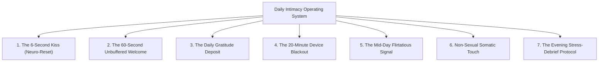
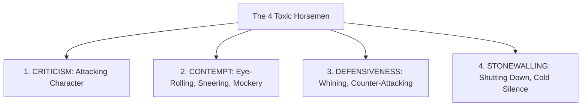

# The Long-Term Relationship Mastery Manual
### How to Keep Passion, Chemistry & Intimacy Alive After 1, 3, and 10 Years Together
**By Deepak Ravi (@founderdeepak)**
**Price Tier:** $24.00 (Executive Relationship Manual)

---

## The Core Manifesto: Love Dies From Neglect Long Before It Dies From Conflict

Couples who remain deeply, passionately in love after 5, 10, or 20 years together are not blessed with rare genetic luck. They operate on intentional, structured relationship systems.

The overwhelming majority of relationships do not end in explosive screaming matches, dramatic betrayals, or sudden catastrophes. They dissolve in the slow, imperceptible silence of **emotional erosion**:
- The morning kiss goodbye that degrades from a passionate embrace into a distracted, 1-second peck on the cheek while checking email.
- The evening routine where two partners sit three feet apart on the sofa, illuminated only by the cold blue glow of their respective smartphones, living parallel lives under the same roof.
- The insidious transition from magnetic romantic lovers into polite domestic roommates managing grocery lists, utility bills, and childcare logistics.

When you take a human being for granted, you do not lose them overnight. You lose them millimeter by millimeter, silent compromise by silent compromise, until one day you look across the kitchen table and realize you are sharing your life with a polite stranger.

This manual is your operational architecture. It is engineered to immunize your partnership against domestic decay, eradicate chronic resentment, preserve erotic polarity, and build an unbreakable bond that deepens with every passing year.

---

## Pillar 1: Defeating Emotional Neglect & The 7 Anti-Erosion Daily Micro-Habits

Intimacy is not maintained through grand annual anniversary celebrations or expensive vacations to Maui. Intimacy is forged and fortified in the tiny micro-moments of emotional presence you invest on an ordinary Tuesday morning.



### 1. The 6-Second Kiss (The Physiological Circuit-Breaker)
Dr. John Gottman’s clinical research at the Love Lab demonstrated that a kiss lasting less than 2 seconds is purely transactional—it is an administrative acknowledgment that another human being is present. 

However, a kiss that lasts for **at least 6 continuous seconds** triggers a profound neurological shift:
- It halts acute cortisol (stress hormone) secretion.
- It floods the bloodstream with oxytocin and dopamine.
- It relaxes the facial micro-muscles and drops heart rate into parasympathetic equilibrium.
- It communicates to your partner’s nervous system: *"I see you, I choose you, and you are not merely my domestic co-manager."*
- **The Non-Negotiable Rule**: Never leave the home in the morning and never reunite in the evening without an uninterrupted 6-second kiss.

### 2. The 60-Second Unbuffered Welcome
When your partner returns home from work or you meet after a day apart, the first 60 seconds set the emotional climate for the entire evening.
- **The Error**: Remaining glued to your laptop screen or scrolling Instagram while mumbling, *"Hey, how was your day?"*
- **The Protocol**: Put down your device, close your computer, stand up, make direct eye contact, smile, and wrap your arms around them for 60 seconds of undivided presence. Let the chaotic outside world dissolve before discussing domestic tasks.

### 3. The Daily Gratitude Deposit (With 15 Specific Templates)
Resentment cannot survive in an environment of explicit, spoken appreciation. In long-term love, partners often think positive thoughts about each other but fail to articulate them out loud.
- Every single day, vocalize one specific, non-routine appreciation. 

#### 15 Plug-and-Play Gratitude Scripts:
1. *"Thank you for handling the car maintenance today; knowing that was taken care of removed a massive weight from my mind."*
2. *"You looked remarkably striking when you got dressed this morning. I noticed, and it made my morning."*
3. *"I really appreciated how patient and calm you were during that difficult phone call earlier."*
4. *"Thank you for making coffee this morning before I woke up. It felt like an act of genuine care."*
5. *"I love watching you pursue your goals. Your work ethic inspires me more than you realize."*
6. *"Thank you for listening to me vent about my work project without trying to immediately fix it."*
7. *"I love how funny and quick-witted you are in social groups. You brought so much life to dinner last night."*
8. *"Thank you for taking care of dinner tonight when you were just as exhausted as I was."*
9. *"I really value how thoughtfully you manage our home environment. It feels like a true sanctuary."*
10. *"Thank you for giving me space to recharge this afternoon without making me feel guilty."*
11. *"I love the way your mind works when we talk about big ideas. You challenge me in the best way."*
12. *"Thank you for being so gracious with my family this past weekend. It meant the world to me."*
13. *"You have such an incredible heart for people. I'm proud to be your partner."*
14. *"Thank you for holding my hand on the drive home. Small moments like that remind me why I chose you."*
15. *"I just wanted to tell you that after all this time, you are still my absolute favorite person to talk to."*

### 4. The 20-Minute Device Blackout (Bedroom Sanctuary)
The bedroom must be an inviolable temple dedicated exclusively to sleep, emotional connection, and intimacy.
- Charge all smartphones, tablets, and work laptops **outside the bedroom** or on a silent charging dock across the room.
- The 20 minutes before sleep are reserved for skin-to-skin touch, quiet conversation, and emotional decompression. Discussing bills, emails, or news in bed poisons the sleep and intimacy environment.

### 5. The Mid-Day Flirtatious Signal
Long-term partners often reduce texting to logistics: *"Can you pick up milk?"*, *"Did you pay the plumber?"*.
- Break the logistical monotony with one unprompted, flirtatious mid-day text that requires no administrative action:
  - *"Just saw someone who reminded me of our first trip to Lisbon. Thinking about you."*
  - *"Looking forward to seeing you tonight. You looked way too good walking out the door this morning."*
  - *"Quick reminder that I love you and I’m in your corner today."*

### 6. Non-Demanding Physical Touch
When physical touch in a long-term relationship only occurs as a prelude to sex, one partner may begin to pull away from touch altogether to avoid expectations.
- Cultivate non-demanding touch: resting a warm hand on the nape of their neck while cooking, gentle back scratches while watching a movie, or unhurried hand-holding on a casual walk.

### 7. The Evening Stress-Debrief Protocol
Spend 15 minutes each evening debriefing each other's day using the **Empathy-First Rule**:
- The listener’s sole job is to offer emotional alliance (*"That sounds completely unfair", "I would have been furious too"*), NEVER unasked advice or problem-solving. Problem-solving can occur only after emotional validation is complete.

---

## Pillar 2: The Weekly 20-Minute "State-of-the-Union" Meeting

Most couples only communicate about their relationship when a catastrophic argument erupts at 11:30 PM on a Tuesday. Trying to resolve deep emotional friction when exhausted, defensive, and emotionally flooded is relational suicide.

The antidote is the **Weekly State-of-the-Union Protocol**: A scheduled, sacred, 20-minute meeting held every Sunday morning over coffee where micro-resentments are cleared before they calcify into contempt.

```
Weekly State-of-the-Union Agenda (20 Minutes Strict):
┌─────────────────────────────────────────────────────────────┐
│ Phase 1: 5 Mins ➔ 5 Specific Appreciations from the Past Week │
├─────────────────────────────────────────────────────────────┤
│ Phase 2: 5 Mins ➔ Celebrations of Shared Wins & Effort       │
├─────────────────────────────────────────────────────────────┤
│ Phase 3: 7 Mins ➔ One Gentle Calibration (Soft Startup)      │
├─────────────────────────────────────────────────────────────┤
│ Phase 4: 3 Mins ➔ Calendar, Logistics & Date Night Booking  │
└─────────────────────────────────────────────────────────────┘
```

### The Strict Rules of Engagement:
1. **The Rule of One**: Each partner may bring up **only one** behavioral calibration per week. You cannot present a laundry list of grievances.
2. **The 7-Day Statute of Limitations**: You cannot bring up events that occurred months or years ago. Calibrations must pertain strictly to the past 7 days.
3. **The Soft Startup Requirement**: Frame concerns using "I feel... about [Specific Event]... and what I need is [Concrete Positive Action]."
   - *Toxic*: *"You're completely emotionally distant and you never pay attention to me."*
   - *Mastery*: *"I felt disconnected when we didn't get to spend any quiet time together this past week, and I would love if we could protect two hours this Thursday for an uninterrupted walk and dinner."*
4. **The Safe Container Agreement**: No voices are raised. If defensiveness spikes, take a 2-minute silent breath break before resuming.

---

## Pillar 3: The Monthly Adrenaline & Novelty Date Formula

Psychologist Dr. Arthur Aron proved that doing novel, exciting activities together floods the brain with dopamine and norepinephrine, which couples subconsciously misattribute to interpersonal romantic attraction. 

If your date nights consist of the exact same Italian restaurant every other Friday, your dopamine pathways go dormant. To keep passion electric across decades, you must execute one **Adrenaline & Novelty Date** every single month.

### 12 Curated Date Blueprints for Long-Term Couples:

1. **The Secret Speakeasy & High-Stakes Mystery**: Dress in formal attire. Meet at a location where neither has visited, pretend to be strangers meeting for the first time at the bar, and stay in character for the first 30 minutes.
2. **The High-Adrenaline Challenge**: Indoor skydiving, go-kart racing on an outdoor track, or high-ropes obstacle courses. Shared physical fear and triumph release high norepinephrine.
3. **The Progressive Neighborhood Crawl**: Appetizers at Venue A in an unfamiliar neighborhood, main course at Venue B across town, dessert and espresso at a late-night dessert lounge. Movement creates conversational momentum.
4. **The Live Immersion Experience**: An underground jazz club, an interactive murder mystery, or a live comedy club where laughter synchronizes brainwave frequencies.
5. **The Off-Grid Cabin Stargazing Night**: Rent an off-grid cabin with zero Wi-Fi, build an outdoor fire, cook a meal over open flames, and look at constellations without screens.
6. **The Competitive Cook-Off**: Give each partner a $25 budget at an international grocery market to buy mystery ingredients. Return home and compete to create the most creative dish while sharing wine.
7. **The Sunrise Hike & Thermal Soak**: Wake up at 5:00 AM, hike to a scenic overlook to watch the sunrise with thermoses of hot coffee, followed by a visit to a local sauna or thermal bath.
8. **The Art Museum Deep-Curation Tour**: Visit a museum with a single prompt: Each partner must find 3 pieces of art that represent how they feel about their partner, and present their curation over lunch.
9. **The Architectural Walking Tour**: Explore the historic district of your city on foot with audio guides, discovering hidden alleyways and historic architecture.
10. **The Bookstore & Coffee Exchange**: Spend 45 minutes browsing an independent bookstore. Buy each other one book that you believe will inspire their personal growth, write a love letter inside the front cover, and swap them over tea.
11. **The Couples Massage & Sensory Deprivation**: Book a couples thermal spa session or sensory float tank experience to deeply reset somatic nervous system stress.
12. **The Overnight Spontaneous Road Trip**: Pack a weekend bag on Friday afternoon without a pre-set destination. Drive two hours in one direction, book an eccentric boutique hotel, and explore wherever you land.

---

## Pillar 4: Gottman's Four Horsemen Clinical Eradication Manual

In four decades of longitudinal research studying over 3,000 couples, Dr. John Gottman demonstrated that four specific conversational patterns predict divorce with **over 93% statistical accuracy**. Here is how to diagnose and eradicate them permanently:



### 1. Criticism (Attacking Personality or Character)
- **The Toxic Manifestation**: Global statements using *"You always..."* or *"You never..."*.
  - *Example*: *"You're so irresponsible, you forgot to pay the electricity bill again."*
- **The Antidote: Gentle Soft-Startup**: Express a specific feeling about a concrete situation, followed by a positive need.
  - *Script*: *"I noticed the electric bill wasn't paid and I felt stressed about a late fee. Could you take care of that online right now so I don't have to worry?"*

### 2. Contempt (Communicating Superiority, Mockery & Sarcasm)
- **The Toxic Manifestation**: Sneering, eye-rolling, cynical name-calling, mimicking the partner’s voice in a mocking tone. Contempt is sulfuric acid to love; it erodes the partner’s physical immune system.
- **The Antidote: Creating a Culture of Appreciation**: Actively scanning the environment for what your partner is doing right, rather than hunting for their errors.
  - *The Rule*: Contempt has zero place in a sovereign relationship. The moment an eye-roll or sarcastic sneer occurs, call an immediate 5-minute timeout to reset respect.

### 3. Defensiveness (Refusing Responsibility & Playing the Innocent Victim)
- **The Toxic Manifestation**: *"It’s not my fault! If you hadn’t distracted me, I wouldn't have made the mistake!"*
- **The Antidote: Taking Ownership of Even 5% of the Problem**:
  - *Script*: *"You're right. I dropped the ball on that. I'm sorry for causing you stress, let me fix it immediately."*

### 4. Stonewalling (Withdrawing Emotionally and Physically into a Wall)
- **The Toxic Manifestation**: Crossing arms, staring blankly, turning away, refusing to speak or acknowledge the partner. Occurs when heart rate exceeds 100 BPM (diffuse physiological arousal).
- **The Antidote: Physiological Self-Soothing with a Guaranteed Return Time**:
  - *Script*: *"I am feeling emotionally flooded right now and my heart is racing. If we keep talking, I'm going to say something reactive and unhelpful. I am stepping out for a 20-minute walk to calm down, and I will be back at 8:30 PM so we can resolve this calmly."*

---

## Pillar 5: Navigating In-Laws, Finances & The Sovereign Fortress

A marriage or long-term partnership is not just an emotional union—it is an economic, legal, and tribal enterprise. External pressures will inevitably test the structural integrity of your relationship.

### 5.1 The United Front Rule (Protecting the Marital Perimeter)
Your partner must always be your primary allegiance. When parents, siblings, or in-laws criticize your partner, interfere in your parenting, or cross relational boundaries:
- **The Golden Rule**: You deal with your own family; your partner deals with theirs. Never make your partner the "bad guy" to your parents.
- *Word-for-Word Boundary Script to an Overbearing Parent*:
*"Mom / Dad, I love you and I value our relationship deeply. However, [Partner] and I have made a unified decision regarding our home / finances / parenting. I need you to respect our boundary on this. If you criticize [Partner], you are criticizing my decision as well."*

### 5.2 The 3-Account Financial Freedom & Transparency System
Financial infidelity and chronic friction over money destroy relationships faster than infidelity. Eliminate money friction through the **3-Account Model**:
1. **Account 1: The Joint Household Account (The Fortress)**: All shared expenses (mortgage/rent, utilities, groceries, joint savings, childcare, investments) are paid from this account. Funded proportionately according to income.
2. **Account 2: Partner A Discretionary Account (No Permission Needed)**: A fixed monthly allocation that Partner A can spend, save, or invest on anything they desire without asking permission or justifying choices.
3. **Account 3: Partner B Discretionary Account (No Permission Needed)**: The identical autonomy afforded to Partner B.
- **The $250 Transparency Rule**: Any joint purchase exceeding $250 requires a 30-second alignment check before executing.

---

## Pillar 6: Reigniting Erotic Polarity & Long-Term Chemistry

The greatest relationship paradox—articulated by psychotherapist Esther Perel—is that **love requires safety and predictability, but erotic desire requires mystery, distance, and unpredictability.**

When two people know every detail of each other's routines, when they dress solely for comfort, and when all life outside the relationship ceases to exist, erotic desire naturally dies. To preserve chemistry across decades:

### 1. Maintain Your "Secret Garden"
You cannot desire someone who has merged into your identical shadow. Desire requires space between two distinct sovereign entities.
- Keep passions, intellectual interests, and physical disciplines that your partner is not involved in.
- Maintain a personal aesthetic standard: Take pride in your physical conditioning, grooming, and wardrobe at home. Never let yourself become someone who only makes an effort for strangers outside the home while offering your partner stained sweatpants and indifference.

### 2. Guard the Bedroom from Domestic Bleed
Never discuss bills, household repairs, or children's school drama while lying in bed. Keep the bed associated with peace, rejuvenation, and romantic connection.

---

## Pillar 7: 50 Deep Conversation Starters for Couples Together 3+ Years

When you have been together for years, conversations often degrade into domestic logistics. Use these 50 curated questions to rediscover the evolving human being beside you:

### Category A: The Evolving Self & Hidden Dreams (Questions 1–15)
1. What is an ambition or dream you quietly hold that you haven't talked about in months?
2. If you could take a 3-month sabbatical with zero obligations, what creative project would you pursue?
3. What is something you believed about life 5 years ago that you no longer believe today?
4. In what area of your life do you currently feel the most misunderstood by the world?
5. What is a skill or discipline you want to master before our next major anniversary?
6. If we were given $50,000 that had to be spent entirely on experiences, how would you allocate it?
7. What is a piece of art, music, or literature that recently moved you deeply?
8. In what ways do you feel you have grown the most since we first met?
9. What is something you wish you had more courage to do in your career right now?
10. What is an experience from your childhood that still shapes how you handle money or stress today?
11. If you could design our ideal typical Tuesday five years from now, what would it look like from sunrise to sunset?
12. What is an area where you feel I could support your personal growth better?
13. What is something you’ve been procrastinating on because it secretly intimidates you?
14. What part of your identity outside of our relationship feels most alive right now?
15. If our lives were a book, what would the title of this current chapter be?

### Category B: Romantic Nostalgia & Chemistry (Questions 16–30)
16. What was the exact moment in our early dating life where you knew you were falling in love with me?
17. What is your favorite memory of us that doesn't involve an expensive trip or major milestone?
18. What is an outfit or look of mine that you secretly find irresistible?
19. What was the funniest, most unscripted adventure we've ever had together?
20. What is something I used to do early on that you wish I did more of today?
21. When was the last time you looked across a room at me and felt a sudden wave of attraction?
22. What is a romantic fantasy or vacation idea you would love for us to explore without holding back?
23. What is your favorite physical memory of us from our first year together?
24. How has your definition of passion shifted since we were in our twenties?
25. What is something I do that instantly makes you feel loved and cherished?
26. If we could re-live one single 24-hour day from our past together, which day would you pick?
27. What is an adventure we haven't taken yet that you consider non-negotiable for our lifetime?
28. In what environment do you feel most relaxed and open to romantic intimacy with me?
29. What is a flirtatious habit of ours that you hope we never lose, even when we're 80?
30. What made our connection feel different from anyone else you ever dated?

### Category C: Overcoming Friction & Deepening Safety (Questions 31–40)
31. Is there an unresolved hurt or small resentment from recently that you haven't felt safe enough to bring up?
32. What is something I do during disagreements that makes you feel heard, and what makes you feel defensive?
33. Do you feel comfortable saying "no" to me without fear of an emotional reaction?
34. In what ways can I make you feel more emotionally contained and protected during high-stress weeks?
35. How can we make our home feel more like a tranquil retreat from the outside world?
36. Are there any expectations you feel placed on you that are starting to feel too heavy to carry?
37. What is one small habit I have that unintentionally drains your energy?
38. What does genuine emotional comfort look like for you when you are having a terrible day?
39. How can we do a better job of protecting our couple bubble from outside family and work demands?
40. What is one promise we made to each other that we need to recommit to this year?

### Category D: Legacy, Meaning & The Future (Questions 41–50)
41. What values do you hope define the legacy of our partnership when people think of us?
42. How do you want our relationship to serve as an example to the next generation?
43. What is a philanthropic cause or mission that you want us to pour our resources into together?
44. When we look back on our life at age 85, what will we be proudest that we built together?
45. What is the greatest obstacle we have overcome as a team, and what did it teach you about our resilience?
46. If we could leave one core lesson about love to our children or community, what would it be?
47. How can we make sure we keep growing together rather than growing apart over the next decade?
48. What is a tradition we haven't created yet that you would love for us to start this year?
49. What is the one thing about our partnership that you are most fiercely protective of?
50. What is your favorite thing about building a life with me?

---

## 🎁 Exclusive Reader Discounts & Referral Rewards

Thank you for reading this guide! Here are your exclusive discount and sharing benefits:

* **Your Personal Reader Discount (20% Off):** Use code `READER20` at checkout for **20% off** any individual guide or bundle.
* **Share With a Friend (5% Off Referral):** Loved this guide? Give your friends code `FRIEND5` so they get an instant **5% off** their first purchase!

### 📦 Curated Bundles (Best Value & Maximum Savings)

* **[Bundle 1: The Modern Texting & Flirting Toolkit](https://founderdeepak.gumroad.com/l/bundle-texting-toolkit/READER20)** — *Books 02 + 07* ➔ **$9.00** (*Only $7.20 with code READER20*)
* **[Bundle 2: The Silent Signs & Body Language Pack](https://founderdeepak.gumroad.com/l/bundle-body-language-pack/READER20)** — *Books 01 + 08 + 09* ➔ **$14.00** (*Only $11.20 with code READER20*)
* **[Bundle 3: The High-Stakes Romance Kit](https://founderdeepak.gumroad.com/l/bundle-high-stakes-romance/READER20)** — *Books 03 + 04 + 01* ➔ **$14.00** (*Only $11.20 with code READER20*)
* **[Bundle 4: The Deep Connection & Intimacy Masterclass](https://founderdeepak.gumroad.com/l/bundle-deep-connection/READER20)** — *Books 05 + 06 + 10* ➔ **$14.00** (*Only $11.20 with code READER20*)
* **[Bundle 5: The Complete 10-Book Original Vault](https://founderdeepak.gumroad.com/l/complete-10-book-vault/READER20)** — *Books 01 through 10* ➔ **$29.00** (*Only $23.20 with code READER20*)
* **[Bundle 6: The Rapid Dating Quick-Check Pack ($5 Tier Bundle)](https://founderdeepak.gumroad.com/l/bundle-rapid-checklists/READER20)** — *All 6 of the $5 Cheatsheets (Books 27 to 32)* ➔ **$15.00** (*Only $12.00 with code READER20*)
* **[Bundle 7: The Date Night & Attraction Mastery Pack](https://founderdeepak.gumroad.com/l/bundle-date-night-attraction/READER20)** — *Books 11 + 14 + 02* ➔ **$19.00** (*Only $15.20 with code READER20*)
* **[Bundle 8: The Reconnection & Ex-Back Strategy Pack](https://founderdeepak.gumroad.com/l/bundle-ex-reconnection/READER20)** — *Books 12 + 19 + 05* ➔ **$19.00** (*Only $15.20 with code READER20*)
* **[Bundle 9: The Boundary & Self-Worth Armor Kit](https://founderdeepak.gumroad.com/l/bundle-boundaries-armor/READER20)** — *Books 13 + 10 + 15* ➔ **$19.00** (*Only $15.20 with code READER20*)
* **[Bundle 10: The 60-Day Relationship Blueprint Pack](https://founderdeepak.gumroad.com/l/bundle-60-day-relationship/READER20)** — *Books 18 + 16 + 08* ➔ **$27.00** (*Only $21.60 with code READER20*)
* **[Bundle 11: The Master Conversation & Banter Suite](https://founderdeepak.gumroad.com/l/bundle-conversation-mastery/READER20)** — *Books 20 + 06 + 02 + 07* ➔ **$27.00** (*Only $21.60 with code READER20*)
* **[Bundle 12: The Seduction & Magnetic Presence Masterclass](https://founderdeepak.gumroad.com/l/bundle-seduction-magnetic/READER20)** — *Books 17 + 19 + 09 + 05 + 26* ➔ **$34.00** (*Only $27.20 with code READER20*)
* **[Bundle 13: The Long-Term Love & Healing Double-System](https://founderdeepak.gumroad.com/l/bundle-longterm-healing/READER20)** — *Books 24 + 25* ➔ **$34.00** (*Only $27.20 with code READER20*)
* **[Bundle 14: The Executive Double-Bible Masterclass](https://founderdeepak.gumroad.com/l/bundle-executive-bibles/READER20)** — *Books 21 + 22* ➔ **$29.00** (*Only $23.20 with code READER20*)
* **[Bundle 15: The Grand 32-Book Master Lifetime Library](https://founderdeepak.gumroad.com/l/grand-32-book-library/READER20)** — *ALL 32 BOOKS (The Complete Master Codex)* ➔ **$99.00** (*Only $79.20 with code READER20*)

---

### 📚 Complete 32-Book Master Library

#### $5 Micro-Cheatsheet
* **[Book 27: The 50 Best Opening Lines for Any Dating App](https://founderdeepak.gumroad.com/l/50-dating-app-openers/READER20)** ($5)
* **[Book 28: The 30-Second Body Language Quick-Check](https://founderdeepak.gumroad.com/l/body-language-quick-check/READER20)** ($5)
* **[Book 29: The Red Flag Rapid-Screening Checklist](https://founderdeepak.gumroad.com/l/red-flag-checklist/READER20)** ($5)
* **[Book 30: The Green Flag Locator](https://founderdeepak.gumroad.com/l/green-flag-locator/READER20)** ($5)
* **[Book 31: 30 Emergency Texts When a Conversation Goes Silent](https://founderdeepak.gumroad.com/l/emergency-texts-revival/READER20)** ($5)
* **[Book 32: The Morning After & Post-Date Etiquette Guide](https://founderdeepak.gumroad.com/l/post-date-etiquette/READER20)** ($5)

#### $7 Core Foundation
* **[Book 01: The Mixed Signals Decoder](https://founderdeepak.gumroad.com/l/mixed-signals-decoder/READER20)** ($7)
* **[Book 02: The Smooth Texting Vault](https://founderdeepak.gumroad.com/l/smooth-texting-vault/READER20)** ($7)
* **[Book 03: The Coworker Attraction Code](https://founderdeepak.gumroad.com/l/coworker-attraction-code/READER20)** ($7)
* **[Book 04: More Than Friends](https://founderdeepak.gumroad.com/l/more-than-friends/READER20)** ($7)
* **[Book 05: Quiet Chemistry](https://founderdeepak.gumroad.com/l/quiet-chemistry/READER20)** ($7)
* **[Book 06: Beyond "You're Pretty"](https://founderdeepak.gumroad.com/l/beyond-youre-pretty/READER20)** ($7)
* **[Book 07: The Late-Night Texting Playbook](https://founderdeepak.gumroad.com/l/late-night-texting/READER20)** ($7)
* **[Book 08: The First Move Formula](https://founderdeepak.gumroad.com/l/first-move-formula/READER20)** ($7)
* **[Book 09: The Silent Attraction Blueprint](https://founderdeepak.gumroad.com/l/silent-attraction-blueprint/READER20)** ($7)
* **[Book 10: The Situationship Exit Plan](https://founderdeepak.gumroad.com/l/situationship-exit-plan/READER20)** ($7)

#### $9 Action Toolkit
* **[Book 11: The Date Night Masterplan](https://founderdeepak.gumroad.com/l/date-night-masterplan/READER20)** ($9)
* **[Book 12: The Ex Factor](https://founderdeepak.gumroad.com/l/the-ex-factor/READER20)** ($9)
* **[Book 13: The High-Value Boundary Playbook](https://founderdeepak.gumroad.com/l/high-value-boundary-playbook/READER20)** ($9)
* **[Book 14: The DM Attraction Protocol](https://founderdeepak.gumroad.com/l/dm-attraction-protocol/READER20)** ($9)
* **[Book 15: The Jealousy & Mixed Signals Antidote](https://founderdeepak.gumroad.com/l/jealousy-mixed-signals-antidote/READER20)** ($9)

#### $14 Relationship System
* **[Book 16: The Attachment Style Decoder](https://founderdeepak.gumroad.com/l/attachment-style-decoder/READER20)** ($14)
* **[Book 17: Modern Seduction & Magnetic Presence](https://founderdeepak.gumroad.com/l/modern-seduction-magnetic-presence/READER20)** ($14)
* **[Book 18: From First Date to Relationship in 60 Days](https://founderdeepak.gumroad.com/l/first-date-to-relationship-60-days/READER20)** ($14)
* **[Book 19: The Psychology of Making Them Miss You](https://founderdeepak.gumroad.com/l/psychology-of-making-them-miss-you/READER20)** ($14)
* **[Book 20: The Conversation Mastery Manual](https://founderdeepak.gumroad.com/l/conversation-mastery-manual/READER20)** ($14)

#### $19 Masterclass Bible
* **[Book 21: The Master Bible of Modern Romance](https://founderdeepak.gumroad.com/l/master-bible-modern-romance/READER20)** ($19)
* **[Book 22: The Emotional Intelligence & Charisma Bible](https://founderdeepak.gumroad.com/l/eq-charisma-bible/READER20)** ($19)
* **[Book 26: The Subconscious Attraction Trigger Matrix](https://founderdeepak.gumroad.com/l/subconscious-attraction-matrix/READER20)** ($19)

#### $24 Advanced Architecture
* **Book 24: The Long-Term Relationship Mastery Manual ($24)** — *(You just finished this guide!)*

#### $29 Flagship Opus
* **[Book 23: The Modern Romance Encyclopedia](https://founderdeepak.gumroad.com/l/romance-encyclopedia/READER20)** ($29)
* **[Book 25: The Breakup Recovery & Reinvention Blueprint](https://founderdeepak.gumroad.com/l/breakup-recovery-blueprint/READER20)** ($29)
