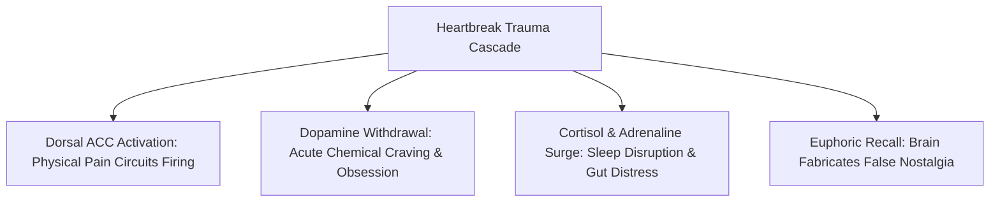
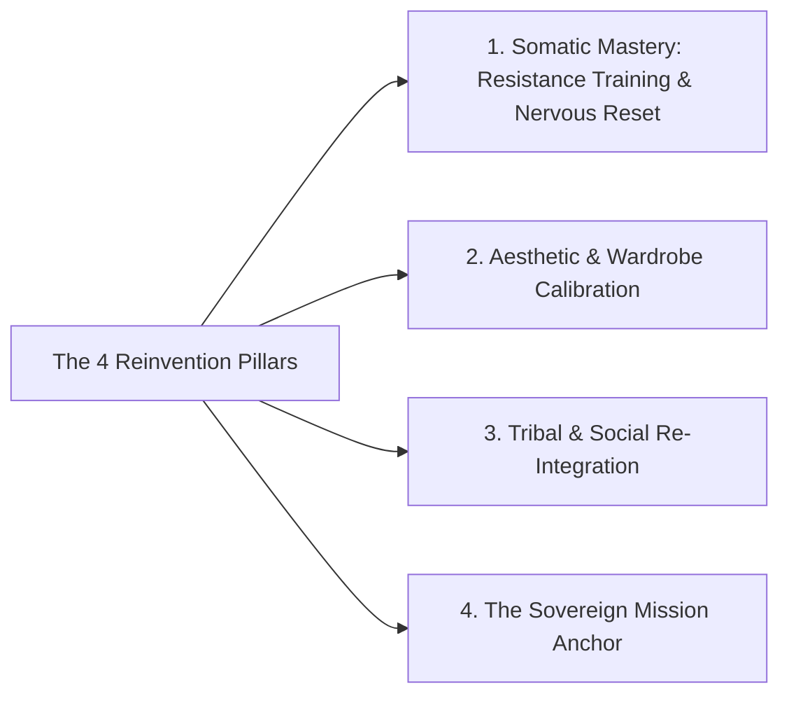

# The Breakup Recovery & Reinvention Blueprint
### The Neurological Roadmap to Heal Heartbreak in 45 Days, Rebuild Self-Worth & Attract Better Love
**By Deepak Ravi (@founderdeepak)**
**Price Tier:** $29.00 (Flagship Executive Blueprint)

---

## The Executive Doctrine: Heartbreak Is Neurological Surgery

A severe breakup is not merely an emotional disappointment—it is an acute, full-body neurochemical trauma.

Functional Magnetic Resonance Imaging (fMRI) studies conducted by cognitive neuroscientists reveal that romantic rejection activates the exact same brain regions responsible for physical bone fractures and third-degree thermal burns (specifically the **dorsal anterior cingulate cortex** and the **anterior insula**).

Simultaneously, your dopamine reward pathways undergo a catastrophic collapse. The brain of a recently heartbroken individual looks identical under brain scans to a patient undergoing acute opioid or cocaine withdrawal.

When you stare at your smartphone at 1:30 AM desperately hoping for a notification, your prefrontal cortex is not simply "sad"—your midbrain is screaming in physical withdrawal agony, demanding a chemical dose of your ex to restore biological equilibrium.



Heartbreak cannot be resolved through generic, passive platitudes such as *"time heals all wounds"* or *"there are plenty of fish in the sea."* 

Time heals nothing if you spend that time reinforcing the neural obsession loop—checking their social media, rereading old text threads, and analyzing what went wrong with mutual friends.

What heals heartbreak is **aggressive neurological quarantine, cognitive narrative reframing, somatic trauma release, and intentional identity reinvention.**

This blueprint is your 45-day operational recovery protocol. It is engineered with clinical precision to guide you from acute emotional shock into unshakable personal sovereignty.

---

## Phase 1: Acute Neurological Stabilization (Days 1 to 14)

### The Absolute No-Contact Doctrine
No-contact is not a manipulative "reverse psychology trick" designed to make your ex miss you or win them back. **No-contact is emergency medical quarantine.**

Every single time you check their Instagram story, stare at an old photograph, or ask a mutual friend how they are doing, you inject a micro-dose of dopamine into your ventral striatum, resetting your recovery clock to Day 1.

#### The 5 Non-Negotiable Rules of Quarantine:
1. **Complete Digital Blindness**: Mute, block, or delete their phone number, social media profiles, and shared location trackers. If blocking feels too dramatic, archive their thread and place their profile on strict restriction so their name, avatar, and activity are 100% invisible to your eyes.
2. **Zero Reach-Out Policy**: You do not text them for birthdays, holidays, work promotions, or family emergencies. No *"hope you're doing well"* messages. Silence is your only dignified language.
3. **The 3rd-Party Information Blackout**: Directly instruct all mutual acquaintances: *"I care about our friendship, but for my mental health, please do not mention what [Ex's Name] is doing, who they are seeing, or anything from their social media around me."*
4. **Physical Relic Purge**: Place all photographs, gifts, handwritten notes, shared clothing, and physical souvenirs into a sealed cardboard box. Put it in a high storage closet, an attic, or give it to a trusted friend to hold. Visual relics activate the amygdala; eliminate them from your living space.
5. **No "Closure" Meetings**: Closure is not something an ex gives you over coffee while crying. Closure is an internal, sovereign decision to accept that someone did not choose you, and that you respect yourself too much to convince them otherwise. Asking an ex why they left only gives them permission to diminish your dignity.

### The Emergency Panic Circuit-Breaker (When the Urge to Reach Out Strikes)
When midnight arrives and the overwhelming urge to send a vulnerable, desperate paragraph strikes, your rational brain has been temporarily hijacked by a cortisol-dopamine deficit. Follow this exact 4-step emergency sequence:

```
Step 1: The 20-Minute Freeze (Set a literal countdown timer. You cannot act until it beeps.)
   ▼
Step 2: The Cold Shock (Splash ice water on your face for 30 seconds to trigger the mammalian dive reflex.)
   ▼
Step 3: The Unsent Letter (Handwrite every furious, vulnerable, desperate thought on physical paper.)
   ▼
Step 4: Somatic Depletion (Perform 30 pushups or a 15-minute brisk walk to burn acute stress chemicals.)
```

> "If you must reach out to someone tonight, reach out to your own dignity. It has been waiting for you to call."

### Dignified Property & Key Exchange Scripts
If you share keys, apartment leases, or personal belongings that must be retrieved, handle the exchange with corporate stoicism. Never use a property exchange as an ambush for emotional reconciliation.

#### Script A: The Remote Porch / Concierge Exchange
*"Hey. I have packed all of your personal items into two boxes. They are labeled and with the building concierge / on the front porch for pickup today before 5:00 PM. Please leave my apartment key in the mailbox. Wishing you the best going forward."*

#### Script B: If They Attempt to Open Emotional Dialogue
- *Ex*: *"Can we sit down for 10 minutes when I pick up my stuff? We need to talk."*
- *Your Sovereign Response*: *"I don't think rehashing the past serves either of us right now. I'm focusing on moving forward cleanly, and I respect your space to do the same. The items are ready for pickup."*

---

## Phase 2: Cognitive Detachment & Pedestal Dismantling (Days 15 to 30)

### Deconstructing Euphoric Recall: The 25 Unfiltered Realities Worksheet
After a breakup, the human brain suffers from **euphoric recall**—a cognitive distortion where your memory selectively replays the romantic dinners, the intense physical chemistry, and the laughter from month two, while completely editing out the cold indifference, the dismissive texts, and the quiet loneliness you felt lying beside them.

To shatter euphoric recall, complete this exercise: Write down **The 25 Unfiltered Realities of the Relationship**.

#### Specific Prompts to Uncover Reality:
1. Write down the 5 times you felt most anxious, unseen, or small in their presence.
2. Write down the 5 arguments where they refused to take accountability and blamed you instead.
3. Write down the 3 core values (finances, family, communication, ambition) where you were fundamentally misaligned.
4. Write down the exact promises they made with their words that were never matched by their actions.
5. Write down the physical feeling of walking on eggshells around their volatile moods.

**The Action**: Keep this list saved in the Notes app of your smartphone. The second your brain attempts to paint them as your "one true soulmate", read this list top-to-bottom. Nostalgia dissolves in the presence of documented facts.

### Breaking the "Phantom Future" Movie
Most of your current grief is not actually for who your ex was on an ordinary Tuesday afternoon. Your grief is for the **Phantom Future** you constructed in your imagination:
- The planned trips to Italy that will never happen.
- The wedding and home you envisioned together.
- The fantasy version of them finally realizing your value.

Acknowledge this psychological reality: You are not mourning an actual human being; you are mourning a mental movie. That movie was an idea—and ideas can be rewritten with a more deserving co-star.

### Handling Ex Outreach (10 Word-for-Word Boundary Scripts)

| Scenario | Ex's Message | Your Sovereign Response |
|:---|:---|:---|
| **The 2 AM Breadcrumb** | *"Thinking of you..."* | *(Leave on read / No response)* |
| **The Vague Guilt Check** | *"Are you okay? Just wanted to make sure you're alive."* | *"I'm doing well, thank you. Taking space to focus on myself. Hope all is well with you."* |
| **The Casual Holiday Text** | *"Happy Birthday! Hope you have an amazing day!"* | *"Thank you, appreciate the note."* |
| **The "I Miss You" Hook** | *"I miss talking to you so much. Can we grab coffee?"* | *"I appreciate you reaching out, but staying in contact doesn't work for me. I wish you all the best."* |
| **The False Emergency** | *"Hey, do you remember the name of that restaurant we went to?"* | *(Ignore completely)* |
| **The Apology Without Change** | *"I'm so sorry for how things ended. I was an idiot."* | *"Thank you for the apology. I've accepted that we weren't right for each other and I'm moving forward."* |
| **The Jealousy Probe** | *"Saw you were out in [Neighborhood] last night, looked fun."* | *(No response / Restrict profile)* |
| **Running into Them in Public** | *"Hey! Wow, you look great! Let's catch up!"* | *(Warm smile, grounded posture)*: *"Good to see you! I'm actually on my way to an appointment, but hope you're doing well." (Walk away immediately)* |
| **Mutual Friends Prying** | *"They asked about you yesterday, should I tell them to call?"* | *"Please tell them I'm doing great, but I'm completely focused on my own life right now."* |
| **The Genuine Reconciliation Attempt** | *"I want to do couples therapy and fix this. I made a mistake."* | *"If you are genuinely serious about structural change, put your thoughts in an email so I can read it when I'm ready. I am not having casual phone calls."* |

---

## Phase 3: Somatic Reset & Radical Identity Reinvention (Days 31 to 40)

Heartbreak is stored directly in the physical body: in the tightness of your shoulders, the shallow breathing pattern of your diaphragm, and the sluggish posture of defeat. You cannot think your way out of trauma; you must **move your way out of it.**



### 1. Somatic Mastery (The Body Reset)
- **Heavy Resistance Training (4 Days/Week)**: Lifting heavy weights forces your central nervous system to recruit motor units, releasing testosterone, growth hormone, and BDNF (Brain-Derived Neurotrophic Factor). It sends an unconscious message to your brain: *"I am physically capable of bearing heavy loads."*
- **Circadian Sunlight Exposure**: 15 minutes of direct morning sunlight within 30 minutes of waking sets your cortisol peak early in the day, optimizing nighttime melatonin synthesis and repairing broken sleep architecture.
- **Cold Exposure**: 60 seconds of cold water at the end of every morning shower spikes baseline dopamine by 250% over a 3-hour window, providing clean mental focus without chemical crashes.

### 2. Aesthetic Calibration
When an individual undergoes a breakup, they often look depleted and neglected. The fastest way to shift internal self-perception is an aggressive external upgrade:
- Book an appointment for a precision haircut, beard trim, or styling overhaul.
- Eliminate old, worn-out loungewear associated with depressed breakup weekends.
- Purchase two tailored, high-value outfits that fit your physique flawlessly. When you look in the mirror and respect what you see, your subconscious stops identifying as a victim.

### 3. Tribal Re-Integration
Isolation is the breeding ground of obsessive relapse.
- Schedule two weekly social dinners or activities with grounded, ambitious friends who hold you to high standards.
- Engage in an environment where no one knows your ex's name: a martial arts academy, a running club, or a professional networking group.

### 4. The Sovereign Mission Anchor
Romantic obsession thrives in an intellectual vacuum. When you have no compelling purpose, your brain defaults to obsessing over the person who left.
- Identify the professional, creative, or financial goal you put on hold while managing relationship drama.
- Pour that redirected emotional energy into building an empire: launching the business, scaling your investment portfolio, preparing for an athletic competition, or writing the book.
- A person obsessed with their own trajectory has zero mental bandwidth remaining to pine after someone who took them for granted.

---

## Phase 4: The 45-Day Daily Sovereign Recovery Journal

Commit to writing for 5 minutes every morning to navigate the 45-day neuro-reset:

### Days 1–10: The Shock & Decontamination Window
- **Day 1**: What is the most painful truth about this relationship that I have been avoiding?
- **Day 2**: What boundary did I repeatedly compromise in order to keep them comfortable?
- **Day 3**: How did my body physically feel around them when things were tense?
- **Day 4**: What is one thing I can do today that proves I have my own back?
- **Day 5**: If my closest friend were in my exact shoes, what advice would I give them right now?
- **Day 6**: What are 3 things I am no longer willing to tolerate from any human being?
- **Day 7**: What does dignity look like for me today in practical actions?
- **Day 8**: What false narrative did I tell myself to justify their inconsistent behavior?
- **Day 9**: Who are the 3 people in my life who make me feel completely safe and grounded?
- **Day 10**: What was I like before I met them, and what parts of that person do I want back?

### Days 11–25: Deconstructing Nostalgia & Reclaiming Power
- **Day 11**: What was the moment I realized they were no longer fighting for this connection?
- **Day 12**: What are 5 specific flaws of theirs that I conveniently ignored?
- **Day 13**: How did I abandon my own needs to manage their emotional volatility?
- **Day 14**: What is a hobby or passion I neglected that I can reignite this weekend?
- **Day 15**: If they texted me right now, why would responding violate my self-respect?
- **Day 16**: What does peace feel like in my apartment today compared to walking on eggshells?
- **Day 17**: What was the biggest red flag on Date 1 that I dismissed as a quirk?
- **Day 18**: What is something I accomplished this week completely on my own?
- **Day 19**: How has my relationship with myself improved since the breakup occurred?
- **Day 20**: What is an apology I owe to myself for how long I stayed in confusion?
- **Day 21**: What are 3 financial or professional goals I want to conquer over the next 6 months?
- **Day 22**: In what ways did staying with them hold me back from reaching my potential?
- **Day 23**: What does a healthy, calm, secure partnership look like to me today?
- **Day 24**: What is something generous I can do for a friend or stranger today?
- **Day 25**: When I look in the mirror today, what am I most proud of?

### Days 26–45: Rebuilding Sovereignty & Future Horizon
- **Day 26**: What are 5 non-negotiable standards for anyone entering my romantic life in the future?
- **Day 27**: What new physical discipline am I mastering right now?
- **Day 28**: How has my emotional resilience expanded over the past 4 weeks?
- **Day 29**: What are 3 things I love about my independent life right now?
- **Day 30**: Can I forgive myself for not knowing then what I know today?
- **Day 31**: What does my ideal living space look and feel like?
- **Day 32**: What is a travel destination I want to explore entirely on my own terms?
- **Day 33**: How can I upgrade my career or professional output this month?
- **Day 34**: What is a belief about love that I need to permanently retire?
- **Day 35**: What is the greatest lesson this painful experience taught me about my own strength?
- **Day 36**: How does it feel to know that my happiness does not depend on their validation?
- **Day 37**: What are 3 habits that make me feel magnetically confident?
- **Day 38**: Who am I becoming as a direct result of overcoming this adversity?
- **Day 39**: If I met my ex today on the street, what silent feeling of peace would I hold?
- **Day 40**: What are the top 3 qualities of my future ideal partner?
- **Day 41**: How will I protect my peace the next time I enter the dating arena?
- **Day 42**: What does living in abundance mean to me today?
- **Day 43**: What is an adventure I am scheduling for myself this upcoming month?
- **Day 44**: How has my capacity to love myself deepened over these 44 days?
- **Day 45**: I am whole. I am sovereign. What extraordinary chapter will I write next?

---

## Phase 5: The 15-Question Dating Readiness Litmus Test

Before you download another dating application or accept a romantic invitation, complete this diagnostic assessment honestly (Yes = 1 point, No = 0 points):

1. Can you think of your ex without experiencing an acute, visceral adrenaline spike or knot in your stomach?
2. Have you gone at least 30 consecutive days with zero surveillance of their social media profiles?
3. If your ex texted you right now saying *"I miss you"*, could you leave it calmly unanswered or decline without trembling?
4. Are you seeking a date because your life is genuinely overflowing with joy, rather than seeking a human painkiller for loneliness?
5. Can you speak about your past relationship for 2 minutes on a date with objective neutrality, zero bitterness, and zero victimhood?
6. Can you articulate at least three distinct boundary mistakes you made that you will never repeat?
7. Do you feel completely comfortable spending an entire Saturday night alone in your home without feeling depressed?
8. Have you fully dismantled the pedestal and accepted that your ex was an ordinary, flawed human who was not right for you?
9. Are you genuinely excited about your personal professional and physical goals, independent of having a romantic partner?
10. Have you ceased using alcohol, compulsive dating apps, or distractions to numb emotional discomfort?
11. Do you view your past breakup not as a personal failure, but as a mandatory life curriculum that upgraded your discernment?
12. If a new prospective partner takes 4 hours to text you back, can you carry on with your day without spiraling into panic?
13. Are you willing to walk away from someone you are intensely physically attracted to the second they display a core moral red flag?
14. Have you reclaimed physical pride in your fitness, grooming, wardrobe, and domestic environment?
15. Do you recognize that your dignity and self-worth are non-negotiable assets that you will never outsource again?

### Scoring & Clinical Action:
- **Score 13–15 (Sovereign Mastery)**: You have fully healed and reclaimed your emotional sovereignty. You are ready to date from abundance, discernment, and strength.
- **Score 9–12 (The Transition Buffer)**: You have made significant progress, but emotional vulnerabilities remain. Do not rush into dating; you will project your unhealed wounds onto innocent prospects. Spend 2 more weeks executing Phase 3.
- **Score 0–8 (Acute Withdrawal)**: You are still in active emotional withdrawal. Stay strictly in quarantine. Re-read Phase 1, recommit to the Daily Journal, and protect your dignity.

> "The ultimate revenge is not proving to them what they lost. The ultimate revenge is building a life so extraordinary and sovereign that their opinion of you becomes completely irrelevant."

---

## 🎁 Exclusive Reader Discounts & Referral Rewards

Thank you for reading this guide! Here are your exclusive discount and sharing benefits:

* **Your Personal Reader Discount (20% Off):** Use code `READER20` at checkout for **20% off** any individual guide or bundle.
* **Share With a Friend (5% Off Referral):** Loved this guide? Give your friends code `FRIEND5` so they get an instant **5% off** their first purchase!

### 📦 Curated Bundles (Best Value & Maximum Savings)

* **[Bundle 1: The Modern Texting & Flirting Toolkit](https://founderdeepak.gumroad.com/l/bundle-texting-toolkit/READER20)** — *Books 02 + 07* ➔ **$9.00** (*Only $7.20 with code READER20*)
* **[Bundle 2: The Silent Signs & Body Language Pack](https://founderdeepak.gumroad.com/l/bundle-body-language-pack/READER20)** — *Books 01 + 08 + 09* ➔ **$14.00** (*Only $11.20 with code READER20*)
* **[Bundle 3: The High-Stakes Romance Kit](https://founderdeepak.gumroad.com/l/bundle-high-stakes-romance/READER20)** — *Books 03 + 04 + 01* ➔ **$14.00** (*Only $11.20 with code READER20*)
* **[Bundle 4: The Deep Connection & Intimacy Masterclass](https://founderdeepak.gumroad.com/l/bundle-deep-connection/READER20)** — *Books 05 + 06 + 10* ➔ **$14.00** (*Only $11.20 with code READER20*)
* **[Bundle 5: The Complete 10-Book Original Vault](https://founderdeepak.gumroad.com/l/complete-10-book-vault/READER20)** — *Books 01 through 10* ➔ **$29.00** (*Only $23.20 with code READER20*)
* **[Bundle 6: The Rapid Dating Quick-Check Pack ($5 Tier Bundle)](https://founderdeepak.gumroad.com/l/bundle-rapid-checklists/READER20)** — *All 6 of the $5 Cheatsheets (Books 27 to 32)* ➔ **$15.00** (*Only $12.00 with code READER20*)
* **[Bundle 7: The Date Night & Attraction Mastery Pack](https://founderdeepak.gumroad.com/l/bundle-date-night-attraction/READER20)** — *Books 11 + 14 + 02* ➔ **$19.00** (*Only $15.20 with code READER20*)
* **[Bundle 8: The Reconnection & Ex-Back Strategy Pack](https://founderdeepak.gumroad.com/l/bundle-ex-reconnection/READER20)** — *Books 12 + 19 + 05* ➔ **$19.00** (*Only $15.20 with code READER20*)
* **[Bundle 9: The Boundary & Self-Worth Armor Kit](https://founderdeepak.gumroad.com/l/bundle-boundaries-armor/READER20)** — *Books 13 + 10 + 15* ➔ **$19.00** (*Only $15.20 with code READER20*)
* **[Bundle 10: The 60-Day Relationship Blueprint Pack](https://founderdeepak.gumroad.com/l/bundle-60-day-relationship/READER20)** — *Books 18 + 16 + 08* ➔ **$27.00** (*Only $21.60 with code READER20*)
* **[Bundle 11: The Master Conversation & Banter Suite](https://founderdeepak.gumroad.com/l/bundle-conversation-mastery/READER20)** — *Books 20 + 06 + 02 + 07* ➔ **$27.00** (*Only $21.60 with code READER20*)
* **[Bundle 12: The Seduction & Magnetic Presence Masterclass](https://founderdeepak.gumroad.com/l/bundle-seduction-magnetic/READER20)** — *Books 17 + 19 + 09 + 05 + 26* ➔ **$34.00** (*Only $27.20 with code READER20*)
* **[Bundle 13: The Long-Term Love & Healing Double-System](https://founderdeepak.gumroad.com/l/bundle-longterm-healing/READER20)** — *Books 24 + 25* ➔ **$34.00** (*Only $27.20 with code READER20*)
* **[Bundle 14: The Executive Double-Bible Masterclass](https://founderdeepak.gumroad.com/l/bundle-executive-bibles/READER20)** — *Books 21 + 22* ➔ **$29.00** (*Only $23.20 with code READER20*)
* **[Bundle 15: The Grand 32-Book Master Lifetime Library](https://founderdeepak.gumroad.com/l/grand-32-book-library/READER20)** — *ALL 32 BOOKS (The Complete Master Codex)* ➔ **$99.00** (*Only $79.20 with code READER20*)

---

### 📚 Complete 32-Book Master Library

#### $5 Micro-Cheatsheet
* **[Book 27: The 50 Best Opening Lines for Any Dating App](https://founderdeepak.gumroad.com/l/50-dating-app-openers/READER20)** ($5)
* **[Book 28: The 30-Second Body Language Quick-Check](https://founderdeepak.gumroad.com/l/body-language-quick-check/READER20)** ($5)
* **[Book 29: The Red Flag Rapid-Screening Checklist](https://founderdeepak.gumroad.com/l/red-flag-checklist/READER20)** ($5)
* **[Book 30: The Green Flag Locator](https://founderdeepak.gumroad.com/l/green-flag-locator/READER20)** ($5)
* **[Book 31: 30 Emergency Texts When a Conversation Goes Silent](https://founderdeepak.gumroad.com/l/emergency-texts-revival/READER20)** ($5)
* **[Book 32: The Morning After & Post-Date Etiquette Guide](https://founderdeepak.gumroad.com/l/post-date-etiquette/READER20)** ($5)

#### $7 Core Foundation
* **[Book 01: The Mixed Signals Decoder](https://founderdeepak.gumroad.com/l/mixed-signals-decoder/READER20)** ($7)
* **[Book 02: The Smooth Texting Vault](https://founderdeepak.gumroad.com/l/smooth-texting-vault/READER20)** ($7)
* **[Book 03: The Coworker Attraction Code](https://founderdeepak.gumroad.com/l/coworker-attraction-code/READER20)** ($7)
* **[Book 04: More Than Friends](https://founderdeepak.gumroad.com/l/more-than-friends/READER20)** ($7)
* **[Book 05: Quiet Chemistry](https://founderdeepak.gumroad.com/l/quiet-chemistry/READER20)** ($7)
* **[Book 06: Beyond "You're Pretty"](https://founderdeepak.gumroad.com/l/beyond-youre-pretty/READER20)** ($7)
* **[Book 07: The Late-Night Texting Playbook](https://founderdeepak.gumroad.com/l/late-night-texting/READER20)** ($7)
* **[Book 08: The First Move Formula](https://founderdeepak.gumroad.com/l/first-move-formula/READER20)** ($7)
* **[Book 09: The Silent Attraction Blueprint](https://founderdeepak.gumroad.com/l/silent-attraction-blueprint/READER20)** ($7)
* **[Book 10: The Situationship Exit Plan](https://founderdeepak.gumroad.com/l/situationship-exit-plan/READER20)** ($7)

#### $9 Action Toolkit
* **[Book 11: The Date Night Masterplan](https://founderdeepak.gumroad.com/l/date-night-masterplan/READER20)** ($9)
* **[Book 12: The Ex Factor](https://founderdeepak.gumroad.com/l/the-ex-factor/READER20)** ($9)
* **[Book 13: The High-Value Boundary Playbook](https://founderdeepak.gumroad.com/l/high-value-boundary-playbook/READER20)** ($9)
* **[Book 14: The DM Attraction Protocol](https://founderdeepak.gumroad.com/l/dm-attraction-protocol/READER20)** ($9)
* **[Book 15: The Jealousy & Mixed Signals Antidote](https://founderdeepak.gumroad.com/l/jealousy-mixed-signals-antidote/READER20)** ($9)

#### $14 Relationship System
* **[Book 16: The Attachment Style Decoder](https://founderdeepak.gumroad.com/l/attachment-style-decoder/READER20)** ($14)
* **[Book 17: Modern Seduction & Magnetic Presence](https://founderdeepak.gumroad.com/l/modern-seduction-magnetic-presence/READER20)** ($14)
* **[Book 18: From First Date to Relationship in 60 Days](https://founderdeepak.gumroad.com/l/first-date-to-relationship-60-days/READER20)** ($14)
* **[Book 19: The Psychology of Making Them Miss You](https://founderdeepak.gumroad.com/l/psychology-of-making-them-miss-you/READER20)** ($14)
* **[Book 20: The Conversation Mastery Manual](https://founderdeepak.gumroad.com/l/conversation-mastery-manual/READER20)** ($14)

#### $19 Masterclass Bible
* **[Book 21: The Master Bible of Modern Romance](https://founderdeepak.gumroad.com/l/master-bible-modern-romance/READER20)** ($19)
* **[Book 22: The Emotional Intelligence & Charisma Bible](https://founderdeepak.gumroad.com/l/eq-charisma-bible/READER20)** ($19)
* **[Book 26: The Subconscious Attraction Trigger Matrix](https://founderdeepak.gumroad.com/l/subconscious-attraction-matrix/READER20)** ($19)

#### $24 Advanced Architecture
* **[Book 24: The Long-Term Relationship Mastery Manual](https://founderdeepak.gumroad.com/l/long-term-mastery-manual/READER20)** ($24)

#### $29 Flagship Opus
* **[Book 23: The Modern Romance Encyclopedia](https://founderdeepak.gumroad.com/l/romance-encyclopedia/READER20)** ($29)
* **Book 25: The Breakup Recovery & Reinvention Blueprint ($29)** — *(You just finished this guide!)*
