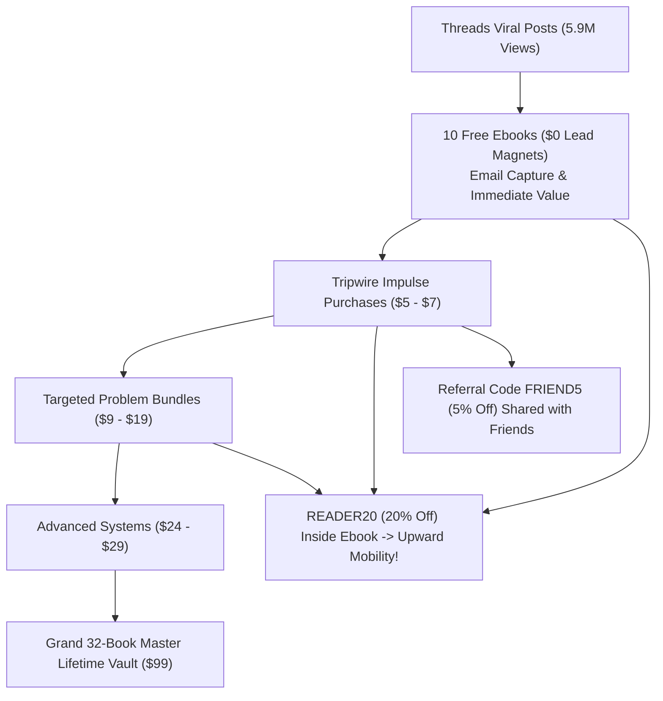

# Master Gumroad Catalog & Funnel Architecture
### 42 Total Products: 32 Paid Guides + 10 Free Lead Magnets + 15 Curated Bundles
**Author: Deepak Ravi (@founderdeepak)**  
**Active Promotion Codes:**
* `READER20` — **20% Off** for existing readers across all products and bundles.
* `FRIEND5` — **5% Off** referral code for readers to share with friends and followers.

---

## 1. Funnel Architecture: From Free Lead Magnet to $99 Master Vault

---

## 2. The 10 Free Lead Magnet Ebooks ($0 on Gumroad)
*Location:* [`deepak_threads_gumroad/free_ebooks/`](file:///c:/Users/LENOVO/Desktop/deepak_threads_gumroad/free_ebooks/)

These free downloads build your Gumroad email list, provide instant value, and naturally upsell readers into the paid tiers:

| # | Free Guide Title | Core Value Proposition | Upsell Target in Guide |
|---|---|---|---|
| **01** | *The 10-Minute Mixed Signals Primer* | Top 10 involuntary signs someone likes you. | Book 01 ($7) or Bundle 02 |
| **02** | *25 Texts to Send Tonight* | Instant copy-paste swipe file to spark banter. | Book 02 ($7) or Bundle 01 |
| **03** | *The 5 Subtle Signs Your Coworker Likes You* | Read workplace chemistry without HR drama. | Book 03 ($7) or Bundle 03 |
| **04** | *Friend or Lover? The 7-Question Litmus Test* | Know if a friend has secret feelings for you. | Book 04 ($7) or Bundle 03 |
| **05** | *3 Psychological Triggers That Spark Curiosity* | Unrushed pauses, comfortable silence, safe havens. | Book 05 ($7) or Bundle 04 |
| **06** | *15 Compliments That Melt Anyone's Heart* | Character and emotional depth validation. | Book 06 ($7) or Bundle 04 |
| **07** | *10 Sweet Texts to Send Before Bed* | Bedtime messages that linger in their thoughts. | Book 07 ($7) or Bundle 01 |
| **08** | *5 Signs They Are Waiting for Your First Move* | Recognizing green lights and doorstep pauses. | Book 08 ($7) or Bundle 02 |
| **09** | *The 5 Involuntary Body Language Tells* | Pupils, vocal frequency shifts, and feet orientation. | Book 09 ($7) or Bundle 02 |
| **10** | *Situationship Red Flags: When to Stay vs. Run* | Spotting emotional placeholders and grey zones. | Book 10 ($7) or Bundle 04 |

---

## 3. The 32 Paid Guides (7 Distinct Price Tiers)
*Location:* [`deepak_threads_gumroad/ebooks/`](file:///c:/Users/LENOVO/Desktop/deepak_threads_gumroad/ebooks/)

### Tier 1: $5 Micro-Cheatsheets (6 Books)
* **Book 27: The 50 Best Opening Lines for Any Dating App ($5)**
* **Book 28: The 30-Second Body Language Quick-Check ($5)**
* **Book 29: The Red Flag Rapid-Screening Checklist ($5)**
* **Book 30: The Green Flag Locator ($5)**
* **Book 31: 30 Emergency Texts When a Conversation Goes Silent ($5)**
* **Book 32: The Morning After & Post-Date Etiquette Guide ($5)**

### Tier 2: $7 Core Foundation Playbooks (10 Books)
* **Book 01: The Mixed Signals Decoder ($7)**
* **Book 02: The Smooth Texting Vault ($7)**
* **Book 03: The Coworker Attraction Code ($7)**
* **Book 04: More Than Friends ($7)**
* **Book 05: Quiet Chemistry ($7)**
* **Book 06: Beyond "You're Pretty" ($7)**
* **Book 07: The Late-Night Texting Playbook ($7)**
* **Book 08: The First Move Formula ($7)**
* **Book 09: The Silent Attraction Blueprint ($7)**
* **Book 10: The Situationship Exit Plan ($7)**

### Tier 3: $9 Action Toolkits & Situational Playbooks (5 Books)
* **Book 11: The Date Night Masterplan ($9)**
* **Book 12: The Ex Factor ($9)**
* **Book 13: The High-Value Boundary Playbook ($9)**
* **Book 14: The DM Attraction Protocol ($9)**
* **Book 15: The Jealousy & Mixed Signals Antidote ($9)**

### Tier 4: $14 In-Depth Relationship Systems (5 Books)
* **Book 16: The Attachment Style Decoder ($14)**
* **Book 17: Modern Seduction & Magnetic Presence ($14)**
* **Book 18: From First Date to Relationship in 60 Days ($14)**
* **Book 19: The Psychology of Making Them Miss You ($14)**
* **Book 20: The Conversation Mastery Manual ($14)**

### Tier 5: $19 Masterclass Bibles (3 Books)
* **Book 21: The Master Bible of Modern Romance ($19)**
* **Book 22: The Emotional Intelligence & Charisma Bible ($19)**
* **Book 26: The Subconscious Attraction Trigger Matrix ($19)**

### Tier 6: $24 Advanced Architectures (2 Books)
* **Book 24: The Long-Term Relationship Mastery Manual ($24)**
* **Book 25: The Breakup Recovery & Reinvention Blueprint ($24)**

### Tier 7: $29 Definitive Codex (1 Book)
* **Book 23: The Modern Romance Encyclopedia ($29)**

---

## 4. The 15 Curated Bundles

| Bundle # | Bundle Name | Guides Included | Reg. Value | Bundle Price | Price with Code `READER20` |
|---|---|---|---|---|---|
| **01** | **The Modern Texting & Flirting Toolkit** | Books 02 + 07 | ~~$14~~ | **$9.00** | **$7.20** |
| **02** | **The Silent Signs & Body Language Pack** | Books 01 + 08 + 09 | ~~$21~~ | **$14.00** | **$11.20** |
| **03** | **The High-Stakes Romance Kit** | Books 03 + 04 + 01 | ~~$21~~ | **$14.00** | **$11.20** |
| **04** | **The Deep Connection & Intimacy Masterclass** | Books 05 + 06 + 10 | ~~$21~~ | **$14.00** | **$11.20** |
| **05** | **The Complete 10-Book Original Vault** | Books 01 through 10 | ~~$70~~ | **$29.00** | **$23.20** |
| **06** | **The Rapid Dating Quick-Check Pack** | Books 27 to 32 (All $5 Cheatsheets) | ~~$30~~ | **$15.00** | **$12.00** |
| **07** | **The Date Night & Attraction Mastery Pack** | Books 11 + 14 + 02 | ~~$25~~ | **$19.00** | **$15.20** |
| **08** | **The Reconnection & Ex-Back Strategy Pack** | Books 12 + 19 + 05 | ~~$32~~ | **$19.00** | **$15.20** |
| **09** | **The Boundary & Self-Worth Armor Kit** | Books 13 + 10 + 15 | ~~$27~~ | **$19.00** | **$15.20** |
| **10** | **The 60-Day Relationship Blueprint Pack** | Books 18 + 16 + 08 | ~~$35~~ | **$27.00** | **$21.60** |
| **11** | **The Master Conversation & Banter Suite** | Books 20 + 06 + 02 + 07 | ~~$35~~ | **$27.00** | **$21.60** |
| **12** | **The Seduction & Magnetic Presence Masterclass** | Books 17 + 19 + 09 + 05 + 26 | ~~$44~~ | **$34.00** | **$27.20** |
| **13** | **The Long-Term Love & Healing Double-System** | Books 24 + 25 | ~~$48~~ | **$34.00** | **$27.20** |
| **14** | **The Executive Double-Bible Masterclass** | Books 21 + 22 | ~~$38~~ | **$29.00** | **$23.20** |
| **15** | **The Grand 32-Book Master Lifetime Library** | **ALL 32 PAID BOOKS** | ~~$315~~ | **$99.00** | **$79.20** *(Save 68%)* |

---

## 5. Discount Codes Setup on Gumroad

1. **`READER20`** (Existing Reader Loyalty):
   - Set up in Gumroad as **20% off all products**.
   - Auto-applied via: `https://founderdeepak.gumroad.com/l/[slug]/READER20`.
2. **`FRIEND5`** (Customer Referral Reward):
   - Set up in Gumroad as **5% off all products**.
   - When happy customers tell their friends, their friends get 5% off, virally expanding your customer base.
